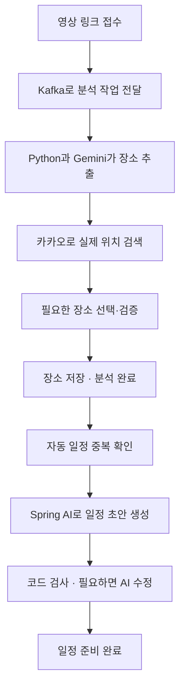

# 영상 분석과 일정 생성, 코드로 쉽게 따라가기 (#303)

현재 구조는 **장소를 찾는 작업**과 **찾은 장소로 일정을 짜는 작업** 두 개입니다. Kafka는 첫 작업을 전달하고, Spring AI는 주로 두 번째 작업에서 AI를 부릅니다. 둘을 도입했다는 사실만으로 영상 분석 전체가 빨라지는 것은 아닙니다.



## 1. Kafka: 분석할 일을 전달한다

[KafkaShareJobQueue.enqueue](../../src/main/java/com/trova/backend/queue/KafkaShareJobQueue.java#L51)는 분석 작업 번호를 외부 Kafka에 보냅니다. Kafka가 받았다고 응답할 때까지 기다리므로 전달 시간이 추가됩니다. 장애 때는 최대5초 대기 후 서버 내부 처리로 넘기고, 이후1분 동안 Kafka를 건너뛰는 보호 장치도 있습니다. 이것은 장애 때의 규칙이며 정상 요청마다5초 기다린다는 뜻은 아닙니다.

[ShareJobListener](../../src/main/java/com/trova/backend/queue/ShareJobListener.java)는 작업을 받아 [PlaceExtractionService.processNow](../../src/main/java/com/trova/backend/service/PlaceExtractionService.java#L97)를 실행합니다. 처리가 끝난 뒤에야 “여기까지 처리했다”고 Kafka에 확인합니다. 이를 **ACK/오프셋 확정**이라고 합니다. 속도보다 중단된 작업을 다시 받을 수 있게 하는 목적이 큽니다. 모든 장애에서 무조건 작업이 보존되는 보장은 아닙니다.

작업 생성→분석 시작 대기에는 Kafka 전달뿐 아니라 서버 스레드 대기, 같은 작업의 잠금, DB 상태 확인·저장도 포함됩니다. 이 시간을 전부 Kafka 네트워크 지연으로 부르면 안 됩니다.

## 2. Python + Gemini: 영상에서 장소를 찾는다

[run_pipeline.run](../../pipeline-test/run_pipeline.py#L193)은 유튜브 주소를 Gemini에 직접 보냅니다. 다운로드 경로도 있지만 이 영상 시험은 유튜브 링크 직접 입력 경로입니다. 영상/자막/오디오를 받아 처리하는 것은 Python 코드입니다.

[extract_places](../../pipeline-test/extract_places.py#L541)는 보통 AI를 두 번 부릅니다.

1. `collect_candidates`: 영상에서 장소일 법한 이름을 넓게 모읍니다.
2. `filter`: 그중 실제 지도에 저장할 구체적인 장소를 고릅니다.

예를 들어 후보에서 “부산”과 “부산역”이 나왔을 때, 도시 전체와 실제 방문 지점을 구분하려는 과정입니다. 장소 소개가 아닌 영상이면 첫 호출 뒤 멈춥니다. 형식 오류 등을 바로잡는 추가 호출이 생길 수도 있어 항상 정확히2회라고 보장하지 않습니다.

이 구간은 **Spring AI를 거치지 않습니다**. 이전 운영 한 쌍에서 후보 수집+선별의 기록 시간은6.851→9.541초였습니다. 이 차이는 Gemini 응답이 달라진 관측이며 프롬프트나 Spring AI 속도 효과로 단정할 수 없습니다.

## 3. 카카오 + Python 추가 확인: 실제 지도 위치를 고른다

[PlaceExtractionService의 candidateSearches](../../src/main/java/com/trova/backend/service/PlaceExtractionService.java#L150)는 여러 장소의 카카오 후보 검색을 동시에 보냅니다. **병렬 처리**는 서로 독립적인 일을 겹쳐 실행한다는 뜻입니다. 장소6곳이 각각0.6초여도 전체가3.6초라고 더하면 잘못입니다. 동시 실행 수, 후속 검색, 기다리는 순서에 따라 전체가 달라집니다.

카카오 후보가 여러 개면 `selectAmongAlternatives`가 Python의 장소 선택기를 부릅니다. 확신이 낮은 결과만 `verifyUncertainMatches`에서 다시 확인합니다. 이 두 AI 호출도 현재는 Python이며 Spring AI가 아닙니다. 필요 없으면 생략되므로 같은 영상이어도 호출 수와 시간이 달라질 수 있습니다.

새 반복 도구는 개별 카카오 시간의 합 대신, 코드가 이미 남기는 “지오코딩 전체 단계 시간”도 따로 읽습니다. **지오코딩**은 장소 이름을 지도 좌표로 바꾸는 일입니다.

## 4. 저장: 장소 전체와 완료 표시를 함께 확정한다

[ProcessingJobLifecycleService.completeAnalysis](../../src/main/java/com/trova/backend/service/ProcessingJobLifecycleService.java#L86)는 장소 전체와 분석 완료 상태를 한 묶음으로 저장합니다. **트랜잭션**은 이 묶음이 모두 성공하거나 실패하면 함께 되돌리는 경계입니다.

이전에는 장소마다 따로 저장해 일부만 남을 수 있었습니다. 이번 수정은 저장 안전성을 높이고 중복 조회도 줄였지만, 저장 단계만의 운영 시간을 따로 재지 않았으므로 “몇 초 빨라졌다”는 수치는 없습니다.

여기까지가 보고서의 **작업 생성→장소 저장 완료** 시간입니다. 자동 일정 생성까지 포함한 시간이 아닙니다.

## 5. 자동 초안: 중복 확인 뒤 Spring AI로 일정을 짠다

[AutoDraftService.startFor](../../src/main/java/com/trova/backend/service/AutoDraftService.java#L52)가 이미 같은 영상의 여행이나 초안이 있는지 확인합니다. 없으면 초안을 만들고 [TripPlannerService.process](../../src/main/java/com/trova/backend/service/TripPlannerService.java#L114)를 별도 스레드에서 실행합니다.

[DraftGenerator.generate](../../src/main/java/com/trova/backend/planner/DraftGenerator.java#L57)는 장소와 이동·식사 등의 조건으로 AI에게 일정을 요청합니다. 여기서 [GeminiJsonClientImpl.generateJson](../../src/main/java/com/trova/backend/planner/GeminiJsonClientImpl.java#L64)이 **Spring AI의 ChatModel**을 사용합니다. ChatModel은 이 코드에서 Gemini에게 요청하고 응답을 받는 공통 창구입니다.

[TripPlanGraph](../../src/main/java/com/trova/backend/planner/TripPlanGraph.java)는 코드를 이용해 휴무·거리·시간·중복 등을 검사하고 고칩니다. 코드만으로 못 고치면 AI에게 최대2번 더 수정을 요청합니다. 이것은 **일정 품질 수정**이며 통신 실패의 **재시도**와 다릅니다. 통신 재시도는 GeminiJsonClientImpl 한 곳에서 최대3회, 기다림2·4초를 관리합니다. 두 횟수를 섞으면 실제 호출 수를 잘못 읽게 됩니다.

자동 초안은 [TripPlannerService의 비용 보호 분기](../../src/main/java/com/trova/backend/service/TripPlannerService.java#L163)에 따라 Google 영업시간 조회를 생략합니다. 이번 반복 시험도 자동 초안 경로만 사용합니다.

## 새로 찾은 확인 대상: 자동 초안 중복 검사

[TripService.findExistingTripForVideo](../../src/main/java/com/trova/backend/service/TripService.java#L583)에 다음 구조가 있습니다.

```java
processingJobRepository.findByUserOrderByCreatedAtDescIdDesc(user).stream()
        .filter(candidate -> VideoKey.of(candidate.getSourceUrl()).equals(key))
        .flatMap(candidate -> savedPlaceRepository.findByProcessingJob(candidate).stream())
```

먼저 사용자 작업 목록을 읽고, 같은 영상의 작업마다 장소를 다시 읽습니다. 목록 뒤에 항목별 추가 조회가 붙는 구조를 흔히 **N+1 조회**라고 합니다. 같은 영상의 과거 기록이 많아지면 장소가 없는 기록에도 조회가 생길 수 있습니다. 이 작업은 장소 분석이 끝난 뒤, 자동 초안이 만들어지기 전에 수행됩니다.

이것은 코드에서 확인한 비용 증가 가능성입니다. 운영 SQL 횟수나 함수 시간은 아직 직접 측정하지 않았으므로 지난 지연의 확정 원인이라고 하지 않습니다. 이번에는 같은 영상의 과거 작업 수와 **분석 완료→초안 생성 사이 시간**을 함께 기록합니다. 코드는 아직 바꾸지 않았습니다.

## 새 반복 시험에서 읽을 숫자

| 구간 | 뜻 | 주의할 점 |
|---|---|---|
| 작업 생성→분석 시작 | 전달·스레드·시작 상태 검사 | 순수 Kafka 지연 아님 |
| 작업 생성→장소 저장 | 앱에서 장소를 볼 수 있을 때까지 | 자동 일정은 제외 |
| 분석 완료→초안 생성 | 자동 초안 중복 확인·DB 작업 등 | 해당 함수만의 정확한 시간은 아님 |
| 초안 생성→마지막 갱신 | 일정 처리 대기·AI·검사·저장 | READY의 대용 시각, 전용 완료시각은 아님 |
| 일정 AI 시간대 로그 | 같은 시간대 Spring AI 요청 기록 | 개별 영상과 직접 연결되지 않음 |

준비1회+측정6회를 현재 운영 구성으로 실행합니다. 같은 영상만 보므로 서비스 전체, 인스타그램, 다중 사용자 처리량으로 일반화하지 않습니다. 한 번의 느린 첫 요청과 비교해 유리한 개선률을 만들지 않습니다. 카카오/DB/AI를 함께 보는 이유는 Kafka나 Spring AI 한 가지 이름으로 전체 지연을 설명할 수 없기 때문입니다.
