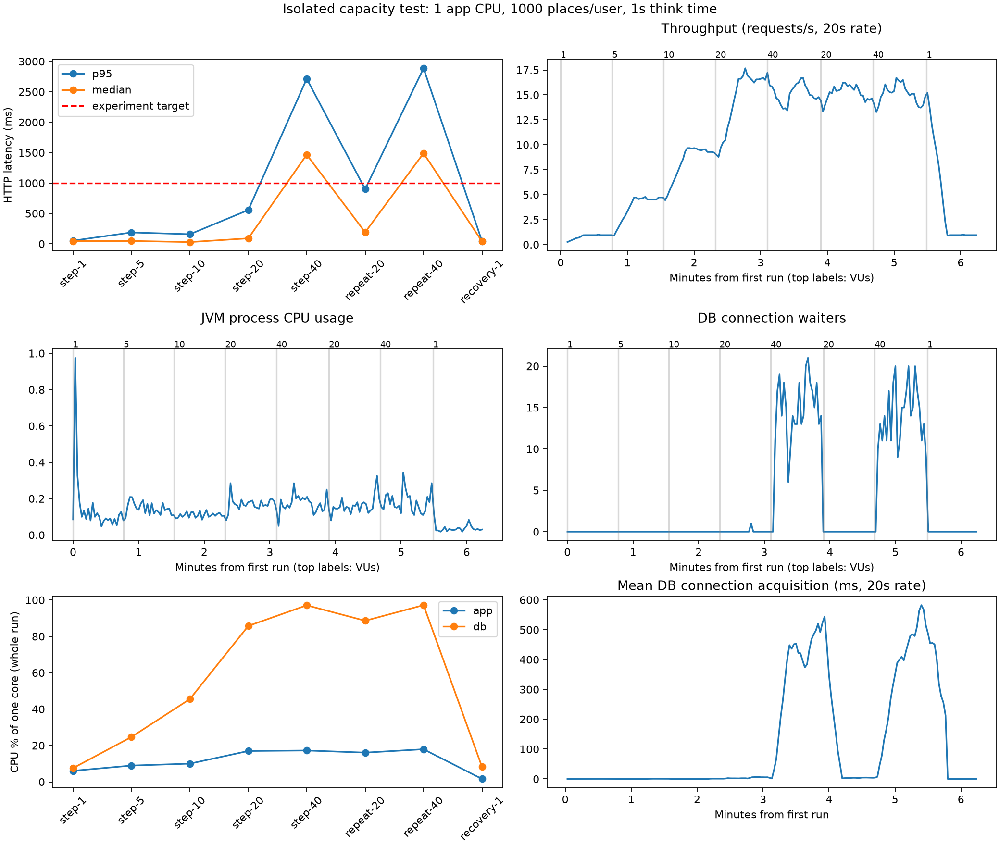

# 동시 조회 부하와 지연 한계 — 2026-11-02 (#307)

격리 환경에서 실제 k6 동시 조회 부하 테스트를 수행했다. **20 VU는 p95 1초 목표를
두 번 충족했고, 40 VU는 두 번 초과했다.** 20과 40 사이의 정확한 경계는 측정하지 않았다.
운영 서버 최대 동시 사용자 수로 해석하면 안 된다.

## 조건과 방법

- main `008e2de9be78205a5d089ed1b4f0ecdd70d95d6a` 실제 Spring Boot JAR.
- 앱 1 CPU / 768 MiB / Java heap 384 MiB, PostgreSQL 17 별도 1 CPU / 512 MiB.
- Mac Docker 환경. 앱·DB는 외부 통신 없는 internal network, localhost nginx 경유.
- 합성 사용자 160명 × 장소 1,000개 = 16만 행, 영상 작업 16,000개, 모두 분석 완료.
  이는 큰 목록 시나리오이며 일반 사용자 대표 데이터라는 주장은 하지 않는다.
- 각 VU가 서로 다른 계정으로 GET /api/places 호출 후 1초 대기. 로그인 토큰 검증 유지,
  테스트 IP rate limit만 해제. AI·운영 DB·실사용자 요청 없음.
- 1→5→10→20→40 VU, 각 45초. 각 VU 첫 15초는 평가에서 제외.
  실패 후 20/40 반복, 마지막 1 VU 회복. 80/160 단계는 실행하지 않음.
- 실험 기준 p95 < 1초, 오류율 < 1%. 운영 SLO는 아님.
- 총 3,639 HTTP 요청, 평가 표본 2,355개. 모든 응답 200, 장소 1,000개와 사용자별 소유 데이터 확인 성공.
- Prometheus가 2초 간격으로 실제 테스트 서버를 수집. Grafana 캡처가 아닌
  수집 원본에서 생성한 그래프를 아래에 첨부.

## 측정 결과

| 단계 | VU | p95 | 평가 요청 | 전체 구간 RPS | DB 평균 CPU |
|---|---:|---:|---:|---:|---:|
| 최초 | 1 | 52 ms | 28 | 0.94 | 7.5% |
| 증가 | 5 | 188 ms | 140 | 4.63 | 24.7% |
| 증가 | 10 | 158 ms | 280 | 9.24 | 45.5% |
| 증가 | 20 | 556 ms | 506 | 16.52 | 85.8% |
| 증가 | 40 | 2,715 ms | 466 | 14.95 | 97.1% |
| 반복 | 20 | 900 ms | 452 | 15.40 | 88.6% |
| 반복 | 40 | 2,888 ms | 455 | 15.44 | 97.2% |
| 회복 | 1 | 45 ms | 28 | 0.95 | 8.3% |

오류율은 모든 단계 0%. RPS는 k6 전체 구간(워밍업 포함), p95는 워밍업 제외이므로
분모가 다르다. CPU는 cgroup usage_usec 증가분 / 단계 경과시간 / 1 core로 계산했다.
VU는 로그인된 가상 사용자 수이며 동시 실행 중인 HTTP 요청 수와 다르다.

## 그래프를 쉽게 읽으면

1. 왼쪽 위: 40명에서 빨간 1초 선을 넘는다. 사람이 늘었는데 응답이 크게 느려졌다.
2. 오른쪽 위: 처리량은 약 15~17 요청/초 부근에 머문다. 40명으로 늘려도 더 많이 처리하지 못했다.
3. 왼쪽 아래: 앱 CPU는 여유가 있지만 DB가 약 97%까지 찼다.
4. 오른쪽 가운데: DB 연결을 기다리는 요청이 40명 구간에서 최대 21개였다.
   Hikari active도 최대 10개로 풀 상한에 도달했다.
5. 오른쪽 아래: DB 연결을 얻는 데 드는 평균 시간도 커진다. 부하를 줄이면 함께 내려간다.

이 실험의 직접 관측 결과는 **DB CPU 포화와 DB 연결 대기**다.
앱 CPU 부족이나 메모리 부족으로 단정할 근거는 없다. OOM·컨테이너 재시작은 없었고,
1 VU로 낮춘 뒤 응답 속도도 회복했다.

## 실행 계획과 다음 개선 후보

부하가 끝난 뒤 같은 목록 SQL에 EXPLAIN (ANALYZE, BUFFERS)를 실행했다.
`Parallel Seq Scan`에 해당하는 병렬 Seq Scan으로 saved_places를 읽고 user_id로 걸러냈다.
각 worker 루프 평균 53,000행이 필터에서 제외됐고 processing_jobs도 Seq Scan했다.
단건 실행 시간은 21.945ms였다. 부하 중 쿼리 시간으로 혼동하지 않는다.

따라서 **user_id와 정렬 열에 맞는 인덱스 후보를 검증**하는 것이 다음 실험이다.
이 PR은 인덱스나 운영 코드를 바꾸지 않았다. 인덱스의 개선 효과는 아직 A/B로 입증하지 않았으며,
연결 풀만 늘려도 빨라진다고 주장하지 않는다. 페이지네이션도 큰 응답을 줄일 별도 개선 후보다.

## 한계와 이력서 표현

45초 단계의 짧은 실험이며 장시간 안정성/최대 파괴 부하/AI 처리량 검증이 아니다.
20명은 반복 p95 0.90초로 목표에 가까워 운영 권장 인원으로 쓰지 않는다.
DB 스키마는 JPA 자동 생성이므로 운영에서 별도 관리하는 인덱스와 다를 수 있다.
게이트웨이·Docker·호스트 자원과 데이터 분포도 운영과 다르다.

> k6와 Prometheus로 격리 환경의 동시 조회 부하를 단계적으로 증가시키고,
> 20/40 VU 반복 측정에서 p95 지연 기준 초과와 DB CPU 포화·연결 대기를 확인했다.
> 부하 제거 후 회복 및 실행 계획을 기록해 후속 인덱스 검증의 근거를 마련했다.

## 재현 및 원본

- [재현 가이드](../../monitoring/capacity/README.md)
- [환경/JAR 해시](2026-11-02-capacity/environment.json)
- [요약](2026-11-02-capacity/summary.json), [단계별 시간 및 CPU 원본](2026-11-02-capacity/runs.json)
- [SQL 실행 계획](2026-11-02-capacity/explain.json)
- 동일 디렉터리 `step-*.json`, `repeat-*.json`, `prom-*.json`, `resources.jsonl`에 원본 보존.
- `./gradlew build` 성공(변경 없는 Java 태스크는 UP-TO-DATE). 앱 코드 변경 없음.
- 실험 컨테이너·전용 네트워크·DB 볼륨 정리. 기존 운영 모니터링 컨테이너 유지.

Prometheus `up` 원본 첫 표본은 서버 준비 직후 이전 scrape 결과인 0이며,
이후 표본은 모두 1이다. 전체 구간 무중단 수집으로 과장하지 않는다.
부하 발생기 k6는 40 VU 구간의 단일 호스트 표본에서 CPU 14.2%, RSS 약 189 MiB였다.
전체 구간 발생기 자원을 연속 검증한 결과는 아니다.
