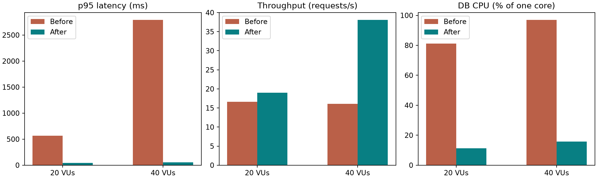
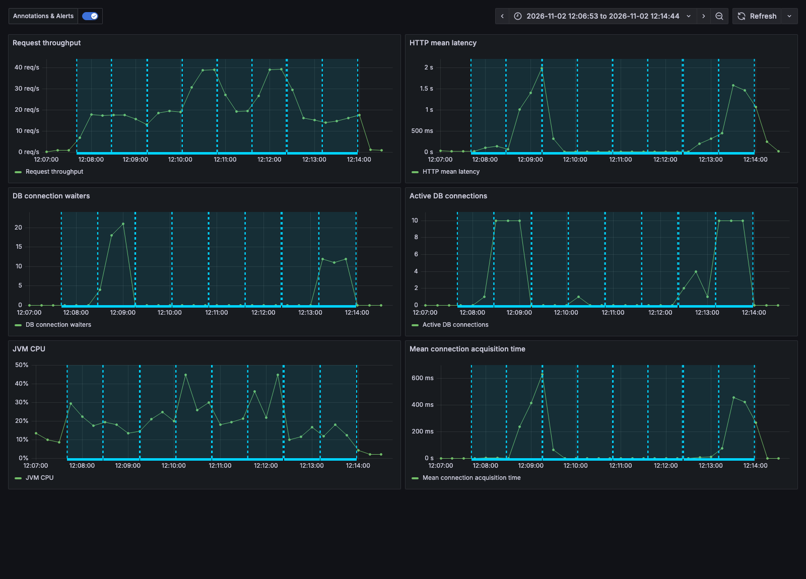
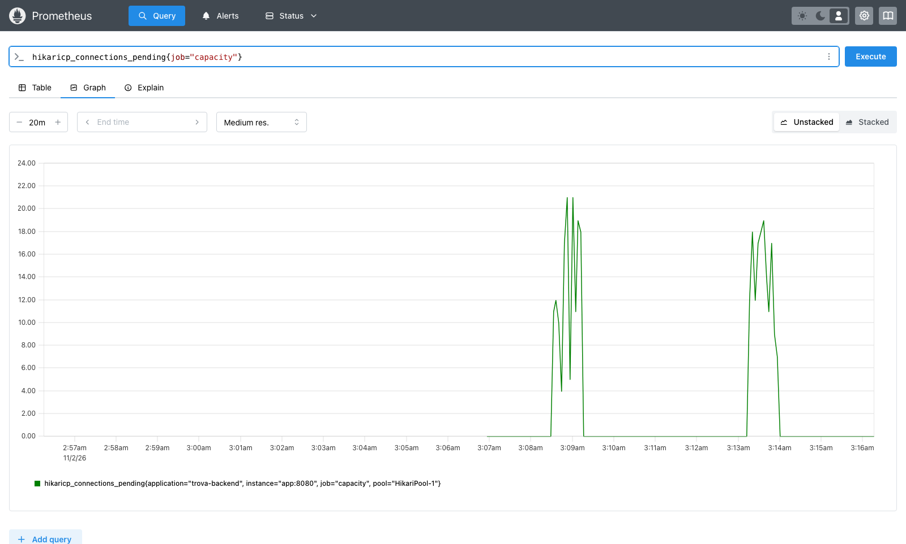

# 장소 조회 인덱스 개선 ABBA 검증 — 2026-11-02 (#307)

40 VU의 실행별 p95 두 개의 평균은 **2793.0 → 56.8ms (98.0% 감소)**였다.
이는 pooled p95가 아니며 통계적 신뢰구간을 산출한 결과가 아니다. 운영 적용은 아직 하지 않았다.

## 조건과 대조 방법

동일 JAR/데이터/JVM/컨테이너에서 `saved_places(user_id,created_at,id)` 인덱스만 제거·생성했다.
앱/DB 각 1 CPU, 앱 768 MiB(Xmx384m), DB 512 MiB, 사용자 160명 × 장소 1,000개.
각 VU는 서로 다른 사용자로 GET /api/places를 조회한 후 1초 대기한다. 각 단계 45초, 첫 15초 평가 제외.
A1(없음)→B1(있음)→B2(있음)→A2(없음) 순서이며 각 블록은 20/40 VU로 동일하다.
처음 1 VU 예열은 JPA 생성 인덱스를 사용했고 비교에서 제외했다. 마지막 회복은 인덱스 없는 상태다.
고정 요청률 테스트가 아니므로 응답이 빨라지면 실제 요청량도 늘어난다. 총 요청 수/오류는 원본 k6 요약 참조.
40개 사용자의 전체 응답 본문 SHA-256이 모든 블록에서 같았다. 값·순서가 유지됐다.

## 결과

| 실행 | VU | p95 ms | 전체 RPS | DB CPU | 평가 오류 | 최대 연결 대기 |
|---|---:|---:|---:|---:|---:|---:|
| a1-20 | 20 | 339.1 | 17.56 | 78.4% | 0.000% | 0 |
| a1-40 | 40 | 3287.4 | 15.92 | 97.3% | 0.224% | 21 |
| b1-20 | 20 | 45.0 | 19.03 | 11.3% | 0.000% | 0 |
| b1-40 | 40 | 49.3 | 37.95 | 16.2% | 0.000% | 0 |
| b2-20 | 20 | 43.5 | 19.03 | 11.4% | 0.000% | 0 |
| b2-40 | 40 | 64.3 | 38.28 | 15.4% | 0.000% | 0 |
| a2-20 | 20 | 797.6 | 15.63 | 83.7% | 0.000% | 0 |
| a2-40 | 40 | 2298.6 | 16.25 | 96.8% | 0.000% | 19 |

p95/오류는 예열 제외, RPS/CPU는 전체 단계 기준이다. 오류율은 응답 상태·데이터 검사까지 포함한다.

## Prometheus와 Grafana 근거

Prometheus가 테스트 앱을 2초마다 수집했다. 전용 Grafana datasource/dashboard를 통해 실제 지표를 조회했다.
Grafana 화면의 HTTP 지연은 평균이며 k6 p95와 구분한다. DB CPU는 cgroup usage_usec 차이를 사용했다.

## SQL 실행 계획

- a1: Seq Scan; 단건 실행 9.824ms
- b1: Bitmap Heap Scan, Bitmap Index Scan; 단건 실행 2.682ms
- b2: Bitmap Heap Scan, Bitmap Index Scan; 단건 실행 2.971ms
- a2: Seq Scan; 단건 실행 16.902ms

인덱스가 있어도 planner는 Bitmap Scan 뒤 정렬을 선택했다. 정렬까지 제거됐다고 주장하지 않는다.
processing_jobs의 Seq Scan도 남아 있다. 해당 단건 계획은 부하 도중 프로파일이 아니다.

## 판단과 적용 범위

인덱스를 되돌린 A2에서도 지연 증가가 재현되는지와 B1/B2의 방향 일관성을 함께 확인한다.
모니터링→병목 파악→인덱스 변경→동일 VU 재측정의 검증이다. 짧은 45초 단계 두 반복으로 장시간 안정성은 주장하지 않는다.
운영 모니터링은 기존에 수행했으나, 이 개선율은 격리 합성 데이터 기준이다. 운영 성능 개선 완료나 최대 수용 인원으로 쓰지 않는다.
JPA 인덱스 정의와 운영용 CONCURRENTLY SQL을 준비했다. 운영 적용 전 기존 인덱스 및 쓰기/공간 비용을 확인해야 한다.

## 재현과 원본

- [실행 절차](../../monitoring/capacity/README.md)
- [요약](2026-11-02-index-abba/summary.json), [CPU/시간 원본](2026-11-02-index-abba/runs.json)
- [응답 동등성](2026-11-02-index-abba/response-equivalence.json)
- 같은 디렉터리 k6 요약·Prometheus 시계열·실행 계획·Grafana JSON·실제 화면 보존.
- [운영 적용 SQL(미실행)](../bench/sql/place-list-user-order-index.sql)
- [ADR 0035](../adr/0035-place-list-user-order-index.md)

## 검증 및 실패 건수

전체 8,361 요청 중 인덱스 미적용 40 VU에서 timeout 2건(A1/A2 각각 1건).
A2의 1건은 예열 중이므로 평가 오류율 0과 모순되지 않는다. 적용 후 네 단계는 오류 0.
전체 빌드 성공: JUnit 1,036개, 실패/오류 0, opt-in 등 skip 5.
Grafana는 KST, Prometheus 화면은 UTC이므로 축 시간은 9시간 차이가 난다.
실험 후 전용 컨테이너/네트워크/DB를 정리하고, 임시 Grafana datasource/dashboard도 JSON 보존 후 제거했다.
