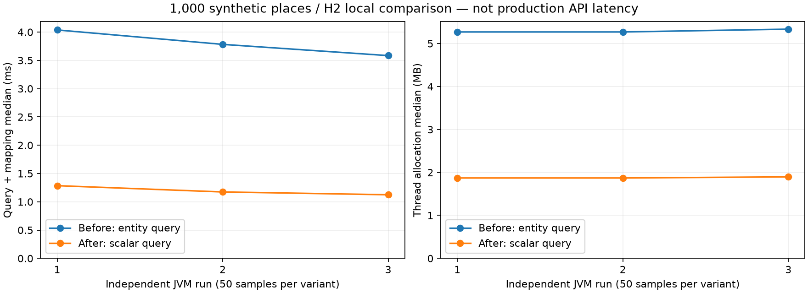

# 장소 목록 조회 비용 개선

## 무엇을 확인하고 바꿨나

사용자의 시뮬레이터 조작 요청에 따라 기존 운영 앱의 영상 기록 화면을 다시 확인했다.
이미 열린 탭으로 돌아가기만 했을 때 API 카운터 증가는 없었다. 캐시된 화면 표시를 새 HTTP 요청으로
세지 않았으며, 앱 재실행과 목록 진입을 별도로 관찰했다. 운영에는 반복 부하를 만들지 않았다.
재실행 관찰 구간에서 장소 목록은 2회, 서버 처리 평균 332.94ms였고 관측 API 10건은 모두 200이었다.
[재실행 카운터 증거](2026-11-02-place-list-benchmark/simulator-relaunch.json)는 서버 전체 증가분이며
이번 변경 전 운영 배포본의 값이다.

코드의 기존 EntityGraph는 N+1을 이미 제거한 상태다. 하지만 응답에 없는 사용자 필드·작업 상태·
영업시간 원문까지 가져와 Hibernate 관리 엔티티를 만들었다. 같은 작업 URL도 장소마다 두 번 파싱했다.

합성 데이터 1,000개·작업 100개의 최초 측정에서 SQL 1회, 엔티티 로딩 1,101회,
스레드 메모리 할당 중앙값 5.34MB가 확인돼 이 비용을 줄였다.

- `SavedPlaceRepository.findListRowsByUserId`: 목록에 필요한 scalar 값만 조회한다.
- `SavedPlaceListRow`: 사용자·작업 엔티티, 영업시간 원문을 생성/조회하지 않는다.
- `VideoResults.latestRows`: 동일 작업의 URL 정규화를 요청 안에서 한 번만 수행한다.
- `PlacesController.list`: 위 경로를 사용하되 기존 응답 필드·순서·영상 대표 선택 규칙을 유지한다.

## 수정 전후 비교

Apple M5 / RAM 32GiB / Temurin Java 21.0.9 / H2 in-memory (`@DataJpaTest`의 embedded DB).
서로 독립된 JVM 3회, 각 실행에서 100개·1,000개 데이터 조건을 측정했다.
조건마다 기존·개선 경로를 각각 20회 워밍업하고 50회씩 측정했다. 순서는 매 회 교대했다.
각 요청 전 영속성 컨텍스트를 비워 1차 캐시 재사용을 막고, SQL 수·엔티티 로딩을 함께 확인했다.
합성 데이터는 영상당 장소 10개, 영상 메모 2줄과 약 512자 영업시간 문자열을 가진다.
데이터 준비는 측정에서 제외하며 동일 테스트 트랜잭션을 사용한다. 트랜잭션 생성·커밋 시간과
DB/OS의 콜드 캐시 성능을 측정하는 실험은 아니다. 통계 수집은 두 경로에 동일하게 켜져 있다.

**1,000개 조건의 결과** (MB는 1,000,000 bytes):

| JVM 실행 | 기존 중앙값 | 개선 중앙값 | 기존 p95 | 개선 p95 | 기존 할당량 중앙값 | 개선 할당량 중앙값 |
|---|---:|---:|---:|---:|---:|---:|
| 1 | 4.037ms | 1.285ms | 5.285ms | 1.499ms | 5.269MB | 1.871MB |
| 2 | 3.782ms | 1.174ms | 4.839ms | 2.153ms | 5.269MB | 1.871MB |
| 3 | 3.584ms | 1.124ms | 4.889ms | 1.448ms | 5.335MB | 1.897MB |

조회·필터·응답 DTO 생성 중앙값은 약 **68~69% 감소**, 요청 스레드 할당량은 약 **64~65% 감소**했다.
SQL 수는 전후 모두 1회다. 엔티티 로딩은 **1,101 → 0회**지만 DTO 객체까지 없어졌다는 의미는 아니다.
할당량은 요청 스레드의 누적 allocation 차이이며 프로세스 RSS·최대 힙 사용량이 아니다.



100개 조건도 같은 방향이었다. 기존 중앙값 1.091~1.131ms, 개선 0.299~0.311ms,
할당량 중앙값 약 0.665MB → 0.216MB. 작은 절대 시간의 로컬 결과이므로 운영 체감 차이로 확대 해석하지 않는다.

## 정확성과 범위

`PlaceListProjectionTest`에서 기존 결과와 새 결과의 모든 응답 필드·순서를 비교했다.
타인 데이터 제외, 같은 영상의 URL 별칭, 장소 없는 최신 작업, 생성 시각 동률의 ID 정렬,
null 좌표·null 영상 메모·다중 메모를 포함했다. SQL 1회와 엔티티 로딩 0회도 검증한다.
컨트롤러 기존 테스트를 함께 실행했다. 성능 수치 자체는 CI 통과 임계값으로 사용하지 않는다.

최종 `./gradlew build` 성공: 1,035개 테스트, 실패 0, 오류 0, 건너뜀 4개(성능 실험 opt-in 포함).
첫 전체 실행에서 공유 H2 DB 종료와 테스트 컨텍스트 간 간섭이 나타났다. 새 회귀 테스트를 기존
통계 수집용 DataJpaTest와 동일한 설정으로 맞춘 후 전체 빌드를 재실행해 통과했다.
[검증 결과](2026-11-02-place-list-benchmark/validation.json)

이번 측정은 **로컬 repository 조회 + 필터링 + DTO 생성**이다. 인증 사용자 조회, HTTP 직렬화,
네트워크, 실제 PostgreSQL, 모바일 렌더링은 제외된다. 따라서 운영에서 관찰한 334ms가 1.2ms로
줄었다고 말할 수 없고, 운영 334ms의 주원인을 찾아냈다고도 말할 수 없다.
개선 코드는 현재 작업 브랜치에 있으며 이번 작업에서 운영 배포는 하지 않았다.
운영 시뮬레이터는 기존 배포본을 확인한 것이므로 수정 후 운영 검증으로 표현하지 않는다.

## 재현과 증거

```bash
TROVA_PLACE_LIST_BENCH=1 ./gradlew test --tests '*PlaceListPerformanceTest' --rerun-tasks
# build/reports/place-list-comparison.csv 생성. 기본 전체 테스트에서는 이 실험을 건너뛴다.
./gradlew build
```

- [각 실행의 요약](2026-11-02-place-list-benchmark/summary.json)
- [실행 1](2026-11-02-place-list-benchmark/place-list-comparison-1.csv),
  [실행 2](2026-11-02-place-list-benchmark/place-list-comparison-2.csv),
  [실행 3](2026-11-02-place-list-benchmark/place-list-comparison-3.csv)
- [후보 구현 전 기준 측정](2026-11-02-place-list-benchmark/baseline.csv): 워밍업 10회/측정 30회.
  비교표의 개선율은 이 별도 기준 측정이 아니라 동일 JVM 내 교대 비교로 계산했다.
- [결정 기록](../adr/0034-place-list-scalar-read.md)

이력서에는 범위를 포함해 다음과 같이 쓸 수 있다:

> 장소 목록의 불필요한 엔티티 조회와 반복 URL 파싱을 제거하고 응답 동등성을 검증.
> 합성 장소 1,000개를 사용한 로컬 H2 반복 비교에서 조회·DTO 변환 중앙값 약 68~69%,
> 요청 스레드 메모리 할당량 약 64~65% 감소를 확인.

다음 검증은 PostgreSQL을 사용하는 격리 환경에서 실제 HTTP 응답까지 포함한 동일 조건 비교다.
운영 개선율은 배포 후 동일 조건으로 별도 측정해야 한다.
