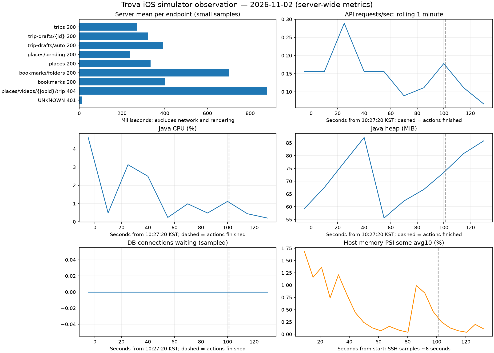

# 시뮬레이터 실제 화면 동작 관찰

2026-11-02 10:27:20~10:29:01 KST 요청 관찰, 이후 10:29:32까지 유휴 구간 비교.
iPhone 17 Pro / iOS 26.5 시뮬레이터에서 이미 로그인된 앱을 직접 조작했다.
앱 화면의 데이터는 영상 19개·장소 138개·여행 9개·찜 4개였다.
앞선 k6 테스트 계정의 장소 42개와 다른 조건이므로 두 결과로 개선율을 계산하지 않는다.

## 실행과 복구

- 앱이 `No script URL provided`로 실행되지 않아 개발 번들 서버를 8081에서 시작했다.
  프로세스 환경으로 운영 API 주소를 지정했으며 앱 소스·저장 데이터·로그인을 바꾸지 않았다.
- Prometheus `up=0` 원인은 로컬 18080 SSH 터널 부재였다. SSH에서 백엔드 active 및 health UP을
  확인한 뒤 터널을 복구했고 관찰 구간의 `up=1`을 확인했다. 백엔드 재배포는 없었다.
- 홈 → 영상 기록 → 원주 영상의 장소·지도 → 준비된 일정 초안 → 뒤로 돌아가기 → 내 여행 →
  찜한 장소 → 마이페이지 → 홈 순서로 직접 탭하고 각 화면을 확인했다.
- 조회만 수행했다. 영상 재분석·일정 생성·삭제·부하 반복은 실행하지 않았다.
  화면 확인용 원본 스크린샷은 계정 정보를 포함하여 로컬 `/tmp/trova-simulator-305`에만 남겼다.

## 관측 결과

서버 전체 HTTP 누적 카운터의 전후 차이다. 클라이언트 추적 ID가 없으므로 모든 증가분을
시뮬레이터 단독 요청이라고 확정하지 않는다. 서버 시간은 네트워크·지도 다운로드·화면 렌더링을 제외한다.

| API | 응답 | 건수 | 서버 처리 평균 |
|---|---|---:|---:|
| `/api/places` | 200 | 5 | 334.05ms |
| `/api/trips` | 200 | 3 | 268.40ms |
| `/api/trip-drafts/auto` | 200 | 3 | 393.28ms |
| `/api/trip-drafts/{id}` | 200 | 1 | 321.79ms |
| `/api/bookmarks` | 200 | 2 | 401.15ms |
| `/api/bookmarks/folders` | 200 | 1 | 702.26ms |
| `/api/places/pending` | 200 | 1 | 237.97ms |
| `/api/places/videos/{jobId}/trip` | 404 | 1 | 878.49ms |
| `UNKNOWN` | 401 | 1 | 11.11ms |

총 18건(200 16건, 404 1건, 401 1건), 5xx 증가 없음. 해당 시간 journal WARN/ERROR 0줄.
404는 저장한 여행이 없는 정상 분기다. `TripController.getVideoTrip`은 여행이 없으면 404를 반환하고,
앱 `src/lib/api/trips.ts:getVideoTrip`은 이를 null로 처리한다. 오류로 재시도하지 않는다.
401은 URI가 UNKNOWN으로 기록되어 출처를 특정할 수 없고, 앱 로그인 해제는 관찰되지 않았다.
이 결과를 “HTTP 오류율 0%”로 보고하지 않는다.

유휴 31초의 actuator 제외 HTTP 카운터 증가는 0이었다. 이 구간에서 불필요한 반복 호출은 관찰되지 않았다.

## 그래프 읽기

[Grafana 동일 시간 구간](http://localhost:3300/d/trova-monitoring-lab?from=1793582835000&to=1793582972000)
· [원본 수치](2026-11-02-simulator-results.json)

1. **응답 시간:** 왼쪽 위는 API별 평균이다. 1건인 API는 평균도 단일 관측값이며 p95나 지속적 지연을
   판단할 수 없다. 404 조회 약 878ms는 추가 조사 후보지만 DB·코드 구간별 측정 없이 원인을 단정하지 않는다.
2. **요청량:** 화면 이동 시 올라가고 이후 내려간다. 1분 이동 구간의 `rate`이므로 조작을 끝낸 뒤에도
   선이 남는다. 실제 유휴 요청 수는 누적 카운터 전후 차이 0으로 따로 확인했다.
3. **CPU:** 관측 Java CPU 최대 약 4.63%. 이 구간에서 CPU가 포화됐다는 증거는 없다.
4. **힙:** 약 55.6~87.1MiB 사이 변화다. 짧은 구간의 증감만으로 누수나 개선을 판정하지 않는다.
5. **DB 연결 대기:** 15초 간격 표본은 모두 0이다. 짧은 쿼리를 놓칠 수 있으므로 “DB 사용 없음”이나
   “느린 SQL 없음”을 뜻하지 않는다.
6. **호스트 메모리 대기:** SSH 관측은 10:27:29부터 약 6초 간격이다. PSI some avg10 최대 1.68%,
   조작 중 여유 메모리 약 324~351MiB, 관측 조작 구간 swap-out 증가는 0페이지였다.
   유휴 구간에는 swap-out 52페이지(208KiB)가 증가했고 PSI는 최대 0.25%였다.
   시스템 전체 지표여서 앱 요청의 원인이라고 단정할 수 없다. 일반 사용자 수준의 조회만 유지했고
   부하를 늘리지 않았다. 앞선 k6 자동 중단 기준을 적용해 완료한 실험으로 취급하지 않는다.

## 개선 판단과 이력서 표현

실제로 복구하고 재확인한 문제는 **개발 앱 실행 환경과 모니터링 수집 연결**이다.
특정 애플리케이션 성능 병목은 입증하지 못했으므로 캐시·SQL·메모리 설정을 임의로 변경하지 않았다.
수집은 여전히 로컬 머신과 SSH 연결에 의존한다. 이번 복구를 24시간 상시 감시 완성으로 표현하지 않는다.

현재 증거로 가능한 문장:

> Spring Boot 서비스에 Prometheus·Grafana 기반 API/JVM/DB 및 비동기 분석 단계 모니터링을 구축하고,
> iOS 시뮬레이터의 실제 사용자 흐름을 관찰했다. HTTP 상태와 도메인 정상 분기를 구분하고,
> 수집 연결 장애를 서버 장애와 분리해 복구·재검증했다.

성능 개선율이나 최대 동시 사용자 수는 아직 주장할 수 없다. 이를 추가하려면 격리된 환경에서 동일 데이터·
동일 요청 조건으로 SQL 횟수와 구간 시간을 측정하고, 병목 재현 → 수정 → 동일 조건 재측정을 해야 한다.
이 보고서는 실제 운영 화면의 저빈도 조회 관찰이며 용량 검증용 부하 테스트가 아니다.
