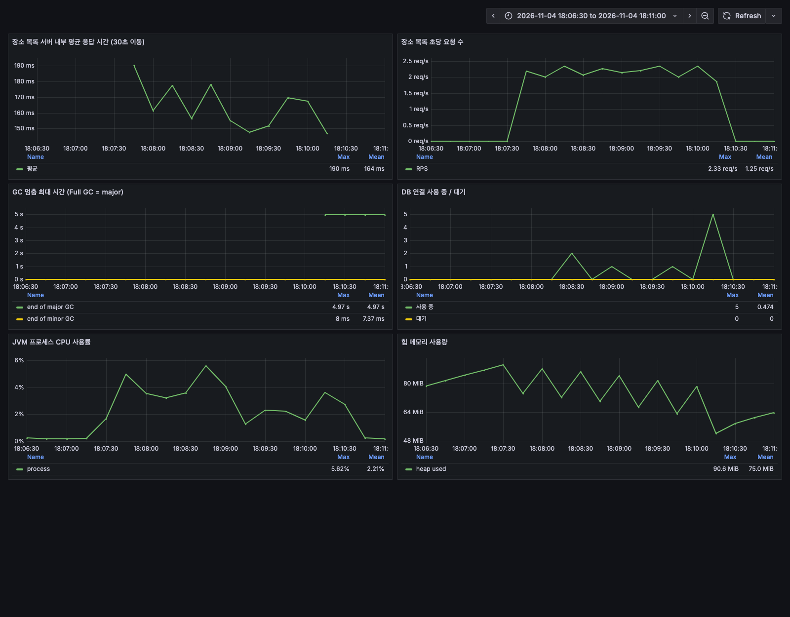
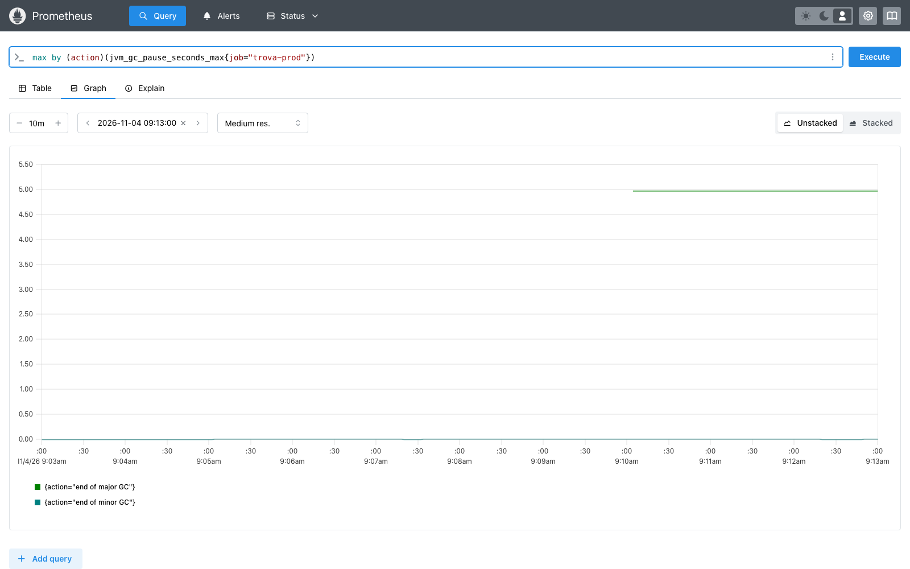
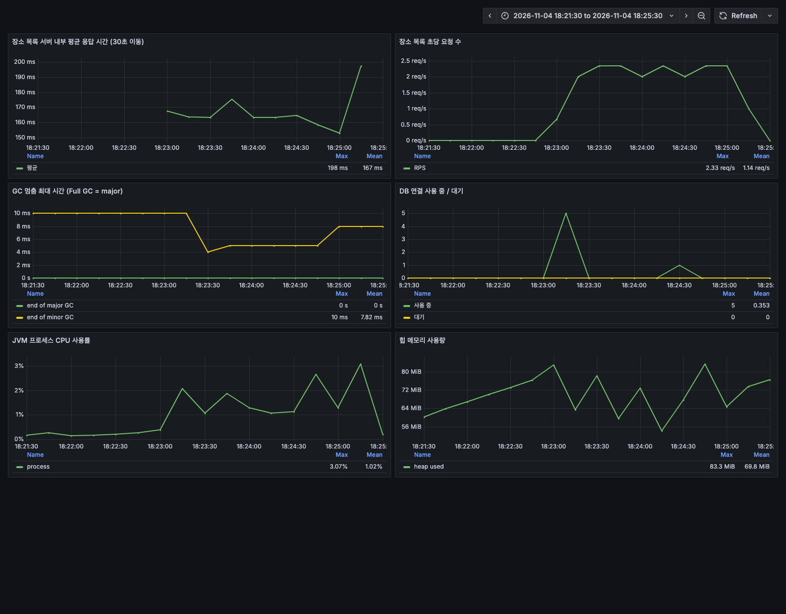
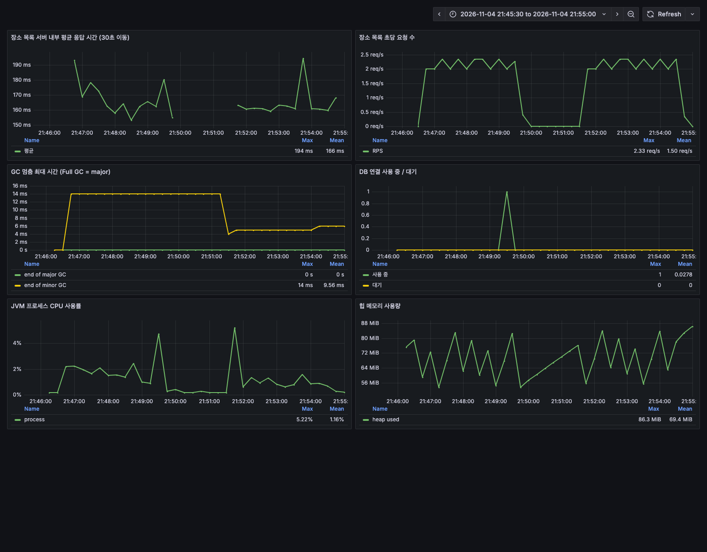
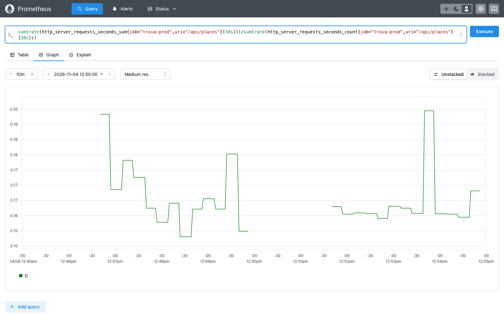

# 운영 장소 목록 인덱스 반영과 전후 측정 (2026-11-04, 운영)

PR #308 인덱스 `idx_saved_places_user_created_id(user_id, created_at, id)`를 운영 DB에 반영하고,
같은 조건의 약한 통제 부하로 전/후를 비교했다. 격리 실험(16만 행)에서 확인한 효과가 운영에서도 보이는지가 질문이었다.

## 결론
- **운영 규모(장소 277행·184kB)에서는 인덱스 효과가 없다.** 3분 완주 재측정에서 중앙값 275.6ms(있음) vs 274.9ms(없음),
  서버 내부 평균 167.4 vs 164.2ms. 실행 계획은 Seq Scan → Bitmap Index Scan으로 바뀌었지만 쿼리 자체가 0.26~0.29ms라 응답 시간에 드러나지 않는다.
- 인덱스는 데이터가 늘었을 때를 위한 선제 조치다. 격리 실험(16만 행, 40 VU)에서는 p95 2.30~3.29초 → 49~64ms였다(`2026-11-02-index-abba.md`).
- **측정 중 새 병목을 발견했다: Full GC 4.97초 멈춤.** 힙 90MiB 수준에서 Serial GC의 Full GC가 5초 동안 앱 전체를 멈춰 요청 1건이 3초 시간 초과.
  원인 분석·해결은 별도 작업(아래 “다음”).
- 운영 응답 약 270ms 중 쿼리는 0.3ms, 앱 서버→DB 왕복은 31.5ms, 앱 내부 처리 평균은 약 165ms. 나머지 대부분은 클라이언트↔서버 구간이다.
  앱 내부 165ms의 정체(요청당 DB 왕복 횟수 등)는 미확인 가설.

## 조건
| 항목 | 값 |
|---|---|
| 환경 | 운영: Oracle E2.1.Micro(vCPU 2, RAM 956MiB, 1/8 OCPU) + Supabase Postgres 17.6 |
| JVM | `-Xmx384m -Xss256k -XX:+ExitOnOutOfMemoryError`, GC 미지정(→ Serial) |
| 앱 | 전/후 모두 같은 JAR(`f5e6a773…`, main a108814). 인덱스만 바뀜. 배포는 측정 후 |
| 부하 | k6 `monitoring/places-load.js`: 5 VU, 요청 뒤 2초 대기, `GET /api/places`만, 3분 (≈150 req/min) |
| 계정 | 운영 테스트 계정(user 1, 장소 42개). 단기 토큰은 사용자가 발급, 파일 경로로만 전달 |
| 중단 조건 | 응답 1건 ≥ 2초, 오류율 ≥ 1%, p95 ≥ 1초, 401 구분, 서버 자원 감시 |
| 측정 위치 | 개발자 맥 → 운영(TCP 왕복 중앙 40.4ms) |
| 관측 | 로컬 Prometheus(SSH 터널 수집, 5초 간격 원본 저장) + Grafana |

## 결과

### 1차 (18시대, 감시 기준: swap-out 1페이지라도 생기면 중단)
| | 인덱스 없음 18:07 | 인덱스 있음 18:22 |
|---|---|---|
| 시간 | 2분 46초 (Full GC 시간 초과로 중단) | 2분 11초 (swap-out 20페이지로 중단) |
| 요청 / 실패 | 359 / 1 | 290 / 0 |
| 중앙 / p95 / 최대 | 273.2 / 425.4 / **3,006.1ms** | 269.0 / 354.4 / 438.6ms |
| 서버 내부 평균 | 165.5ms | 167.0ms |
| Full GC 최대 | **4.973초** | 0 |

### 재측정 (21시대, 감시 기준을 swap-out 속도 1MiB/s로 보정 후, 둘 다 3분 완주)
| | 인덱스 있음 21:46 | 인덱스 삭제 후 21:51 |
|---|---|---|
| 요청 / 실패 | 395 / 0 | 395 / 0 |
| 중앙 / p95 / 최대 | 275.6 / 413.1 / 686.3ms | 274.9 / 378.0 / 460.3ms |
| 서버 내부 평균 | 167.4ms | 164.2ms |
| Full GC | 0 | 0 |

순서: 인덱스 생성 18:20:56 → 1차 후 측정 → 재측정 B → 삭제 21:51:17 → A → 재생성 21:54:39 → 배포 22:04(b041704).

### 실행 계획
| | 실행 방식 | 실행 시간 |
|---|---|---|
| 인덱스 전 | Sort ← Hash Join ← Seq Scan saved_places(235행 제거) | 0.264ms |
| 인덱스 후 | Sort ← Hash Join ← Bitmap Index Scan `idx_saved_places_user_created_id` | 0.294ms |

정렬(Sort)과 processing_jobs Seq Scan은 남는다(격리 실험과 같음).

## 그래프

인덱스 전 측정 — Full GC 4.97초와 DB 연결 5개 몰림(18:10:05):

Prometheus 원본 화면(UTC, 09:10 = KST 18:10):

인덱스 후 1차 측정:

재측정(왼쪽 구간 인덱스 있음, 오른쪽 구간 없음) — 서버 내부 평균이 두 구간 모두 160~170ms:

Grafana는 KST, Prometheus 화면은 UTC다. Grafana의 응답 시간은 서버 내부 **평균**이고, k6 표의 p95와 다르다.

## 한계
- 짧은 3분 측정, 5 VU 한 가지 조건. 운영 최대 인원·장시간 안정성은 재지 않았다.
- 1차 측정은 둘 다 조기 중단(사유 기록). 결론은 3분 완주 재측정에 근거한다.
- Full GC가 왜 5초나 걸렸는지(1/8 OCPU 제한, 스왑으로 밀린 힙 등)는 미확정. GC 순간의 swap-in은 감시 표본 사이에 끼어 기록되지 않았다.
- 실사용 요청은 측정 구간에 0건(Prometheus 다른 URI 요청률 0).

## 다음
1. Full GC 멈춤 분석: GC 로그 켜기 → 빈도·원인 확인 → 복제 환경에서 Serial vs G1 비교 → 운영 반영 여부 결정.
2. 앱 내부 165ms 분해: 요청당 DB 왕복 횟수(왕복 31.5ms) 계측.
3. 2단계 한계 찾기(설계 5절).

## 원본
`docs/monitoring/2026-11-04-prod-index/`: `preflight.json`, `before|after|rerun-b-index|rerun-a-noindex/`(k6 요약·로그·points.json.gz·run.json·prometheus.json),
`*-explain.txt`, `create-index.txt`, `rerun-*-index.txt`, `summary.json`, `grafana-dashboard.json`, 캡처 png.
문제와 선택: `2026-11-04-capacity-issue-log.md` #2~#8.
