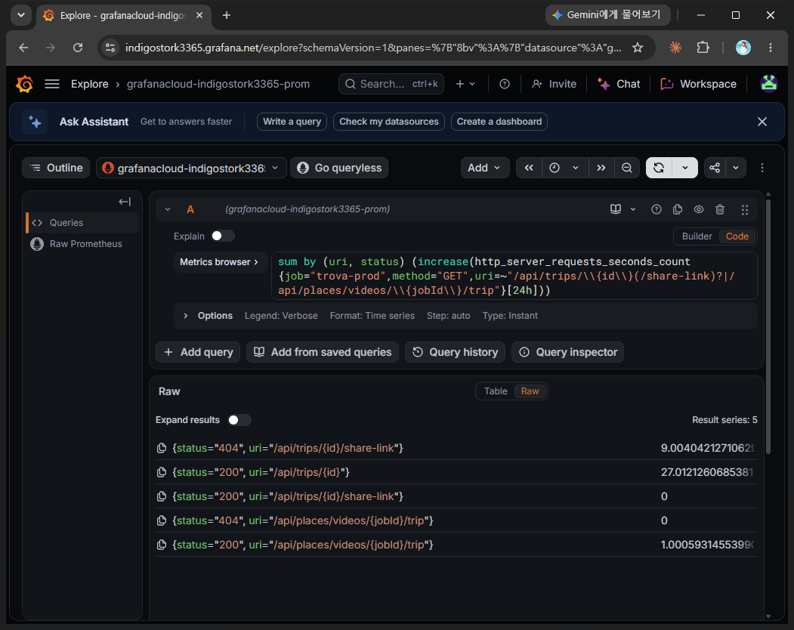

# 1단계 성능 작업 기록 — 여행·영상·관리자 조회

기록일: 2026-11-18. P1: [PR #463](https://github.com/Trovapp/trova-backend/pull/463), P2: [PR #465](https://github.com/Trovapp/trova-backend/pull/465), [이슈 #464](https://github.com/Trovapp/trova-backend/issues/464).
아래 SQL 수는 **이 PC의 로컬 H2 실측**이고, Grafana 캡처는 **배포 전 운영 기준선**이다. SQL 감소를 운영 응답 시간 개선으로 환산하지 않는다.
캡처는 P2 배포 전 스냅샷이며, 당시 운영 배포 SHA와 P1의 운영 반영 여부는 확인하지 않았다.

## 배경: 운영 기준선

2026-11-18 17:39~17:40 KST에 Grafana Explore에서 최근 24시간을 조회했다. 기존 Chrome 세션의 **새 창 하나만** 열어 조회·캡처하고 그 창만 닫았다. 다른 창·탭, 서버 셸, 운영 DB에 접근하지 않았고 Grafana 설정을 저장하지 않았다. API 경로는 ID 대신 템플릿으로 집계했다. 캡처에 토큰·개인정보가 없는지 확인했다.

| GET 경로 | 최근 24시간 p95 (초) | 요청 수 추정 (`increase[24h]`) | 상태 |
|---|---:|---:|---|
| `/api/trips/{id}` | 0.444280 | 27.012126 | 200 |
| `/api/places/videos/{jobId}/trip` | 0.532437 | 1.000593 | 200; 404 증가분 0 |
| `/api/trips/{id}/share-link` | 0.337781 | 9.004042 | 404; 200 증가분 0 |

`increase`는 수집 구간 끝을 외삽하므로 정수가 아니다. p95는 상태별로 나누지 않은 히스토그램 추정치이며, 특히 영상 여행 요청 약 1건은 성능 비교 표본으로 부족하다. 작업 요청에는 두 없음 조회의 정상 404가 오류처럼 기록됐다는 운영 관찰이 있었지만, 이번 캡처 구간에서 영상 여행 404의 증가분은 0이었다. 이를 새로 발생한 오류로 세지 않는다.

쿼리(데이터 소스 `grafanacloud-prom`, 화면 시간 범위 `Last 24 hours`, Instant):

```promql
histogram_quantile(0.95, sum by (le, uri) (
  increase(http_server_requests_seconds_bucket{
    job="trova-prod",method="GET",
    uri=~"/api/trips/\\{id\\}(/share-link)?|/api/places/videos/\\{jobId\\}/trip"
  }[24h])
))

sum by (uri, status) (
  increase(http_server_requests_seconds_count{
    job="trova-prod",method="GET",
    uri=~"/api/trips/\\{id\\}(/share-link)?|/api/places/videos/\\{jobId\\}/trip"
  }[24h])
)
```

### 캡처





메모리는 Trova 필수 모니터링의 패널 29(`서버 여유 메모리·java 메모리`)를 캡처했다. 그래프에는 서버 available, Java RSS, 스왑 사용량이 함께 표시된다. 이 작업으로 메모리가 줄었다는 주장은 하지 않는다.

## 작업별 SQL 수 전/후

테스트 트랜잭션 없이 MockMvc HTTP 요청을 예열한 뒤 Hibernate `Statistics.getPrepareStatementCount()`로 요청 전체의 SQL 수를 센다. 영상 작업마다 SavedPlace를 적어도 한 개 넣어 EAGER 추가 조회까지 드러낸다.

| 작업 | 항목 수 | 변경 전 SQL | 변경 후 SQL | 근거 |
|---|---|---|---|---|
| P1 여행 상세 | 일차 1·3·5·7 | 6·10·14·18 | 5·5·5·5 | PR #463, `TripDetailQueryCountTest` |
| P1 관리자 삭제 영향 | 일차 1·3·5·7 | 3·5·7·9 | 3·3·3·3 | PR #463, `TripDetailQueryCountTest` |
| P1 재구성용 장소 조회 자체 | 일차 1·3·5·7 | 미측정 | 1·1·1·1 | PR #463, 전체 재구성 작업 수 아님 |
| P2 같은 영상의 여행 | 작업 1·5 | 8·16 | 7·7 | `VideoAdminShareQueryCountTest` |
| P2 관리자 사용자 상세 | 실패 작업 1·5 | 13·17 | 12·12 | 같은 테스트 |
| P2 공개 공유 여행 | 일차 1·3·5·7 | 6·10·14·18 | 5·5·5·5 | 같은 테스트 |

실행 출력 발췌:

```text
변경 전:
P2 admin jobs=1,5 SQL=[13, 17]
P2 video jobs=1,5 SQL=[8, 16]
P2 public days=1,3,5,7 SQL=[6, 10, 14, 18]
5 tests completed, 3 failed
BUILD FAILED in 1m 33s

변경 후:
P2 admin jobs=1,5 SQL=[12, 12]
P2 video jobs=1,5 SQL=[7, 7]
P2 public days=1,3,5,7 SQL=[5, 5, 5, 5]
BUILD SUCCESSFUL in 1m 6s
```

변경 전 새 SQL 수 테스트 세 개가 실제 실패함을 확인했다. 없음 응답·권한 테스트 추가 후에도 구현 전 실행하여 7개 중 SQL 수 세 개와 JSON null 한 개가 실패하고 권한·응답 정렬은 통과함을 확인했다. 마지막에는 최근 10개 경계 테스트를 더했다.

## 방법 비교와 변경 범위

- 영상 여행: `VideoKey`로 같은 영상을 먼저 고른 뒤 SavedPlace를 한 번에 읽는다. 단순 IN 조회는 EAGER 연관을 작업마다 다시 읽으므로 기존 저장소 방식과 같은 EntityGraph(`processingJob`, `processingJob.user`, `user`)를 적용했다. 여행 선택·소유자 확인은 기존 흐름을 유지한다.
- 관리자 상세: (가) 링크별 최대 ID 집계 조회와 (나) 이미 읽은 최근 작업 활용을 비교했다. 같은 사용자의 작업을 상태 필터 없이 ID 내림차순으로 읽으므로 표시할 작업보다 새 작업은 반드시 앞에 있다. 따라서 (나)를 선택하고 먼저 나온 링크인지 Set으로 판단한다. 상위 10개 밖의 작업은 더 오래됐으므로 추가 SQL이 필요 없다. 기존 `isRetryable(job)`과 실행 직전 `retryableJob`의 DB 재확인·409·감사 흐름은 그대로다.
- 공유 공개 상세: P1의 정렬된 여행별 장소 조회를 재사용하고 일차 ID로 묶는다. 빈 일차, 방문 순서, 공개 필드 제한을 유지한다.
- P1 정리: `TripReplanGraph`의 미사용 Itinerary import·저장소 주입 제거, `TripController`·`TripDetailQueryCountTest`의 완전한 클래스 이름을 import로 정리했다.

## 없음 응답 결정과 앱 호환 근거

**소유한 자원은 있지만 아직 여행·활성 공유 링크가 없을 때만 `200`, `Content-Type: application/json`, 본문 `null`을 보낸다.** 타인 자원·존재하지 않는 원본 자원은 404, 미인증은 401을 유지한다. 해제한 공유 링크의 소유자 조회도 null이다. 공개 토큰의 조회·삭제·생성 상태 코드는 바꾸지 않는다.

빈 본문은 앱의 `res.json()`에서 파싱 오류가 나고 `{}`는 참으로 평가돼 링크/여행이 있다고 오인할 수 있어 사용하지 않는다. 본문 네 글자 `null`을 HTTP 테스트로 검사한다.

앱 저장소의 함수 이력은 `git log -L`로, 호출부는 `git log -p -G`로 처음 도입부터 v10까지 확인했다.

- [`getVideoTrip` 최초 도입 4199d0e](https://github.com/Trovapp/trova-app/commit/4199d0e86475e2b936fe2c5f020484e8b06d44bb): 404는 null, 성공은 `res.json()`을 반환하며 이후 함수 본문 변경이 없다. 화면은 최초부터 `videoTripQuery.data ?? null`, 존재 여부 분기 후 필드 접근을 사용했다. 이후 호출부 변경도 null 분기를 유지한다.
- [`getShareLink` 최초 도입 e8cdc0c](https://github.com/Trovapp/trova-app/commit/e8cdc0c3615d8a179e945099a9392d645ba54d82): `shareLinkOutcome`은 2xx를 ok로 분류하고 함수는 `res.json()`을 반환한다. 공유 시트는 최초부터 `linkQuery.data` 분기와 `linkQuery.data?.url`을 사용했다. 후속 두 커밋에서도 null 분기는 유지된다.
- [v10 소스 af3b078](https://github.com/Trovapp/trova-app/tree/af3b0787d3caecf23d0f195c5980ad91e8748027): 코디네이터가 제공한 EAS 빌드 `379054e5`의 커밋. 두 함수와 호출부를 확인했다.
- v7의 정확한 빌드 커밋은 기록에 없다. 코디네이터에 따르면 OTA `01a1d431` 적용 상태이며 앱 경험 기록 43줄이 근거다. **v7 바이너리 실행 확인은 하지 않았다.** 대신 해당 함수와 호출부가 최초 도입부터 모든 이력에서 null을 처리함을 확인했다. 기능 도입 전 버전은 해당 API 호출부가 없다.
- 최초 도입·v10의 실제 두 함수 본문을 읽어 가짜 HTTP 응답 `404`와 `200 + JSON null`을 각각 넣는 로컬 Node 검증 4건도 통과했다. 두 응답 모두 null 반환, 200에서만 JSON 파싱을 호출함을 확인했다. 실제 앱 네트워크/화면 E2E를 실행한 것은 아니다.

정상 없음이 200이 되므로 별도로 404 지표를 숨기지 않는다. 권한 위반과 없는 원본 자원의 404는 그대로 관측한다.

## 검증 환경과 전체 결과

- 이 PC의 Ubuntu WSL, JDK 21, 프로젝트 Gradle Wrapper 9.5.1, H2. 루트 `.env`, 운영 DB·서버, 로컬 8080, 개발 DB 테스트 계정, Gemini는 사용하지 않았다. 별도 허용된 Grafana 브라우저 읽기만 수행했다.
- P1의 기존 WSL JDK/Gradle 캐시를 재사용했다. CRLF wrapper 스크립트를 고치지 않고 같은 Wrapper의 main으로 `test build`를 실행했다. 임시 init script는 산출물 위치만 `/tmp/trova-perf-p2-runtime/build`로 바꾼다. 테스트 제외·전역 설치·설정 변경은 없다.
- 첫 전체 실행: 1,231개 중 2개 실패·6개 건너뜀. 기존 `ApiSessionCreationIntegrationTest`가 H2 `USERS` 테이블이 없다는 오류로 실패했다. 새 테스트 컨텍스트가 공유 `testdb`의 create-drop 수명에 간섭하지 않도록 새 클래스만 독립 H2 이름을 사용하도록 수정했다.
- 최종 전체 실행: **1,231개 중 1,225개 통과, 6개 기존 조건부 건너뜀, 실패·오류 0**(JUnit XML 합산). 새 회귀 테스트 8개 모두 통과. `BUILD SUCCESSFUL in 3m 49s`, `8 actionable tasks: 2 executed, 6 up-to-date`. `git diff --check` 통과.

실행한 Wrapper 명령(임시 init script는 `allprojects { layout.buildDirectory = file('/tmp/trova-perf-p2-runtime/build') }` 한 줄):

```sh
java -classpath gradle/wrapper/gradle-wrapper.jar org.gradle.wrapper.GradleWrapperMain \
  test build --init-script build/p2-wsl.init.gradle --console=plain
```

## 배포

P1(#463)·P2(#465)·P3(#467)를 한 번에 운영에 반영했다. 직전 운영 배포는 2d52505(2026-11-17).

| 항목 | 값 |
|---|---|
| 배포 시각 (KST) | 2026-11-18 21:36:06 시작 → 21:36:51 재시작 → 21:39:05 UP 확인 (전체 180초) |
| 커밋 | `523308a` (origin/main과 같음, 깨끗한 작업 폴더) |
| 방법 | devflow `deploy.sh` (빌드 → 사전 확인 → 전송·해시 비교 → 백업 → 교체·재시작 → UP 대기 → 확인) |
| 사전 확인 | 운영 진행 중 작업(영상 분석·일정 초안 PENDING/PROCESSING) 0건 |
| 해시 | 로컬·서버 일치 (`178d83ed4f99a29e`) |
| UP까지 | 재시작 후 134초 |
| 백업 | `/opt/trova-backend/app.jar.bak-20261118-213606` |
| 배포 후 확인 | devflow 3개 통과(인증 없는 공유 요청 401, 세션 쿠키 0개, 자동 초안 목록 401). 추가로 `/actuator/health` UP, 인증 없는 `GET /api/trips/1`·`/api/places/videos/1/trip`·`/api/trips/1/share-link`·`/api/trip-drafts/auto` 모두 401 |
| 직후 메모리 | 이번 작업에서 서버 접속 측정은 하지 않음 — Grafana 패널 29에서 따로 확인 |
| 되돌리기 | 하지 않음 |

## 배포 전/후 비교 (배포 뒤 작성)

같은 길이의 관찰 구간, 요청 수·상태 분포·서버 부하를 함께 기록한다. 이번 PR에서는 배포하거나 운영 API에 테스트 요청을 보내지 않았다.

| 지표 | 배포 직전 구간/값 | 배포 후 구간/값 |
|---|---|---|
| 여행 상세 p95 / 요청 수 | | |
| 영상 여행 p95 / 요청 수 | | |
| 공유 링크 p95 / 요청 수 / 404 수 | | |
| Java RSS / 서버 available / 스왑 | | |

## 남은 것

- 머지·배포 뒤 같은 조건의 운영 비교. 특히 영상 여행은 요청 표본을 충분히 확보해야 한다.
- SQL 문장 수는 고정됐지만 영상 조회는 여전히 사용자의 작업 목록을 읽는다. 데이터 행 수·메모리 사용까지 고정된 것은 아니다.
- 관리자 최신 판단은 한 번 읽은 목록의 스냅샷이다. 조회 직후 새 작업이 생길 수 있으므로 실제 재시도 실행에서 기존 DB 재확인을 유지한다.
- P1과 이번 작업 모두 H2에서 검증했다. 운영 PostgreSQL 실행 계획과 p95 개선 폭은 확인하지 않았다.

## P3 자동 초안 목록 조회 (#466)

PR: [#467](https://github.com/Trovapp/trova-backend/pull/467).

### 분석과 기준선

대상은 홈·내 여행·영상 기록에서 호출하는 `GET /api/trip-drafts/auto`다. 요청에서 전달된 운영 p95 약 351ms는 이번 작업에서 재측정하지 않았다. 화면 조작 도구가 제공되지 않아 허용된 예외에 따라 Chrome/Grafana 캡처는 건너뛰었다. 새 캡처 파일·운영 API 호출·운영 DB/서버 접근은 없다.

변경 전 경로는 `TripDraftController.autoDrafts` → `TripDraftRepository.findListedByUserId` → `TripPlannerService.analysesOf` → `TripService.jobIdsWithExistingTrip`이었다. 사용자별 미닫힘 자동/대체 초안(PENDING·PROCESSING·READY), 사용자의 분석 전체, 여행에 포함된 저장 장소의 영상 URL을 읽었다. `VideoKey`로 URL 별칭을 통일해 이미 여행이 된 영상을 숨기고 같은 영상의 최대 ID인 DONE 분석을 표시한다. 필터링 뒤 최신 초안 10개에만 READY JSON을 파싱해 장소 수를 센다. **DB 조회와 메모리 계산만 하며 Gemini·카카오 등 외부 호출은 없다.**

기억된 JWT 사용자로 테스트 트랜잭션 없이 MockMvc HTTP 요청을 예열한 뒤 Hibernate Statistics를 초기화해 측정했다. 기존 테스트의 트랜잭션 안에서는 사용자 엔티티가 공유돼 가려졌던 추가 조회가 여기서는 드러난다. 변경 전 SQL 5회는 초안·그 사용자, 분석·그 사용자, 여행 영상 URL이다. 변경 후에는 초안 값·분석 값·여행 URL의 3회만 남는다. 사용자 존재 확인이 기억되지 않은 JWT 첫 요청에는 별도 SQL 1회가 더해진다(기존 ADR 0036 정책 유지).

| 로컬 H2 HTTP 시나리오 | 변경 전 SQL | 변경 후 SQL | 변경 전 엔티티 로딩 | 변경 후 엔티티 로딩 |
|---|---:|---:|---:|---:|
| 초안/분석 1개 | 5 | 3 | 4 | 0 |
| 초안/분석 8개 | 5 | 3 | 18 | 0 |
| 초안/분석 20개, 응답 10개 | 5 | 3 | 42 | 0 |
| 빈 목록, 예열 JWT | 1 | 1 | 0 | 0 |

근거: `src/test/java/com/trova/backend/controller/AutoDraftReadPerformanceTest.java`의 SQL·엔티티 수 단언. 변경 전 새 테스트 2개 중 SQL 목표 테스트 1개가 실패했고, 쓰기 직후 반영 테스트는 통과했다.

```text
변경 전: P3 drafts=1,8,20 SQL=[5, 5, 5] entities=[4, 18, 42]
2 tests completed, 1 failed
BUILD FAILED in 1m 21s
변경 후: P3 drafts=1,8,20 SQL=[3, 3, 3] entities=[0, 0, 0]
```

### 방법 비교와 선택

| 방법 | 장점 | 비용·위험 | 결정 |
|---|---|---|---|
| (a) SQL·불필요 조회 줄이기 | 추가 SELECT 2개 제거, 필요한 6개 초안 값·4개 분석 값만 로딩, 사용자 엔티티와 큰 상세 요약 제외 | 사용자의 전체 후보 초안·분석은 여전히 읽음 | 선택 |
| (b) 사용자별 짧은 캐시 | 적중 시 본 조회 SQL을 없앨 수 있음 | 아래 쓰기 경로 전체의 커밋 후 무효화, 조회/무효화 경합, 크기·만료 검증 필요; 144MiB 힙에서 상주 데이터 증가 | 보류 |
| (c) 둘 다 | 미적중·적중 모두 개선 | (b)의 운영·구현 비용이 그대로 필요 | 보류 |

기존 scalar projection 방식(ADR 0034·0036)을 적용했다. `AutoDraftQueryService`는 연관 엔티티나 추가 서비스 읽기 트랜잭션 없이 값을 조합하고, 영상 키는 요청 안에서 한 번 계산해 재사용한다. 응답 캐시는 전후 모두 **없음**이며 적중률·만료·무효화 테스트는 해당 없음이다. 영구 메모리 증가 없이 확인된 추가 조회부터 제거한다. 힙 바이트·운영 응답 시간 개선 폭을 측정한 것은 아니다.

### 결과에 영향을 주는 쓰기 경로와 무효화 검토

응답 캐시가 없으므로 아래 커밋 이후 다음 요청은 DB를 다시 읽는다. 무효화 훅을 추가하지 않았다. 한 요청의 여러 SELECT 사이에 동시 쓰기가 끼는 기존 일관성 한계는 남는다.

| 쓰기 경로(코드 근거) | 목록/상세에 미치는 영향 |
|---|---|
| `AutoDraftService.create`의 초안 저장·실패 시 삭제 (`service/AutoDraftService.java:63,98`) | 새 자동 카드 생성/삭제 |
| `TripPlannerService.create`, `dismissReplaced`, `answer`, `processSerially` (`service/TripPlannerService.java:103,142,196,229`) | 대체 초안 생성, 이전 카드 닫기, 상태·days·jobIds·draftJson·placeCount 변경 |
| `TripDraftController.dismiss` 및 `admin/action/HideDraftAction.java:35` | 사용자·관리자 카드 숨김 |
| `TripDraftApprovalService.approve` (`service/TripDraftApprovalService.java:86,102,106`) | APPROVED 초안 제외, 여행 장소 연결로 같은 영상의 다른 카드도 숨김 |
| `TripService.confirmVideoPlacesIntoTrip`, 여행 장소 추가·교체·삭제, `deleteTrip` (`service/TripService.java:274,310,568,738,114`), `admin/action/DeleteTripAction` | SavedPlace 연결이 생기거나 없어지면 같은 영상 카드 숨김/재등장; 빈 여행 생성·제목/날짜 변경은 영상 연결에 영향 없음 |
| `ProcessingJobLifecycleService.completeAnalysis`, `markDone`, 제목·상태 변경 (`service/ProcessingJobLifecycleService.java:99,221`), `ItineraryGenerationService` | 저장 장소 교체, 최신 DONE 분석 ID·제목 변경. 실패/진행 중 최신 분석은 완료 분석을 대체하지 않음 |
| `PlacesController` 장소 삭제 (`controller/PlacesController.java:211`), 분석 중 장소 저장 (`service/ProcessingJobLifecycleService.java:88,109,118`) | 여행 장소와 SavedPlace의 연결 존재 여부가 바뀌면 카드 숨김 판단 변경. 단순 저장 장소 수가 아니라 초안 JSON이 placeCount 기준 |
| `PlaceRelocateService.relocate/markListedDrafts` (`service/PlaceRelocateService.java:43,58`) | 좌표 변경 및 자동/대체 초안의 placesChangedAt 표시. 목록 DTO에는 이 표시가 없고 상세 DTO의 placesChanged로 안내 띠를 유지 |
| `OrphanedJobRecoveryService` (`service/OrphanedJobRecoveryService.java:81`) | 멈춘 초안을 FAILED로 바꾸면 목록에서 제외 |
| `UserAccountService.withdraw` (`service/UserAccountService.java:102,105`) 및 관리자 계정 삭제 | 사용자 데이터 삭제, 기존 KnownUsers 탈퇴 처리 유지 |

경로의 앞부분은 `src/main/java/com/trova/backend/`다. #151 관련 `findListedForPlacesChangeByUser`, `markListedDrafts`, 상세 응답의 placesChanged/currentJobIds는 변경하지 않았다. 다시 짠 초안도 홈에 포함하며 최신 DONE 분석 선택, 없는 작업 fallback, URL 별칭, 여행 제외 후 10개 제한, JSON 오류 시 null을 유지한다.

### 검증과 한계

- 새 회귀 테스트: SQL 수·엔티티 수, 이전 엔티티 경로와 전체 DTO/순서 동등성, 응답 10개 경계, READY 장소 수/잘못된 JSON, 자동/대체/직접/타 사용자 초안, 최신 DONE/실패 분석·없는 영상, 빈 목록 뒤 생성·분석 완료·닫기, 여행 연결·저장 장소 삭제·여행 삭제 직후 반영.
- 기존 `TripDraftAutoControllerTest`, `TripDraftAutoQueryCountTest`, `PlaceRelocateServiceTest`, `PlaceRelocateServiceIntegrationTest` 집중 실행 통과. #151의 자동/대체 초안 표시와 승인·닫힘·실패·타 사용자 제외를 포함한다.
- 첫 전체 실행: 1,235개 중 5개 실패·6개 건너뜀. 동등성 비교 3개는 JSON 내용은 같지만 Java Long 노드와 HTTP 파싱 Integer 노드를 직접 비교한 테스트 오류였다. 양쪽 모두 JSON 직렬화 후 파싱해 비교하도록 수정했다. 나머지 2개는 기존 ApiSessionCreationIntegrationTest의 H2 USERS 테이블 없음으로, 새 컨텍스트가 캐시에서 기존 컨텍스트를 밀어내며 공유 testdb의 create-drop 수명과 간섭했다. 새 테스트를 P2의 독립 H2/동일 Spring 컨텍스트에 합쳐 추가 컨텍스트를 만들지 않게 했다(운영 설정·다른 테스트 변경 없음).
- 전체 결과: 1,235개 중 1,229개 통과·기존 조건부 건너뜀 6개·실패/오류 0개(JUnit XML 합산), 새 테스트 4개 모두 통과; `BUILD SUCCESSFUL in 4m 5s`, `8 actionable tasks: 6 executed, 2 up-to-date`
- P1·P2와 같은 WSL JDK 21.0.13+9와 Gradle 캐시로 Wrapper main의 `test build --offline`을 실행했다. 임시 init script는 산출물 위치만 `/tmp/trova-perf-p3-runtime/build`로 지정했다. CRLF `gradlew` 수정, 테스트 제외, 의존성·전역 설정 변경은 없다. 명령: `java -classpath gradle/wrapper/gradle-wrapper.jar org.gradle.wrapper.GradleWrapperMain test build --init-script build/p3-wsl.init.gradle --console=plain --offline`.
- 루트 `.env`·운영 DB/서버·개발 DB 계정·로컬 8080·Gemini는 사용하지 않았다. 머지·배포하지 않는다.
- SQL 수는 고정돼도 읽는 행 수는 사용자 이력에 비례하고 후보 초안의 JSON도 전부 전송된다. 추후 필요하면 페이지/최신 영상 키 저장을 별도로 검토한다. 이번 H2 수치를 운영 p95 감소나 PostgreSQL 실행 계획 개선으로 환산하지 않는다.