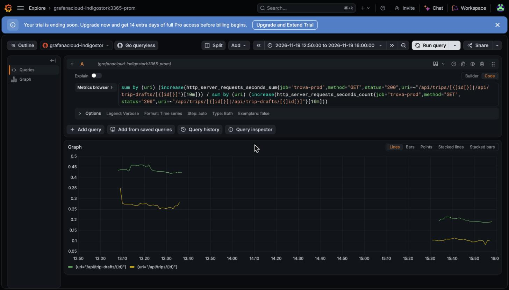
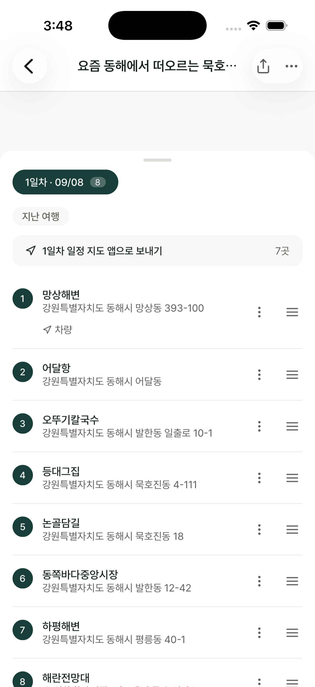
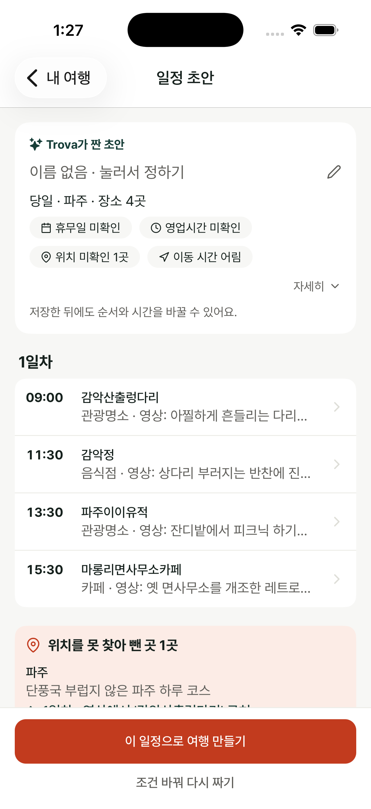
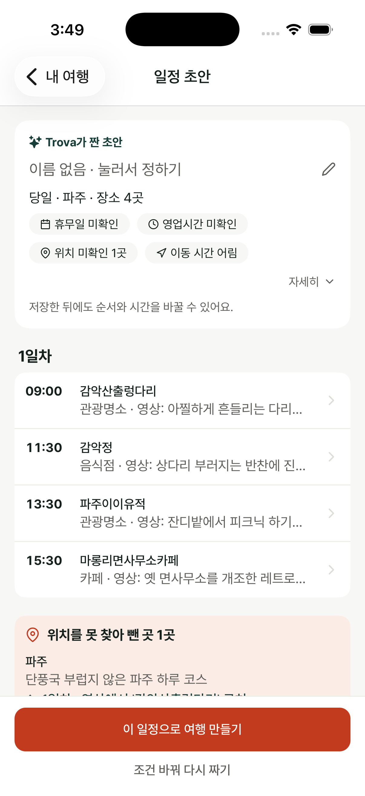

# P4: 요청당 SQL 수와 JVM 힙 밖 메모리 관측

2026-11-19. [이슈 #475](https://github.com/Trovapp/trova-backend/issues/475), [PR #474](https://github.com/Trovapp/trova-backend/pull/474). 구현·로컬 검증을 마쳤으며 **미머지·미배포**다. 운영 서버·DB·Grafana·Slack에 접근하지 않았고 JVM 옵션·systemd·경보·Cloud 저장본을 바꾸지 않았다. [P1~P3 기록](../2026-11-18-perf-phase1/README.md), ADR 0005·0037·0039~0042·0050과 r26·r27·r28 기록을 따른다.

## 선택과 측정 범위

| 방법 | 비용·범위 | 선택 |
|---|---|---|
| Hibernate `StatementInspector` + 요청 스레드 카운터 | 기존 의존성, SQL당 ThreadLocal 조회·정수 덧셈. SQL 문자열을 보관하지 않음 | 선택. P1~P3의 Hibernate 준비 SQL 수와 같은 기준 |
| Hibernate session statistics / 전역 Statistics 차분 | session 하나는 요청 전체 트랜잭션·인증 조회를 포괄하지 못함. 전역 차분은 동시 요청과 영상 분석 SQL이 섞임. statistics 전체 활성화도 필요 | 사용하지 않음 |
| datasource-proxy | JDBC까지 자동 포괄하지만 의존성과 Connection/Statement 감싸기·호출별 중계가 추가됨 | 현재 직접 JDBC가 두 저장소뿐이므로 보류 |

`RequestDbQueryMetrics`는 Security 필터보다 먼저 동기 `/api/**` 요청에 카운터 하나를 만들고 `finally`에서 제거한다. 원시 URL은 필터 대상 판별에만 쓰며 태그·캐시에 저장하지 않는다. 완료 시 MVC `BEST_MATCHING_PATTERN_ATTRIBUTE`의 `/api/` 템플릿과 표준 HTTP method만 사용한다. 매핑 없는 401/404·비API·서블릿 async 요청은 표본에서 제외한다. 처리된 오류 응답도 표본에 들어가며 status 태그는 없다.

일반 `ThreadLocal`이므로 `@Async`·Kafka·스케줄러·자식 스레드의 SQL은 요청에 섞이지 않는다. 현재 영상 분석처럼 접수 HTTP는 동기 완료하고 작업만 다른 스레드에서 실행하면 접수 과정의 SQL만 기록한다. 앞으로 Servlet async/Callable API를 추가하면 현재 지표는 그 요청을 제외하므로 별도 설계가 필요하다. 요청 스레드에서 직접 실행한 작업은 포함한다.

직접 JDBC는 `ApiCallLogJdbcRepository`와 `PlaceEmbeddingJdbcRepository`의 `batchUpdate` 직전에 같은 카운터에 batch 항목 수를 더한다. 생성자·DB 동작은 그대로이며 요청 밖에서는 아무 값도 기록하지 않는다. 새 직접 JDBC 경로가 생기면 같은 훅을 연결하거나 datasource-proxy를 재검토해야 한다.

**이 값은 앱에서 제출을 시도한 SQL 수다.** Hibernate SQL 준비 1회와 직접 JDBC batch 항목 1개를 각각 1로 센다. 실패한 SQL도 포함하고, 트랜잭션 제어·드라이버 내부 재시도/배치 재작성·DB trigger 내부 SQL·실제 왕복 수는 세지 않는다. Hibernate JDBC batching은 현재 설정하지 않았으며, 향후 켜면 inspector 횟수와 실행 항목 수가 달라질 수 있어 재검토한다. 배치의 DB 성공 행 수라는 뜻도 아니다.

## 지표·비용

- 이름: `trova.db.queries.per.request` → OTLP 변환 후 예상 `trova_db_queries_per_request_{sum,count,bucket}`. 단위 접미사는 추가하지 않는다.
- 새 태그는 `uri`, `method` 둘뿐이다. 기존 `application`, OTLP resource의 `job`·`instance`는 유지한다. ID·사용자·상태·SQL·쿼리 문자열은 태그에 없다.
- 고정 SLO 경계 **1·3·5·7·10·20**만 둔다. 0 SQL도 첫 버킷과 count에 포함한다. Prometheus의 `+Inf`를 더해 7개 버킷이며 자동 percentile histogram·클라이언트 percentile을 켜지 않는다. 20회 초과는 평균·count에 남고 p95 세분성은 없다.
- 요청당 작은 mutable 카운터 하나만 만들고, summary는 템플릿/method별로 재사용한다. SQL별 객체·문자열 복사·전역 statistics·요청별 샘플 목록·새 라이브러리는 없다. 활성 템플릿/method당 대략 9~10개 시리즈(버킷·sum·count, exporter의 max 여부에 따라 다름). 실제 시리즈·바이트·CPU 비용은 미측정이다.
- 기본 활성화. `APP_METRICS_DB_QUERIES_ENABLED=false` 또는 `app.metrics.db-queries.enabled=false`로 필터와 Hibernate customizer를 함께 제거한다. 직접 JDBC 훅은 활성 요청 카운터가 없어 기록하지 않는다.
- OTLP 전송은 기존 composite registry와 60초 주기를 재사용한다. JVM 메모리용 새 binder·샘플러는 추가하지 않는다.

## 배포 후 요청 지표 조회식

Grafana Cloud Prometheus 데이터 소스에서 이름·라벨·버킷을 먼저 확인한다. 이하 식은 기존 OTLP 이름 변환 규칙을 따른 예상식이며 Cloud에서 실행하지 않았다.

```promql
# 경로와 method별 SQL 평균(요청 없는 구간은 비워 둔다)
sum by (uri, method) (rate(trova_db_queries_per_request_sum{job="trova-prod"}[5m]))
/
sum by (uri, method) (rate(trova_db_queries_per_request_count{job="trova-prod"}[5m]))

# p95: 버킷 경계 사이 보간값이므로 정수 SQL의 정확한 p95는 아님
histogram_quantile(0.95, sum by (le, uri, method) (
  rate(trova_db_queries_per_request_bucket{job="trova-prod"}[5m])
))

# 여행 상세가 5회 이하인 요청의 비율(인증 예열·캐시·오류에 따라 평균도 변함)
sum(increase(trova_db_queries_per_request_bucket{job="trova-prod",uri="/api/trips/{id}",method="GET",le="5"}[1h]))
/
sum(increase(trova_db_queries_per_request_count{job="trova-prod",uri="/api/trips/{id}",method="GET"}[1h]))

# 실제 uri/method 조합 수와 분모 확인
count(count by (uri, method) (trova_db_queries_per_request_count{job="trova-prod"}))
sum by (uri, method) (increase(trova_db_queries_per_request_count{job="trova-prod"}[1h]))
```

P1 여행 상세 5회·P3 자동 초안 목록 3회는 예열한 정상 요청의 H2 기준이다. 이 지표는 성공/오류를 나누지 않으므로 운영 평균이 그 값과 다르다는 사실만으로 회귀라고 판단하지 않는다. 표본 수·요청 종류·배포 SHA를 함께 남긴다. `http_server_requests_seconds_count`는 매핑 없는 요청도 포함하여 분모가 정확히 같지 않다.

## 힙 밖 구성: 실측 지표와 추정치를 구분해서 보기

기존 Micrometer JVM 지표와 `HostProcMetrics` RSS를 재사용한다. **JVM used/committed와 RSS는 서로 다른 회계다. 아래 값은 RSS의 정확한 조각이 아니므로 누적 영역 그래프로 쌓지 않는다.** Java RSS는 실제 상주 페이지, JVM used는 논리적 사용량, buffer는 할당/매핑 크기다.

```promql
# Java RSS와 heap used: 각각 별도 선
max by (job, instance) (host_process_memory_rss_bytes{job="trova-prod"})
sum by (job, instance) (jvm_memory_used_bytes{job="trova-prod",area="heap"})

# Metaspace와 Compressed Class Space: id별로 분리
sum by (job, instance, id) (jvm_memory_used_bytes{job="trova-prod",area="nonheap",id=~"Metaspace|Compressed Class Space"})

# Code cache: JDK/플랫폼에 따라 이름이 다르므로 실제 id 라벨을 먼저 확인
sum by (job, instance, id) (jvm_memory_used_bytes{job="trova-prod",area="nonheap",id=~"CodeHeap.*|Code Cache"})

# 전체 nonheap과 direct/mapped buffer: id별. mapped - 'non-volatile memory' 등이 있으면 함께 노출
sum by (job, instance) (jvm_memory_used_bytes{job="trova-prod",area="nonheap"})
sum by (job, instance, id) (jvm_buffer_memory_used_bytes{job="trova-prod"})

# 플랫폼 Java 스레드 스택 시나리오: 스레드당 1MiB를 가정한 추정치
max by (job, instance) (jvm_threads_live{job="trova-prod"}) * 1048576

# 기타 '진단용 잔차': RSS 실측 기타 메모리가 아님. 음수도 그대로 표시
max by (job, instance) (host_process_memory_rss_bytes{job="trova-prod"})
- sum by (job, instance) (jvm_memory_used_bytes{job="trova-prod"})
- sum by (job, instance) (jvm_buffer_memory_used_bytes{job="trova-prod"})
- max by (job, instance) (jvm_threads_live{job="trova-prod"}) * 1048576
```

1MiB는 운영 `-Xss` 확인값이 아니라 비교용 가정이다. 실제 배포 JVM의 스택 크기가 확인되면 승수만 바꾼다. JVM 내부 native thread/GC thread·virtual thread는 `jvm_threads_live`와 일치하지 않으며 예약된 스택 전체가 상주하는 것도 아니다. 잔차에는 heap의 미사용 상주 페이지, GC 자료구조, libc arena, JNI, 공유 라이브러리, 계측 누락, 샘플 시각 차이가 섞인다. mapped buffer·파일 매핑 등의 회계 차이도 있어 음수를 0으로 숨기지 않는다. 정확한 RSS 분해가 필요하면 별도 승인된 짧은 측정에서 smaps와 NMT를 비교할 수 있으나, NMT reserved/committed도 RSS는 아니다. 이번에는 NMT·`-Xss`·systemd를 바꾸지 않았다.

`jvm_memory_committed_bytes{area="heap"}`도 함께 보면 used보다 RSS가 큰 이유 중 힙의 여유 영역을 구분하는 데 도움이 된다. 지표가 없으면 `or vector(0)`로 가리지 말고 OTLP·binder·플랫폼 지원을 확인한다. 재시작/전송 공백은 ADR 0050의 메모리 경보 정책과 별개이며, 이 작업에서 경보를 수정하지 않는다.

패널 정의는 [dashboard-review.json](dashboard-review.json)이다. 기존 `monitoring/grafana-cloud/dashboards`는 운영 export 저장본이라 편집하지 않고 별도 검토안으로 뒀다. 실제 Cloud 반영·데이터 소스 선택·동작 확인은 미수행이다. 스레드 이름은 기존 Cloud 저장본의 `jvm_threads_live`를 따랐다. 로컬 Prometheus exporter의 단위 접미사와 다를 수 있으므로 Cloud 이름을 기준으로 확인한다.

## 테스트와 매니저 인계

최종 결과는 PR #474와 커밋 `0011f6e`의 매니저 검증 기록에 근거한다. **대상 테스트 18개 통과**(RequestDbQueryMetricsTest 9·TripDetailQueryCountTest 5·OtlpMetricsExportTest 4). **전체 1,247개 중 1,239개 통과·기존 실패 2개·건너뜀 6개, 새 실패 0개**다. 실패는 `ApiSessionCreationIntegrationTest`의 H2 `USERS` 테이블 없음이며 아래 기준 브랜치 대조에서 확인한 기존 실패와 같다. Codex 검증(낮음 3건 반영)과 Claude 리뷰(낮음만)를 교차로 통과했다. 리뷰 뒤 마지막 빈 `destroy()`의 꺼짐 분기를 직접 검증하도록 테스트를 고치고 대상 18개를 다시 실행해 통과했다.

후속 수정에서 비활성 계측의 직접 JDBC 훅은 ThreadLocal 조회 전에 반환하도록 했다. 빈 수에 따른 활성 플래그와 중복 `destroy()` 방어를 추가했고, 관련 테스트 2개 및 조기 반환 제거 변형의 실패를 확인했다. MockMvc 경계 테스트 1개로 컨트롤러 오류의 단일 표본, 매핑 없는 404 제외, 다음 정상 요청의 독립적인 5 SQL과 uri 템플릿 유지도 확인했다. Servlet async 재디스패치는 미검증이며 현재 해당 async 반환 컨트롤러가 없다.

먼저 `TripDetailQueryCountTest`에 실제 JWT MockMvc 여행 상세의 5 SQL·요청 count/total 증가·서로 다른 ID의 템플릿 통합 테스트를 추가했다. 그 뒤 구현했다. 새 단위 테스트 6개는 요청/자식 스레드 격리, JDBC batch 두 경로, 100개 원시 ID의 태그 수 고정, 6개 경계, 예외 후 0 SQL 요청, 매핑 없는 요청/비API/미지원 method/Servlet async 제외, 설정 비활성화를 검사한다. OTLP 테스트 1개는 동일 summary와 기존 JVM binder 지표가 OTLP 레지스트리에 등록되는지 검사하며 실제 네트워크 전송 테스트는 아니다.

**매니저(Claude) 실행 결과(2026-11-19, 로컬 맥, `./gradlew test --offline`)**: 처음 실행 때 테스트 컴파일 오류 6건(이 Micrometer 버전의 `SimpleMeterRegistry`·`PrometheusMeterRegistry`·`JvmMemoryMetrics`는 `AutoCloseable`이 아님)이 나서 `finally close()`/지역 변수로 고쳤다. `application.yml`의 켜기 값이 `management.metrics.db-queries`에 있어 `@ConditionalOnProperty(app.metrics.db-queries.enabled)`와 어긋났으므로 `app.metrics` 아래로 옮기고, 운영 `application.yml`을 직접 읽는 켜짐/꺼짐 테스트를 추가했다. OTLP 스냅샷은 `+Inf`까지 7개 버킷이라 OTLP 테스트 기대값을 경계 7개로 고정했다. 그 뒤 대상 테스트 15개(RequestDbQueryMetricsTest 7·TripDetailQueryCountTest 4·OtlpMetricsExportTest 4) 통과. 변형 1(비활성화)은 `MeterNotFoundException`, 변형 2(`recordJdbcStatements(2)`)는 `expected: 5.0 but was: 10.0`으로 실패한 뒤 원복했다. 전체 테스트는 1244개 중 2개 실패·6개 건너뜀이며, 실패 2개(`ApiSessionCreationIntegrationTest`, H2 `USERS` 테이블 없음)는 origin/main(0b03dc5)에서도 1235개 중 같은 2개가 실패해 기존 실패다. 새 실패 0개.

이전 작업 세션 기록: **테스트 0개 실행, 통과·실패 수 미확인**. 기본 `./gradlew test --tests ...`는 Gradle 캐시 zip lock의 `Operation not permitted`로 차단됐다. 조정자 지시대로 작업 폴더의 별도 `GRADLE_USER_HOME`으로 한 번만 재시도했지만 `UnknownHostException: services.gradle.org`로 배포본 다운로드 전에 실패했다. 테스트를 건너뛰고 성공으로 처리하지 않았다. 이후 Gradle 재시도는 하지 않았다. 임시 `.gradle-user/`는 커밋 대상에서 제외한다.

매니저 실행 명령(루트 `.env` 없이, JDK 21과 사용 가능한 Gradle 캐시 환경에서):

```sh
./gradlew test --tests '*RequestDbQueryMetricsTest' --tests '*TripDetailQueryCountTest' --tests '*OtlpMetricsExportTest' --console=plain
./gradlew build --console=plain
```

정적 확인은 `git diff --check` 통과, Python JSON 파싱으로 6개 패널의 고유 ID·형식을 확인했다. Gradle 실패로 생긴 빈 zip 임시 파일 두 개는 제거했으며 작업 폴더의 별도 Gradle 캐시는 커밋 대상에 없다.

다음 두 변형은 매니저가 실행해 **동일한 기대값에서 실패함을 확인하고 원복했다**. 아래는 재현 절차다.

1. `TripDetailQueryCountTest`의 `@TestPropertySource`에 `app.metrics.db-queries.enabled=false`를 잠시 추가하고 위 여행 상세 테스트를 실행한다. meter 부재로 실패해야 한다. 어노테이션에 직접 넣어야 하며 Gradle CLI의 임의 `-D`는 테스트 JVM 전달을 보장하지 않는다.
2. `inspect()`의 `recordJdbcStatements(1)`을 `recordJdbcStatements(2)`로 바꿔 여행 상세 테스트를 실행한다. 실제 Hibernate statistics는 5, summary 증가량은 10이 되어 실패해야 한다. JDBC 훅 하나를 제거하면 직접 JDBC 단위 테스트도 실패해야 한다.

두 변형에서 사용할 정확한 여행 상세 테스트 명령:

```sh
./gradlew test --tests '*TripDetailQueryCountTest.여행_상세의_예열_후_SQL_다섯_회를_요청_지표로_기록하고_ID는_태그에_넣지_않는다' --console=plain
```

Windows의 Python/nice 31개 실패는 이전 환경의 사례로, 이번 맥 전체 결과에 포함하지 않는다. H2 세션 2개 실패는 이번 맥 실행과 기준 브랜치 대조에서도 확인됐다. 새 통합 테스트는 고유 H2 DB를 사용해 create-drop 공유 간섭을 피한다.

## PR과 변경 파일

변경 파일 11개:

- `src/main/java/com/trova/backend/config/RequestDbQueryMetrics.java`
- `src/main/java/com/trova/backend/repository/ApiCallLogJdbcRepository.java`
- `src/main/java/com/trova/backend/repository/PlaceEmbeddingJdbcRepository.java`
- `src/main/resources/application.yml`
- `src/test/java/com/trova/backend/config/RequestDbQueryMetricsTest.java`
- `src/test/java/com/trova/backend/config/OtlpMetricsExportTest.java`
- `src/test/java/com/trova/backend/controller/TripDetailQueryCountTest.java`
- `docs/monitoring/2026-11-19-p4-metrics/README.md`
- `docs/monitoring/2026-11-19-p4-metrics/dashboard-review.json`
- `docs/monitoring/2026-11-18-perf-phase1/README.md`
- `docs/experience-notes.md`

제목: `feat: 요청당 SQL 분포와 힙 밖 메모리 관측 추가`

배경: P1~P3의 로컬 SQL 감소를 운영 수치로 확인하고, 144MiB 힙 제한에서 RSS의 나머지를 기존 JVM 지표와 비교할 근거가 필요하다. PR #474는 `Closes #475`를 포함한다. 브랜치 `feat/p4-db-query-metrics`의 이슈 번호 생략은 매니저 승인 예외로 PR에 기록했다.

변경: StatementInspector + 요청 ThreadLocal과 직접 JDBC 두 batch 훅으로 동기 API의 SQL 제출 수를 기록한다. session statistics는 요청 단위가 다르고 전역 통계는 비동기 SQL을 섞으므로 배제했으며, datasource-proxy는 추가 의존성/프록시 비용 때문에 보류했다. uri 템플릿/method만 태그로 쓰고 버킷은 6개다. 메모리 패널은 기존 JVM 지표를 재사용하고 스택/기타 잔차를 가정값으로 분리한다. 운영 export·경보·JVM 옵션·systemd 변경은 없다.

검증: 대상 18개 통과, 전체 1,247개 중 기존 실패 2개·건너뜀 6개·새 실패 0개다. 비활성화·두 배 카운트·JDBC 비활성 조기 반환 제거 변형의 실패를 확인했다. 초기 작업 세션의 캐시 권한/DNS 차단 이후 매니저가 검증·커밋·push·PR 생성을 마쳤다. 머지는 하지 않았다.

후속(낮음, 이번 PR 밖): OTLP 자동 구성에서 이 summary가 실제 운영 레지스트리 조합으로 등록되는지 보는 회귀 테스트, 요청당 SQL 측정 정책(무엇을 세고 무엇을 세지 않는지·새 JDBC 경로 연결 규칙) ADR.

남은 것: 배포 후 실제 OTLP 이름·태그·버킷·표본 수·비용 확인, Cloud 패널 반영 여부 결정. 머지·운영 배포 자체는 이번 범위 밖이다.

## 운영 배포

2026-11-19 사용자 승인으로 main `69b55fa`(P4 측정 #474, 여행 상세 SQL 5→2 #477, 초안 상세 SQL 5→3 #478)를 운영 서버(Oracle E2.1.Micro)에 배포했다. devflow `deploy.sh`(0.5.3)를 옵션 없이 한 번 실행했다.

| 항목 | 결과 |
|---|---|
| 시각(KST) | 2026-11-19 14:54:35 시작 → 14:55:04 재시작 → 14:57:28 끝(전체 173초) |
| 커밋 | `69b55fa` (`perf: 초안 상세 조회 SQL 5→3회와 저장 장소 엔티티 로딩 제거 (#473) (#478)`) |
| 사전 확인 | 운영 진행 중 작업(영상 분석·초안) 0건 |
| 전송 해시 | 로컬·서버 일치 `8b7197ea49a45b81` (104M) |
| UP 걸린 시간 | 재시작 후 133초 |
| 스크립트 확인 | 인증 없는 공유 요청 401, 세션 쿠키 0개, 자동 초안 목록 인증 없이 401 |
| 추가 확인(curl) | `/actuator/health` 200, `/api/trips/1` 401, `/api/trip-drafts/1` 401 |
| 백업 경로 | `/opt/trova-backend/app.jar.bak-20261119-145435` |

새 지표(`trova_db_queries_per_request_*`)의 실제 OTLP 이름·표본 확인은 아래 "운영 전후 비교 (2단계)"의 표본3에서 했다(SQL/요청 열).

## 운영 전후 비교 (2단계)

2026-11-19, #476(여행 상세 #477)·#473(초안 상세 #478). 운영 서버(Oracle E2.1.Micro, 도쿄) + Supabase 기준이며 로컬 측정은 따로 표시한다. 수치는 매니저가 맥에서 Grafana Cloud API(GET 200, `job="trova-prod"`)로 조회해 전달한 값이다.

### 표본 조건

| 항목 | 전(기준선3) | 후(표본3) |
|---|---|---|
| 시각(KST) | 13:06:26~13:27:02 | 15:28:10~15:48:38 (재시작 31분 뒤) |
| 집계 | `increase[22m]` | `increase[21m]` |
| 배포 | 이전 운영 JAR | main `69b55fa`(14:54~14:57 배포, UP 133초) |
| 조작 | Android 에뮬레이터(trova-qa, 구글 계정) + iOS 시뮬레이터(Trova QA 17 Pro, 카카오 계정) 동시 약 20분, 사람 속도로 조회만 | 같음 |

### 경로별 응답 시간 (운영, GET 200, ms)

| 경로 | 전 평균/p50/p95/건수 | 후 평균/p50/p95/건수 | 평균 변화 | 후 SQL/요청(P4) |
|---|---|---|---:|---:|
| `/api/trips/{id}` | 267 / 253 / 352 / 35 | **105 / 101 / 201** / 42 | **-61%** (-162ms) | 2 |
| `/api/trip-drafts/{id}` | 438 / 410 / 559 / 16 | **199 / 199 / 248** / 19 | **-55%** (-239ms) | 3 |
| `/api/trip-drafts/auto` | 140 / 142 / 167 / 12 | 139 / 137 / 194 / 9 | -1% | 3 |
| `/api/trips` | 133 / 136 / 155 / 12 | 132 / 129 / 154 / 9 | -1% | 3 |
| `/api/trips/{id}/share-link` | 229 / 232 / 251 / 17 | 230 / 228 / 316 / 19 | 0% | 3 |
| `/api/bookmarks` | 74 / 77 / 107 / 36 | 86 / 77 / 156 / 43 | +16% (p50 같음) | 1 |
| `/api/bookmarks/folders` | 99 / 101 / 140 / 31 | 111 / 102 / 204 / 40 | +12% (p50 비슷) | 2 |
| `/api/places` | 138 / 128 / 176 / 27 | 138 / 133 / 178 / 29 | 0% | 1 |

- 전·후 모두 5xx 0건. 프로세스 CPU 평균 0.6%→1.5%, heap 최대 106→108MiB.
- p50·p95는 히스토그램 버킷 보간값이고 `increase` 건수는 반올림한 추정치다.
- 찜·폴더의 평균 증가는 p50이 같고 p95만 커진 형태라 소수 느린 요청 영향으로 본다(건수 31~43). 이번 변경이 건드리지 않은 경로다.



Grafana Explore, `sum by (uri)(increase(..._sum[10m])) / sum by (uri)(increase(..._count[10m]))`. 노랑=`/api/trips/{id}`(약 0.27s→0.10s), 초록=`/api/trip-drafts/{id}`(약 0.43s→0.20s). 가운데 빈 구간은 조작하지 않은 시간이다.

### 로컬(H2) vs 운영

| 경로 | SQL | 로컬 MockMvc 중앙값(작업자 측정) | 운영 평균 |
|---|---|---|---|
| 여행 상세 | 5→2 | 1일 0.784→0.656ms, 30일·300장소 1.927→1.283ms | 267→105ms |
| 초안 상세(READY, 저장 1/20/100) | 5→3, 엔티티 6/44/204→2 | 2.555/2.195/2.220→1.605/1.395/1.425ms | 438→199ms |

### 해석

로컬은 DB가 같은 프로세스 메모리(H2)라 SQL 왕복 비용이 거의 0이어서 차이가 1ms 미만으로만 보인다. 운영은 서버(Oracle 도쿄)↔Supabase 왕복이 SQL마다 수십 ms라 줄인 횟수가 그대로 응답 시간에 나타난다. 여행 상세는 3회 감소로 평균 162ms가 줄었고(약 54ms/회), 초안 상세는 2회 감소와 저장 장소 엔티티 로딩 제거로 239ms가 줄었다. 즉 이 서버의 병목은 CPU가 아니라 DB 왕복 횟수다. 손대지 않은 경로(목록·찜·장소)는 전후가 같아 비교 구간이 공정함을 보여 준다.

회당 약 54ms는 사전 추정에 쓴 RTT 31.5ms보다 크다. SELECT마다 붙던 읽기 트랜잭션 종료 등 SQL 수에 보이지 않는 왕복도 함께 줄었을 수 있으나 이번에 분해하지 않았다.

### P4로 새로 보인 후보

- `/api/trips/{tripId}/days/{day}/gap-recommendations`: 요청당 SQL **20.15회**(35건). 다음 N+1 후보. → P7(#482)에서 후보별 개인화 조회를 묶고 데이터 읽기를 한 번으로 줄임(로컬 빈 시간 1개 기준 후보 수와 무관하게 5회). [분석](gap-recommendations-analysis.md)
- `/api/places/pending`: 요청당 4회 × 21분 232건(앱 폴링). 1회 비용은 작지만 횟수가 많다.

### 한계

- 계정이 기기별로 달라(Android 구글, iOS 카카오) 두 기기가 연 여행·초안 구성이 다르다. 같은 fixture로 통제한 AB 실험이 아니다.
- 경로당 9~43건이라 p95는 몇 건에 크게 흔들린다.
- 초안 상세는 READY와 진행 중 상태를 나누지 않은 평균이다.
- 앱 화면 캡처는 iOS만 넣었다. Android 캡처는 Windows 쪽에 있어 생략했다.

| 배포 전(표본2, 01:27) | 배포 후(표본3, 15:48) |
|---|---|
|  |  |
|  |  |

두 시점의 화면 내용이 같아 응답 내용이 바뀌지 않았음을 눈으로 확인할 수 있다(응답 바이트 동일은 로컬 테스트로 확인).
