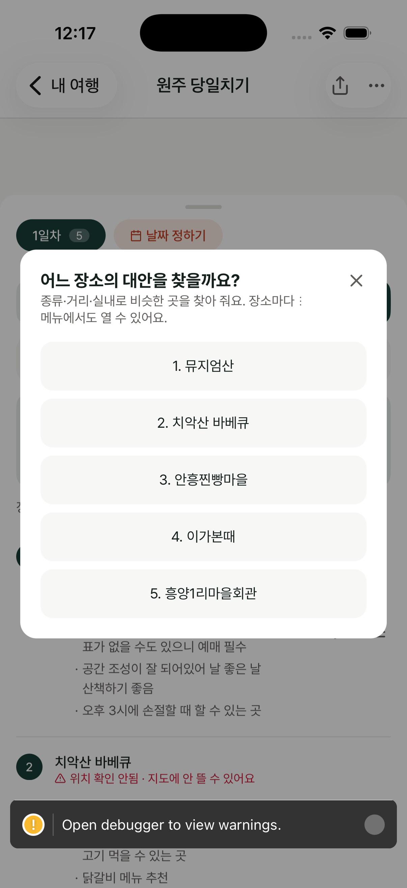
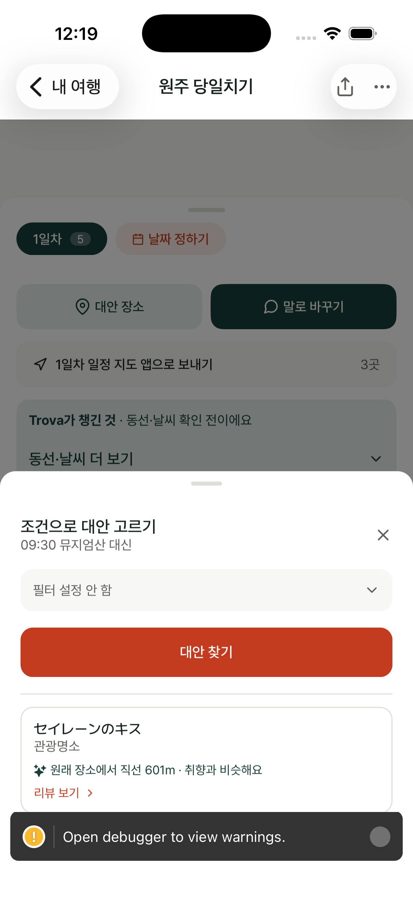

# 대안 장소 운영 재측정 — 312dbf6 배포 후

2026-11-20 T23. 11:51 KST 배포 SHA `312dbf6`는 조정자 전달 기준이다. **운영 앱 조회 12건의 서버 HTTP 평균은 2.049초, 요청당 SQL은 26.67항목**이었다. 이전 19.2초·67.4항목 대비 각각 89.3%·60.4% 낮지만, 같은 장소/캐시/응답 구성을 통제한 실험이 아니므로 전부 코드 개선 효과로 해석하지 않는다.

## 방법과 시간창

- Trova QA 17 Pro의 로그인된 기존 QA 계정으로 여행 상세 → 대안 장소 → 장소 선택 → 대안 찾기만 사용했다. 적용·교체·저장·삭제·리뷰 보기는 하지 않았다. 필터 기본값(종류/실내/거리/이동수단 미지정).
- 원주 당일치기 5개 장소(치악산 바베큐만 2회), 서울 당일치기 6개 장소, 합계 11개 장소·12회. **모두 1일차이며 다른 일차 혼합은 미수행**이다. 선택한 기존 두 여행은 당일 일정이었다.
- 클릭 시각: **12:17:57~12:24:54 KST**. 각 시각과 대상은 [request-times.txt](request-times.txt). 12:17:23은 선택 UI 조작일 뿐 HTTP 표본에 포함하지 않는다. 클릭 시각은 실제 서버 수신 시각과 수백 ms 이상 다를 수 있다.
- 지표 스냅샷: **12:16:44.815~12:25:05.601 KST**(500.786초). [before.prom](before.prom), [after.prom](after.prom). 승인된 SSH로 운영 서버의 `http://127.0.0.1:8080/actuator/prometheus`만 읽었다. `/actuator/metrics`는 404였다.
- 원래 계획의 Grafana Cloud 조회는 조정자 지시로 기존 서버 지표 직접 조회로 대체했다. 서버 벤치 토큰 파일이 없어 인증 HTTP 벤치는 실행하지 않았고, 토큰을 생성/복원하지 않았다. **최종 표본 요청은 모두 앱에서 인터넷을 거쳐 운영 서버로 보냈다.** 지표를 localhost에서 읽은 것이며 대안 요청을 localhost로 보낸 것이 아니다.
- 운영 로그에서 클릭 시각에 맞는 단계 로그가 생긴 점과 운영 카운터 12건을 대조했다. API 응답/지표는 서버 처리시간이며 앱 화면 렌더링·인터넷 왕복 전체 시간을 직접 재지는 않았다. 이전 값도 `http_server_requests` 기준이다.
- 전후 `process_start_time_seconds=1795142930.167` 동일. 시작 스냅샷에는 HTTP/SQL/외부 API 시리즈 자체가 없었고 끝에는 생성되어 있었다. 이 작업의 차이는 최초 등록 전 누적값을 0으로 취급한 값이다. 중간 재시작 흔적은 없다.

## 전후 비교

| 항목 | 전: 2026-11-19 23:38~23:58 KST | 후: 2026-11-20 12:16:44.815~12:25:05.601 KST |
|---|---:|---:|
| 표본 | 앱 9건(기존 Cloud 집계) | 앱 GET 200 **12건**, 다른 status 시리즈 없음 |
| HTTP 평균 | 19.2초 | **2.049초** (sum 24.592540598초 / 12) |
| p95 버킷 | 30초 이상으로 전달됨(유한 버킷 상한; 정확한 p95 불명) | **(3.937053352, 4.294967296]초**, 보간 약 **4.080초** |
| 요청당 SQL 항목 | 67.4 | **26.667** (sum 320 / count 12) |
| Gemini 추천 이유 타이머 count | 약 15.2(증가량 추정), sum 136.7초 | **관측 0**: 해당 시리즈 전후 없음; 규칙 이유 표시·단계 로그와 일치 |
| Gemini 임베딩 타이머 | sum 약 76초(문장 중복 계수), count 미제공 | **73문장**, 중복 가중 sum **85.761초**; HTTP 호출 수 아님 |

후 p95는 rank `12 × 0.95 = 11.4`. 누적 bucket은 3.579139411초 9건, 3.937053352초 11건, 4.294967296초 12건이다. 선형 보간은 `3.937053352 + (11.4-11)/(12-11) × (4.294967296-3.937053352) = 4.080218930초`. max gauge는 시간창 전체 최대가 아니므로 p95 계산에 쓰지 않았다.

전체 12건 중 3건은 0.223696211초 이하이고 SQL 3항목 이하이며 단계 로그도 없다. UI에서 빈 응답을 본 치악산 바베큐 2회·이가본때 1회와 대응하는 것으로 추정한다(요청 ID 연결 없음). 이 빠른 표본이 전체 평균을 낮춘다. 나머지 9건의 평균 HTTP는 버킷 경계로 계산하면 약 **2.665~2.672초** 범위다(전체 sum에서 빠른 3건의 시간 하한·상한을 차감). 전 표본에 동일한 빈 응답 비율이 있었는지는 모른다.

## 외부 호출과 단계 시간

| 타이머/로그 | 건수 | 합계 시간 | 평균 | 의미 |
|---|---:|---:|---:|---|
| google-places / nearby-search-alternative / success=true | 11 | 2.966초 | 0.270초 | 논리 검색, 내부 재시도 포함; 보충 검색은 별도 |
| gemini / recommendation-explanation | 시리즈 없음(관측 0) | 관측 없음 | 해당 없음 | 화면 규칙 이유 및 단계 로그와 함께 해석; 미등록 시리즈를 실측된 0 sample로 주장하지 않음 |
| gemini / place-embedding-batch / success=true | 73문장 | 85.761초 | 문장 가중 1.175초 | batch latency를 문장마다 중복 계수 |
| 임베딩 묶음 로그 | **7묶음, 총 73문장** | **요청 시간 6.921초** | 0.989초/묶음 | 로그의 요청 시간; 실제 wire 재시도 개수의 독립 계측은 아님 |

`tag_places`, `citydata-congestion`, 실패 외부 호출 시리즈도 전후 스냅샷에 없었다. 외부 타이머에는 uri/요청 ID가 없으므로 다른 작업 혼입을 완전히 배제할 수 없다. 이유 호출 0은 전체 Gemini 0을 뜻하지 않는다.

[stages.log](stages.log)는 같은 창의 `journalctl -u trova-backend`에서 기존 두 종류 INFO 줄만 추출한 것이다. 완료 단계 로그 9건의 집계:

| 단계 | 합계 ms | 평균 ms | min~max ms |
|---|---:|---:|---:|
| 검색 | 3730 | 414.44 | 195~1249 |
| 카탈로그저장 | 7124 | 791.56 | 37~1472 |
| 실내태그 | 0 | 0 | 0~0 |
| 임베딩 | 9137 | 1015.22 | 33~1664 |
| 혼잡도 | 2 | 0.22 | 0~2 |
| 개인화조회 | 1049 | 116.56 | 57~147 |
| 추천이유 | 101 | 11.22 | 0~62 |

개인화 후보 1~20개에 조회 구간은 57~147ms였다. 규칙 이유는 평균 11ms이며, Gemini 이유 대기가 제거된 동작과 일치한다. 카탈로그 저장과 임베딩이 남은 큰 구간이다. 단계 합에는 원본/형제/여행목록 조회·필터·정렬·직렬화가 모두 포함되지 않는다. 검색 로그와 API 타이머 역시 범위가 달라 같은 값이 아니며 서로 더하지 않는다. 새 임베딩 73문장의 저장 batch가 SQL 항목에 포함되므로 SQL 26.67을 네트워크 왕복 횟수로 부르지 않는다.

## 계산식과 재조회식

이번 실행은 PromQL `increase`가 아니라 동일 프로세스 누적 카운터 차이를 사용했다:

```text
Δmetric = sum(metric at after) - sum(metric at before)
HTTP 평균 = Δhttp_server_requests_seconds_sum / Δhttp_server_requests_seconds_count
SQL 평균 = Δtrova_db_queries_per_request_sum / Δtrova_db_queries_per_request_count
외부 건수/시간 = provider, operation, success별 Δtrova_api_call_seconds_{count,sum}
HTTP 선택: method="GET", uri="/api/trip-places/{id}/alternatives", status="200"
SQL 선택: method="GET", uri="/api/trip-places/{id}/alternatives" (status 라벨 없음)
```

다음은 Cloud에서 별도 확인할 때의 식이며 **이번 작업에서는 실행하지 않았다**. 후 종료 시각을 2026-11-20T03:25:05.601Z로 지정하고 예시 `[501s]` 창을 쓴다(실제 두 스냅샷과 0.214초 차이). 전 표본 재조회는 종료 2026-11-19T14:58:00Z, `[20m]`. Cloud의 전송 주기·외삽으로 직접 스냅샷 차이와 일치하지 않을 수 있다.

```promql
sum(increase(http_server_requests_seconds_count{job="trova-prod",method="GET",uri="/api/trip-places/{id}/alternatives",status="200"}[501s]))

sum(increase(http_server_requests_seconds_sum{job="trova-prod",method="GET",uri="/api/trip-places/{id}/alternatives",status="200"}[501s]))
/
sum(increase(http_server_requests_seconds_count{job="trova-prod",method="GET",uri="/api/trip-places/{id}/alternatives",status="200"}[501s]))

histogram_quantile(0.95, sum by (le) (increase(http_server_requests_seconds_bucket{job="trova-prod",method="GET",uri="/api/trip-places/{id}/alternatives",status="200"}[501s])))

sum(increase(trova_db_queries_per_request_sum{job="trova-prod",method="GET",uri="/api/trip-places/{id}/alternatives"}[501s]))
/
sum(increase(trova_db_queries_per_request_count{job="trova-prod",method="GET",uri="/api/trip-places/{id}/alternatives"}[501s]))

sum by (provider, operation, success) (increase(trova_api_call_seconds_count{job="trova-prod",operation=~"nearby-search-alternative|recommendation-explanation|place-embedding-batch|citydata-congestion|tag_places.*"}[501s]))
sum by (provider, operation, success) (increase(trova_api_call_seconds_sum{job="trova-prod",operation=~"nearby-search-alternative|recommendation-explanation|place-embedding-batch|citydata-congestion|tag_places.*"}[501s]))
```

직접 export에는 `job` 없이 `application="trova-backend"`가 있다. Cloud의 job 선택과 직접 export 라벨을 구분한다.

## 캡처와 한계

| 이번 측정 시작 전(배포 후) | 이번 측정 중 결과(배포 후) |
|---|---|
|  |  |

두 캡처 모두 11-20 배포 후 화면이다. **배포 전 캡처를 새로 확보한 것은 아니다.** 화면의 개발 경고 배너는 그대로 보존했다. 앱 내용만 저장했고 데스크톱의 다른 앱 화면은 산출물에 포함하지 않았다.

표본이 작고 지역·후보 수·신규 저장·임베딩 캐시가 전후 동일하지 않다. 다른 일차, 실내 필터, 동일 fixture 반복 비교, Cloud 전후 원시 재조회, 요청별 정확한 HTTP/SQL 연결은 미수행이다. 서버 설정·경보·직접 SQL·사용자 데이터 변경은 하지 않았다. 조회 과정의 카탈로그/임베딩/API 사용량 저장은 조정자 승인된 정상 앱 동작이다. git commit/push 및 코드 변경은 없다.
