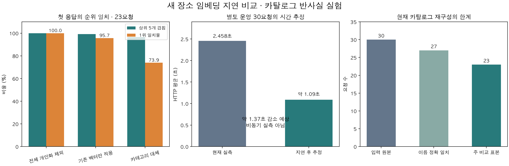

# 새 장소 임베딩을 응답 뒤로 미룰 때 — 첫 응답 순위 비교

2026-11-25 · [이슈 #541](https://github.com/Trovapp/trova-backend/issues/541) · 실험·보고 전용 · 서비스 코드/운영 설정 변경·머지·배포 없음.

**판단: 운영 적용은 보류하고, 후속 검증은 B1(첫 요청의 전체 개인화 제외)을 우선한다.** 주 비교 23요청에서 B1은 1위·상위 5개 집합이 모두 유지됐고 B2(기존 벡터만 개인화)는 1위가 1/23건, B3(카테고리 대체)는 6/23건 바뀌었다. 줄일 수 있는 응답 대기는 약 **1.37~1.40초**로 추정된다. 다만 B1도 전체 순서는 7/23건 바뀌고 취향 문구가 사라진다.

**이번 결과는 당시 30응답의 재현이 아니라 현재 카탈로그를 이용한 반사실 실험이다.** 삭제된 여행과 저장되지 않은 후보 ID 때문에 실제 Google 후보 집합·입력 순서·임베딩 누락마스크를 복원할 수 없다. 사람의 관련성 정답/선택 결과도 없으므로 아래 ‘정확도’ 지표는 **A와의 순위 일치도**다. 실제 사용자 만족이나 엉뚱한 추천의 발생률을 뜻하지 않는다.



[2쪽 요약 PDF](summary.pdf) · [익명 후보 원자료](data/candidates.csv) · [전체 지표 JSON](data/metrics.json) · [요약 지표 CSV](data/metrics.csv) · [추출 SQL](extract.sql) · [30원본 입력](targets.json)

## 1. 임베딩이 실제로 바꾸는 계산

코드 기준 커밋 `acfed70`(이 작업트리 시작점). 실험은 이 소스를 그대로 컴파일했다. 다음 파일 링크의 줄 번호는 이 커밋 기준이다.

| 단계 | 코드 위치 | 임베딩을 만들지 않을 때 |
|---|---|---|
| 후보 검색·보충 | [AlternativeFinderService.java:121](../../../src/main/java/com/trova/backend/recommendation/AlternativeFinderService.java#L121), [:130](../../../src/main/java/com/trova/backend/recommendation/AlternativeFinderService.java#L130) | 원본/필터의 카테고리와 반경 2km로 Places 검색. primary가 3개 미만이면 보충. 임베딩 사용 없음 |
| 카탈로그·기존 일정·실내·아침 필터 | [같은 파일:153](../../../src/main/java/com/trova/backend/recommendation/AlternativeFinderService.java#L153), [:165](../../../src/main/java/com/trova/backend/recommendation/AlternativeFinderService.java#L165), [:188](../../../src/main/java/com/trova/backend/recommendation/AlternativeFinderService.java#L188), [:202](../../../src/main/java/com/trova/backend/recommendation/AlternativeFinderService.java#L202) | 이름·카테고리·태그·일정으로 처리. 임베딩 생성 지연만으로 후보 선정 규칙이 바뀌지 않음 |
| 누락 후보 임베딩 생성 | [같은 파일:212](../../../src/main/java/com/trova/backend/recommendation/AlternativeFinderService.java#L212), [PlaceEmbeddingService.java:50](../../../src/main/java/com/trova/backend/recommendation/PlaceEmbeddingService.java#L50) | 이 동기 대기가 제거 대상. 후보별 존재 조회 후 누락분만 최대 100개씩 묶어 생성·저장 |
| 개인화 조회 | [PersonalizationService.java:81](../../../src/main/java/com/trova/backend/recommendation/PersonalizationService.java#L81), [UserPreferenceSignalRepository.java:46](../../../src/main/java/com/trova/backend/repository/UserPreferenceSignalRepository.java#L46) | 후보 벡터가 없으면 SQL 결과 행 자체가 없음. 이 사용자의 벡터 있는 긍정 신호 top-5 cosine similarity를 유한 값만 평균하고, 후보 행이 없으면 0점. 중복 신호는 그대로 셈 |
| 기본·최종 점수 | [PlaceScoring.java:11](../../../src/main/java/com/trova/backend/recommendation/PlaceScoring.java#L11), [AlternativeFinderService.java:278](../../../src/main/java/com/trova/backend/recommendation/AlternativeFinderService.java#L278) | `max(rating × ln(reviews+1), 1) × (1 + 0.6 × 개인화점수)`. 신규 후보의 부스트가 사라짐. 원본 장소와 후보 사이의 의미 유사도를 쓰는 식은 아님 |
| 최종 순서 | [같은 파일:290](../../../src/main/java/com/trova/backend/recommendation/AlternativeFinderService.java#L290) | 유한 점수 → primary 우선 → 점수 내림차순. 동점은 입력 순서 유지. 개인화가 primary/보충 경계를 넘기지는 않음 |
| 거리·이동시간·혼잡도 | [같은 파일:234](../../../src/main/java/com/trova/backend/recommendation/AlternativeFinderService.java#L234), [:245](../../../src/main/java/com/trova/backend/recommendation/AlternativeFinderService.java#L245), [:259](../../../src/main/java/com/trova/backend/recommendation/AlternativeFinderService.java#L259) | 좌표·교통수단·혼잡도 API 사용. 임베딩과 무관 |
| 상위 2개 추천 이유 | [같은 파일:300](../../../src/main/java/com/trova/backend/recommendation/AlternativeFinderService.java#L300), [AlternativeReason.java:21](../../../src/main/java/com/trova/backend/recommendation/AlternativeReason.java#L21) | 기본 모드는 거리→동일종류→양수 개인화→평점→리뷰 중 앞 2개. 점수 0이면 ‘취향과 비슷해요’가 빠질 수 있음 |
| Gemini 이유 복구 모드 | [PersonalizationService.java:63](../../../src/main/java/com/trova/backend/recommendation/PersonalizationService.java#L63), [:110](../../../src/main/java/com/trova/backend/recommendation/PersonalizationService.java#L110) | 후보 벡터 없으면 유사 신호도 없어 생성 이유 없음. 이번 실험은 운영 기본값인 규칙 이유 모드만 평가 |

`PersonalizationService.queryScores`의 요청 문장 임베딩은 대화 경로의 별도 계산이다. 이번 대안 경로는 호출하지 않으며 T44 범위도 수정하지 않았다.

## 2. 첫 응답 변형 정의

같은 고정 후보 집합·primary 여부·입력 순서·필터를 두고 아래 점수만 바꾼다. A/B 모두 실제 서비스의 최종 점수식·정렬·이유 생성기를 재사용했다.

| 변형 | 첫 요청의 개인화점수 | 의도/주의 |
|---|---|---|
| A 현재 방식 | 현재 벡터로 pgvector에서 구한 top-5 유사도의 유한 값 평균 | 모든 후보 벡터가 있는 표본만 주 비교. 벡터 없는 후보가 포함된 A는 현재 실패/누락 폴백의 참고 재생 |
| B1 전체 개인화 제외 | 후보 중 하나라도 누락이면 해당 요청의 모든 후보를 0점. 전부 벡터가 있으면 A | 신규/기존 사이 부스트 비대칭을 없애지만 이미 있던 개인화도 첫 응답에서 포기 |
| B2 기존 벡터만 적용 | 기존 후보는 A, 누락 후보는 0점 | `ensureEmbeddings`만 뒤로 미루면 자연스럽게 나오는 동작. 기존 후보만 약 1.5배 부스트를 받을 수 있음 |
| B3 카테고리 대체 | 기존 후보는 A, 누락 후보는 벡터 있는 사용자 신호 중 동일 raw category의 비율 | 신규 점수는 0~1 범위의 단순 빈도. top-5 cosine과 분포가 달라 무보정 적용의 위험 확인용. 학습·튜닝 없음 |

- **mixed**: `last_synced_at`이 18:18~19:05 KST 창 안이면 신규/누락으로 가정. 현재 카탈로그 INSERT 시각의 대리 지표이며 당시 벡터 존재 사실이 아니다.
- **all-new**: 모든 후보가 누락된 첫 요청으로 가정. B2는 B1과 같아진다.
- 비동기 생성·저장이 완료되고 모델·입력 텍스트·후보 집합·사용자 신호가 같으면 이후 요청은 A로 돌아간다. **완료 전 재요청, 실패·재시도·한도 대기에서는 첫 요청 뒤에도 차이가 지속된다.**

## 3. 데이터 출처와 재구성

- 원본 30곳·요청시각·한 장소만 둔 여행/필터 없음 조건: [PR #535](https://github.com/Trovapp/trova-backend/pull/535), `origin/main`의 `16b6180`에서 읽은 [UI 기록](data/source-ui-results.md)·[프로토콜](data/source-protocol.md). 입력 이름은 공개 장소명이며 후보는 요청별 `C001…`, 계정은 `U1/U2`만 출력.
- 운영 시간 근거: 브랜치 `docs/533-server-evidence-alternatives`의 [서버 자료](https://github.com/Trovapp/trova-backend/blob/docs/533-server-evidence-alternatives/docs/monitoring/2026-11-25-v11-recheck-followup/server-alternatives/README.md), 복사한 [익명 단계 로그](data/source-stage.log). 30개 대안 단계행을 파싱했다. 배치 로그 59줄은 준비 검색 등의 호출도 포함하므로 30개 대안 HTTP와 같은 모집단으로 단정하지 않는다.
- DB: 매니저가 [extract.sql](extract.sql)을 운영 `REPEATABLE READ READ ONLY`에서 실행. 테스트 계정 두 개의 신호만 사용했으며 기존 신호를 요청시각 이전으로 제한했다. `timestamp without time zone`은 JVM `TZ=Asia/Seoul` 기준 KST임을 매니저가 확인했다. 신호의 이후 삭제·변경과 신호 장소의 당시 벡터 상태까지 복원한 것은 아니다.
- 후보: 저장된 카탈로그에서 원본 이름/지역 근사중심 60km 이내 일치 장소를 찾고 **매칭된 원본 실제 좌표 기준 2km**에서 구성했다. 정확 이름→이름 길이차→근사중심 거리 우선. 현재 `category` 첫 값에 서비스의 검색군 매핑을 적용하고 인기도 상위 20개·3개 미만 보충을 근사했다.
- **Google 후보 조회 SQL은 없다.** 실제 조회는 Places API이고 전체 `types`·Google의 반환 순서·자기자신 포함한 20개 제한·보충 전후 카운트도 소실됐다. SQL의 검색군은 같은 의도의 근사이며 Google `includedTypes` 결과와 동일하다고 주장하지 않는다. 원래 여행의 trip_places는 19:05에 삭제됐다.
- 개인정보·대화·주소·전화·실제 계정 ID·전체 벡터는 받지 않았다. 제공된 것은 테스트 계정 신호의 카테고리와 후보별 top-5 유사도 수치다. **새 Gemini/Places 호출은 0회.**

원자료 CSV SHA-256: `30d4cde231e93360a38fcdc9d28b2bdb4232c4b2c80d698acbfc7ca804b7e792`.

### 표본 제외와 타당성

| 범위 | 요청 | 후보 행 | 해석 |
|---|---:|---:|---|
| 전체 재구성 | 30 | 373 | 원본 모두 찾았으나 부분일치·유형 의심·현재 벡터 누락 포함 |
| 이름 정확일치 | 27 | 338 | R05·R10·R18 부분일치 제외 |
| 주 비교 | **23** | **292** | 위 27 중 현재 벡터 누락이 있는 R04·R14·R21·R27 제외; R27은 `transit_station`이라 문화시설 원본과 의미 불일치도 의심 |

현재 벡터 없는 6후보: R04/C001, R14/C003, R21/C001, R27/C007·C013·C014. 이들의 동기 생성 후 점수를 API 없이 알 수 없어 주 비교에서 **요청 전체를 제외**했다. 벡터 없는 후보만 삭제해 A 모집합을 유리하게 만들지는 않았다. 이름 정확일치도 장소 정체성의 보증은 아니며 R27이 그 반례다.

화면 카드 제목 OCR이 있는 17요청의 33개 후보명 중 재구성 집합에서 **25/33개(75.8%)**를 찾았고 25개 모두 재생 A 상위 5에 있었다. 주 비교에 속한 화면 12요청에서는 **17/23개(73.9%)**였다. 주 비교에서 카드 1위 이름을 매칭할 수 있었던 10요청은 10/10개가 A의 1위였지만, OCR 미매칭 건은 이 분모에서 빠지므로 독립적인 100% 재현 성공률이 아니다. OCR 오인식과 카테고리·원본 매칭 차이를 구분할 정보도 부족하다. 화면에 보인 두 카드만 확인했으며 상위 5·10 전체 원본 검증은 불가하다.

주 비교의 mixed 마스크는 신규 **291/292개(99.7%)**, 기존 1개뿐이다. 따라서 mixed 결과도 대부분 all-new 상황이며 기존/신규가 반씩 섞인 요청에 일반화할 수 없다.

## 4. 결과 — 주 비교 23요청

각 요청에 같은 후보를 유지한다. `교집합 수`, `Jaccard=교집합/합집합`, `겹침률=교집합/min(k,n)`의 **요청별 평균**이다. 후보가 5/10개보다 적어도 빠뜨리지 않으며 주 표본의 평균 유효 k는 각각 **4.870 / 8.957**이다. Spearman/Kendall은 서비스에서 동점 입력 순서까지 해소한 전체 최종 순위 기준이며 점수 자체의 tie 보정 지표는 아니다.

| 변형·마스크 | 상위5 교집합 수 / Jaccard | 상위5 겹침률 | 상위10 교집합 수 / Jaccard | 상위10 겹침률 | Spearman / Kendall tau | 1위 일치율 | 상위5 집합 변경 | 응답시간 감소 추정 |
|---|---|---|---|---|---|---|---|---|
| B1 · mixed | 4.870 / 1.0000 | 100.0% | 8.783 / 0.9697 | 98.3% | 0.9946 / 0.9842 | 100.0% | 0.0% | 약 1.37~1.40초 |
| B2 · mixed | 4.826 / 0.9855 | 99.1% | 8.739 / 0.9618 | 97.8% | 0.9875 / 0.9770 | 95.7% | 4.3% | 약 1.37~1.40초 |
| B2 · all-new | 4.870 / 1.0000 | 100.0% | 8.783 / 0.9697 | 98.3% | 0.9946 / 0.9842 | 100.0% | 0.0% | 약 1.37~1.40초 |
| B3 · mixed | 4.696 / 0.9420 | 96.5% | 8.739 / 0.9618 | 97.8% | 0.9778 / 0.9435 | 73.9% | 17.4% | 약 1.37~1.40초 |
| B3 · all-new | 4.739 / 0.9565 | 97.4% | 8.739 / 0.9618 | 97.8% | 0.9834 / 0.9493 | 73.9% | 13.0% | 약 1.37~1.40초 |

B1/all-new는 B1/mixed와 동일하다. B1은 1위 23/23·상위5 집합 23/23 유지, B2/mixed는 각각 22/23·22/23, B3/mixed는 각각 17/23·19/23이다. B1에서 전체 순서가 바뀐 요청은 7/23, B2는 7/23, B3는 15/23이다. 상위5 집합이 같아도 카드의 표시 순서나 상위2 설명은 달라질 수 있다.

### 개인화 신호가 있는 사용자별

두 테스트 계정 모두 신호가 있다. U1은 요청시각별 총 78~102개, U2는 35~39개다(벡터 없는 신호 제외 수는 CSV의 `embedded_signal_count` 참조). 주 표본 U1 19요청·U2 4요청은 서로 다른 장소를 사용하므로 계정 간 성능 우열 비교는 아니다.

| 계정 | 주 표본 | B1 상위5 겹침 / 1위 일치 | B2 mixed | B3 mixed |
|---|---|---|---|---|
| U1 | 19 | 100.0% / 100.0% | 98.9% / 94.7% | 96.8% / 68.4% |
| U2 | 4 | 100.0% / 100.0% | 100.0% / 100.0% | 95.0% / 100.0% |

실제 무신호 계정 표본은 없다. 합성 픽스처에서 무신호이면 A=B2임을 확인했으며, 서비스 식상 B1/B3도 신호가 없으면 개인화가 0으로 같아진다. 주 표본 상위 2개 46슬롯에서 A의 ‘취향’ 문구는 44개, B1은 0개, B2/mixed는 1개였다. **순위 유지가 개인화 경험 유지와 같지는 않다.** B3는 카테고리 비율을 기존 이유 생성기에 넣으면 취향 문구가 생기므로, 구현한다면 이를 벡터 유사도 근거로 오인하게 표시해서는 안 된다.

### 제외 표본을 포함한 민감도

| 범위 | 요청 | B1 1위 일치 | B2 mixed 1위 일치 | B3 mixed 1위 일치 |
|---|---|---|---|---|
| exact27 | 27 | 92.6% | 88.9% | 70.4% |
| exact26_without_suspect | 26 | 92.3% | 88.5% | 73.1% |
| all30 | 30 | 93.3% | 90.0% | 70.0% |

27개 전체에서 상위5 겹침은 B1 99.3% / B2 98.5% / B3 95.6%, Spearman은 0.9833 / 0.9773 / 0.9718이다. 이 표는 **현재 벡터 없는 A가 포함된 참고치**이며 주 비교의 완성된 A와 같은 근거 수준으로 사용하지 않는다. 전체 상위10·Jaccard·상관·원시 순위는 [metrics.json](data/metrics.json)의 범위별 결과에 모두 남겼다.

## 5. 바뀐 후보와 사용자 영향

요청별 별칭이므로 다른 요청의 C001은 서로 다른 장소다. 아래는 주 표본의 mixed 결과이며 전체 사례는 [metrics.json](data/metrics.json)의 `cases`·`details` 및 [서비스 재생 출력](data/replay-output.json)에 있다.

| 변형·원본 | 상위5에서 빠진 후보 (분류/평점/거리) | 새 후보 (분류/평점/거리) | 의미 |
|---|---|---|---|
| B1 | 없음 | 없음 | 상위5 집합 유지, 표시 순서·취향 설명은 바뀔 수 있음 |
| B2 · R02 인천 차이나타운 | C005 관광명소 / 4.2 / 1.851km | C011 관광명소 / 3.7 / 0.862km | 기존 벡터가 있는 후보만 개인화 부스트가 남음 |
| B3 · R02 | C004 놀이공원 / 4.0 / 1.696km | C011 관광명소 / 3.7 / 0.862km | 빈도가 높은 일반 관광명소 분류가 유리 |
| B3 · R03 수원화성박물관 | C005 불교사찰 / 4.6 / 1.884km | C007 관광명소 / 4.2 / 0.769km | 같은 반경에서도 분류가 달라짐 |
| B3 · R22 동피랑 벽화마을 | C005 역사명소 / 4.4 / 0.459km | C006 관광명소 / 4.1 / 0.346km | 구체 분류가 일반 분류로 교체 |
| B3 · R29 목포 근대역사관 1관 | C005 공원 / 4.4 / 0.296km | C007 관광명소 / 4.8 / 0.916km | 평점은 높지만 거리가 늘어난 사례 |

B2 교체 1건의 빠진/새 후보 평균은 평점 **4.2→3.7**, 원본 거리 **1.851→0.862km**, 리뷰 **1,975→702개**다. B3 교체 4건은 평점 **4.35→4.20**, 거리 **1.084→0.723km**, 리뷰 **1,081.5→539.3개**다. 이 숫자는 교체된 후보만의 기술 통계이며 전체 추천의 품질 변화 추정이 아니다.

가장 주의할 사례는 **R02의 B2에서 C011이 A 11위→첫 응답 1위**가 된 것이다. A의 1위 C001은 놀이공원·평점 4.0·리뷰 8,173개였고 C011은 관광명소·평점 3.7·리뷰 702개다. C011의 사용자 유사도는 약 0.898로, 벡터가 남아 있다는 이유로 약 1.539배가 적용된다. 신규 C001은 A에서 약 0.842의 유사도가 있었지만 B2에서 0으로 떨어진다. C011이 실제로 ‘엉뚱하다’는 사람의 판정은 없으나 **캐시 존재 여부가 1위를 결정하는 편향 사례**로 볼 수 있다.

B3도 수원 R03에서 C003을 A 3위→1위로 올린다. 정확 분류 빈도는 cosine top-5 평균과 척도가 다르고 `tourist_attraction` 같은 일반 분류가 세부 분류보다 자주 쌓여 있다. 이 단순 대체 점수는 이번 표본에서 A 보존에 불리했다.

## 6. 줄어드는 시간과 적용 판단

운영 별도 30요청의 평균 HTTP는 **2.458초**, 단계 로그 임베딩은 **1,400.73ms**(최대 **2,175ms**). 이는 새 대안 후보들이 실제로 생성·저장되는 경로의 측정값이다. 약 33ms의 기존 임베딩 조회/작업 등록 비용이 남는다고 가정하면:

`2.458 - (1.400733 - 0.033) = 약 1.090초`.

전체 임베딩 구간을 제거한 이상적 산술값은 1.057초다. 따라서 **감소 약 1.368~1.401초(56~57%)**를 기대하지만, 비동기 큐 비용·DB 경쟁·동시 사용자 영향은 측정하지 않았다. 최대 임베딩 단계값으로 평균 HTTP/p95를 빼서 예측하지도 않는다. UI 관측 평균 4.258초는 ADB·화면 대기를 포함하므로 이 HTTP 추정과 직접 빼지 않는다.

| 안 | 추천 | 근거 |
|---|---|---|
| B1 | **후속 검증 우선, 운영 적용 보류** | 주 표본에서는 상위 결과 보존이 가장 좋고 캐시 부스트 비대칭이 없음. 첫 응답 개인화·설명을 포기하고 30%는 전체 순서가 바뀜 |
| B2 | **지금 적용 보류** | 코드 이동만으로 생기는 동작이지만 1개 기존 벡터가 11위→1위를 만든 사례. 기존 후보 비율이 높은 상황을 더 확인해야 함 |
| B3 | **보류** | 1위 변경 26.1%, 분류 빈도/벡터 유사도 척도 미보정, 설명 근거 혼동 가능 |

후속 적용 검토의 조건은 당시 후보 ID·primary·입력 순서·누락마스크·점수·추천 이유를 익명 테스트 범위로 보존해 **완성된 A의 그림자 비교**를 수행하는 것이다. 기존/신규가 25·50·75% 섞인 사례, 강한 개인화·희소 신호·무신호, 실제 동시 요청을 포함하고 서버 응답시간/첫 카드 및 재조회 순서 변경·사용자 선택을 함께 확인한다. 이번 자료만으로 허용 가능한 품질 저하의 임계값을 임의로 확정하지 않는다.

## 7. 적용한다면 필요한 비동기 설계 — 미구현

1. 요청 중에는 존재 조회만 하고, 누락 후보 목록·선택한 첫 응답 정책을 고정해 반환한다. 장소 행 커밋 후에 작업을 발행해 저장 전 읽기 경쟁을 피한다. 단순 스레드 실행만으로 ‘응답 후 실행’을 보장하지 않으므로 응답 완료 훅 또는 명시적인 작업 전달 시점을 설계한다.
2. 작업 키를 `(placeId, embeddingModelVersion, embeddingTextHash)`로 두고 서버 간에도 원자적으로 하나만 획득한다. 처리 직전 벡터/텍스트 버전을 재확인하고 완료 갱신은 같은 버전일 때만 한다. 서로 다른 요청이 같은 장소를 요청하면 작업 하나를 공유한다. 메모리 `Set`만으로는 다중 인스턴스·재시작 중복을 막지 못한다.
3. 크기 제한이 있는 영속 대기열/작업 상태와 복구 루틴을 사용한다. 큐 포화 시 HTTP 응답을 기다리게 하지 않고 다음 기회로 넘길 정책이 필요하다. 최대 100개 묶음을 유지하되 실제 토큰/항목 한도와 요청 예산에 맞춰 크기를 정한다.
4. 일시 오류/429/DB 저장 오류는 지수 백오프·지터·`Retry-After`와 횟수/시간 상한으로 재시도한다. 입력 오류는 격리하고 재시작 후 처리 중 작업은 임대 만료로 회수한다. DB 저장 실패 때 이미 생성된 벡터 재사용 가능성을 검토해 유료/제한 API 재호출을 줄인다. 최종 실패에서도 추천 응답은 계속 허용하되 누락이 지속됨을 계측한다.
5. **분당 15회는 이 과제에서 주어진 운영 예산 가정이다.** 이번 읽기 전용 작업으로 제공자 실제 모델/키의 한도는 검증하지 않았다. 임베딩 클라이언트는 직접 REST를 호출하며 별도 전역 limiter가 보이지 않는다. 채팅·태깅·기타 임베딩과 공유되는 실제 프로젝트/모델 할당량을 확인하고 공통 예산을 적용한다. batch의 HTTP 횟수와 문장별 계수(현 로그의 428 등)를 구분한다. 비동기는 작업의 실행 시점만 바꾸고 총 사용량/한도를 줄이지 않으며, 무제한 병렬화는 429·큐 적체를 악화시킨다.
6. 지표: 누락 후보 수/비율, 큐 길이·가장 오래된 작업 나이, 중복 방지 횟수, 배치 HTTP 횟수·문장 수, API 429·대기·실패·재시도·최종 실패, 생성→저장 시간, 재조회 때 미완료 비율, 응답시간·SQL 수, A/B 상위5/10 겹침·1위 변경·취향 설명 소실. 장소/사용자 ID를 메트릭 라벨로 넣지 않는다.
7. 첫 응답을 화면에서 자동 재정렬하면 사용자가 고르던 카드가 움직일 수 있다. 현재 응답은 고정하고 이후 명시 재조회 때 A로 돌아갈지, 사용자에게 갱신 상태를 보여 줄지 별도로 결정한다.

## 8. 재현·검증

JDK 21, 저장소 Gradle Wrapper, Python 3 표준 라이브러리로 재생/지표 계산. PNG/PDF만 `matplotlib==3.11.2`, `reportlab==5.1.1`을 임시 venv에 설치해 생성했다. 전역 설치 없음. 차트는 macOS AppleGothic을 쓰며 다른 OS에서는 `T45_FONT=/path/to/한글폰트.ttf`를 지정한다. 제공된 CSV를 쓰면 DB 접속/외부 API가 필요 없다.

```sh
python3 docs/monitoring/scripts/embedding_defer_eval.py --prepare
python3 docs/monitoring/scripts/embedding_defer_eval.py --self-test
JAVA_HOME=/path/to/jdk21 ./gradlew --offline \
  -I docs/monitoring/scripts/embedding_defer_eval.init.gradle \
  test --tests com.trova.backend.recommendation.EmbeddingDeferReplayTest
python3 docs/monitoring/scripts/embedding_defer_eval.py
python3 -m venv /tmp/t45-eval-venv
/tmp/t45-eval-venv/bin/pip install matplotlib==3.11.2 reportlab==5.1.1
/tmp/t45-eval-venv/bin/python docs/monitoring/scripts/pdf_embedding_defer_eval.py
```

- [실험 Java 하네스](../scripts/java/com/trova/backend/recommendation/EmbeddingDeferReplayTest.java)는 실제 `AlternativeFinderService`와 `PersonalizationService`를 실행한다. 원자료의 pgvector top-5 행만 repository mock에 주고 Google·DB 쓰기·임베딩·생성 API 경계는 mock으로 차단했다. 서비스 소스를 복사해 점수식을 다시 구현하지 않았다.
- 거리만 익명 수치로 받았으므로 하네스는 같은 직선거리가 되는 합성 좌표를 사용한다. 원본 조건은 한 장소 여행·저녁·필터 없음이고 다음 장소는 없다. 혼잡도/실내 API는 이번 순위 비교 대상이 아니며 새 호출을 하지 않는다.
- 명시적 init 스크립트로만 docs 아래 Java를 테스트 소스에 추가하므로 일반 빌드/운영 JAR에 포함되지 않는다.
- 합성 픽스처: 개인화에 의한 역전, primary 우선, 무신호 동일 결과, 취향 문구 소실, warm 요청에서 A=B1=B2 검증. 지표 독립 검산: 정순/역순·Jaccard·단일 후보 상관 미정의 처리.
- 실행 결과: 실험 2개 + 기존 `AlternativeFinderServiceTest` 30개 + `PersonalizationServiceTest` 14개 = **46개 통과, 실패/건너뜀 0개**. [검증 기록](data/validation.json). 운영 비동기 구현/부하 테스트와 실제 신규 API를 이용한 완성 벡터 생성은 수행하지 않았다.

## 부록: 요청별 재구성 감사

mixed 누락 수는 `last_synced_at` 가정값이다. 화면 겹침 분모 0은 OCR 카드명이 없는 표본이며 실제 후보가 없다는 뜻이 아니다.

| 요청 | 원본 이름 | 원본 분류 | 후보 수 | mixed 누락 | 화면 후보 겹침 | 평가 범위 |
|---|---|---|---:|---:|---|---|
| R01 | 정확 | botanical_garden | 11 | 11 | 0/0 | 주 비교 |
| R02 | 정확 | tourist_attraction | 16 | 15 | 0/0 | 주 비교 |
| R03 | 정확 | tourist_attraction | 12 | 12 | 0/0 | 주 비교 |
| R04 | 정확 | bakery | 20 | 20 | 0/0 | 참고만 |
| R05 | 부분 | cafe | 19 | 19 | 2/2 | 참고만 |
| R06 | 정확 | art_museum | 11 | 11 | 1/1 | 주 비교 |
| R07 | 정확 | castle | 14 | 14 | 1/2 | 주 비교 |
| R08 | 정확 | historical_landmark | 18 | 18 | 0/0 | 주 비교 |
| R09 | 정확 | bakery | 20 | 20 | 2/2 | 주 비교 |
| R10 | 부분 | historical_landmark | 10 | 10 | 1/2 | 참고만 |
| R11 | 정확 | tourist_attraction | 3 | 3 | 2/2 | 주 비교 |
| R12 | 정확 | market | 20 | 20 | 2/2 | 주 비교 |
| R13 | 정확 | tourist_attraction | 6 | 6 | 0/0 | 주 비교 |
| R14 | 정확 | art_gallery | 3 | 1 | 1/2 | 참고만 |
| R15 | 정확 | park | 7 | 7 | 1/2 | 주 비교 |
| R16 | 정확 | point_of_interest | 14 | 14 | 0/0 | 주 비교 |
| R17 | 정확 | tourist_attraction | 14 | 14 | 1/2 | 주 비교 |
| R18 | 부분 | bridge | 6 | 6 | 2/2 | 참고만 |
| R19 | 정확 | park | 15 | 15 | 1/2 | 주 비교 |
| R20 | 정확 | tourist_attraction | 17 | 17 | 2/2 | 주 비교 |
| R21 | 정확 | tourist_attraction | 6 | 6 | 2/2 | 참고만 |
| R22 | 정확 | tourist_attraction | 16 | 16 | 0/0 | 주 비교 |
| R23 | 정확 | tourist_attraction | 10 | 10 | 1/2 | 주 비교 |
| R24 | 정확 | tourist_attraction | 6 | 6 | 1/2 | 주 비교 |
| R25 | 정확 | garden | 12 | 12 | 2/2 | 주 비교 |
| R26 | 정확 | island | 14 | 14 | 0/0 | 주 비교 |
| R27 | 정확 | transit_station | 17 | 17 | 0/0 | 참고만 |
| R28 | 정확 | tourist_attraction | 12 | 12 | 0/0 | 주 비교 |
| R29 | 정확 | museum | 20 | 20 | 0/0 | 주 비교 |
| R30 | 정확 | museum | 4 | 4 | 0/0 | 주 비교 |
