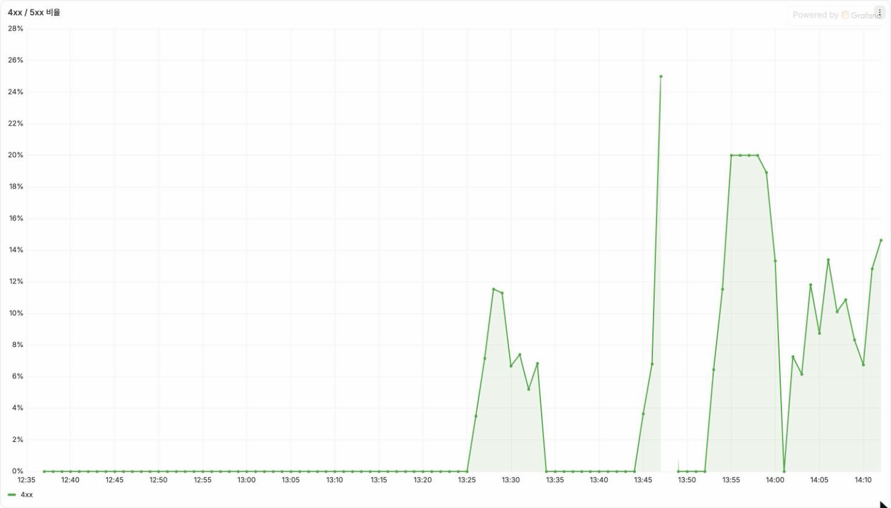
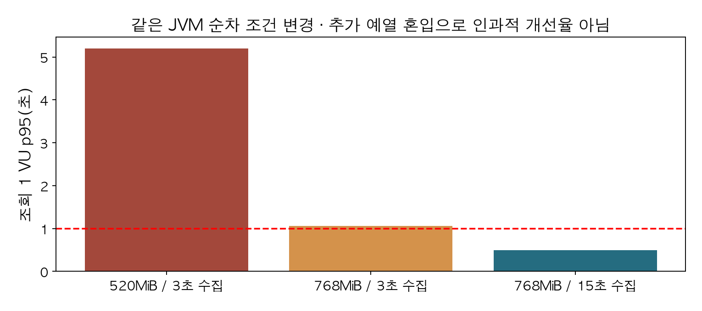
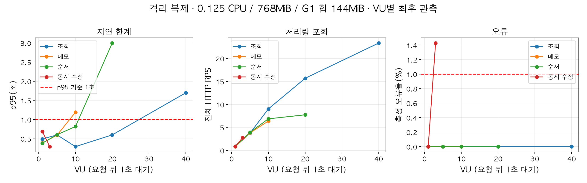
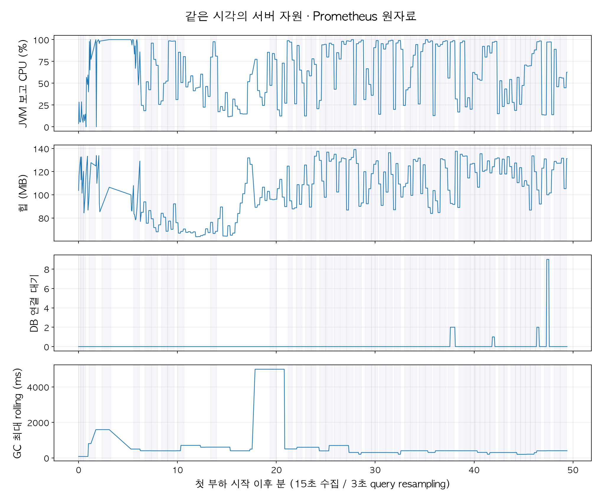
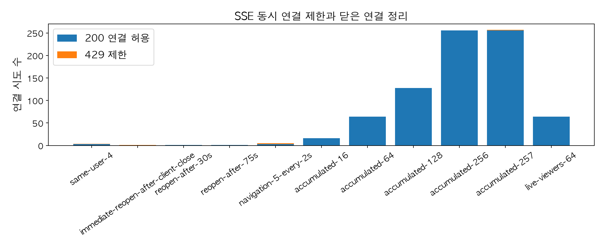
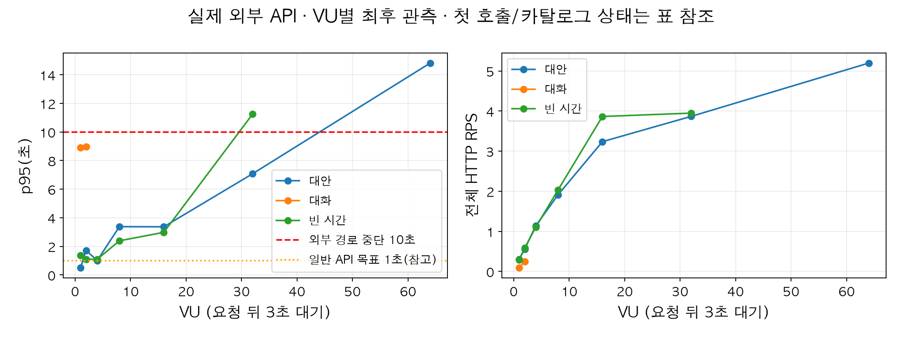

# v11 격리 복제 부하 테스트 — 2026-11-25

작업 이슈 [#534](https://github.com/Trovapp/trova-backend/issues/534). 기준 소스는 `origin/main`의 **fe29e23**, JAR 지문은 [환경 원본](raw/environment.json)에 있다. 구현 코드·운영 설정·운영 DB는 변경하지 않았고 배포·머지·운영 부하는 수행하지 않았다.

[PDF 보고서](load-test-report.pdf) · [개선안](improvements.md) · [검증·정리](validation.md) · [단계별 집계](stage-tables.md) · [원본 실행 목록](raw/runs.json) · [재현 도구](reproduce/compose.yml)

<!-- SUMMARY START -->
## 최종 결과 — 조건을 붙인 한계

실제 부하 기록은 KST 16:36:59~17:32:16다. 그 전 16:29부터 앱을 기동했다. 후기 일반 API는 앱 0.125 CPU·768MiB·G1 힙 144MiB·15초 수집 조건이다. 아래 ‘최고 통과 관측’은 단기 검사이며 장시간 안정 용량이 아니다.

| 경로 | 최고 통과 관측 (VU / RPS / p95) | 같은 VU의 반복 실패 (VU / RPS / p95) | 평가 오류율 | 먼저 확인된 제약 |
|---|---|---|---|---|
| 상세 GET | 20 / 15.70 / 0.599초 | 40 / 18.58→23.36 / 3.605→1.698초 | 0% | 앱 CPU 제한·대기. DB 자체 CPU는 여유 |
| 메모 PATCH | 5 / 3.81 / 0.593초 | 10 / 5.72→6.40 / 1.004→1.191초 | 0% | 앱 CPU 제한·대기. DB 자체 CPU는 여유 |
| 순서 PATCH | 10 / 6.88 / 0.818초 | 20 / 7.79→7.75 / 3.257→2.999초 | 0% | 앱 CPU 제한·대기. DB 자체 CPU는 여유 |

최초 5 VU·10 VU 실패가 재측정에서 통과한 구간도 있다. 최고 통과 관측을 “항상 이 인원까지 안정”으로 바꾸지 않는다. 처리량 최대를 끝까지 밀어 측정한 값이 아니라 p95 1초 목표를 반복해서 못 맞춘 단계다.

| 외부 경로 | 상승 허용 관측 | 중단 단계·상태 | 해석 |
|---|---|---|---|
| 대안 | 32 VU, 3.87 RPS, p95 7.08초 | 64 VU, 5.20 RPS, p95 14.82초, 전체 2/168 HTTP 429 | 10초 실험 기준 초과. 429는 누적 일일 앱 quota이며 Google 제공자 오류 아님 |
| 말로 바꾸기 | 1 VU, 0.097 RPS, p95 8.92초 | 2 VU, 0.249 RPS, p95 8.98초, 내용 실패 1/5 | Gemini 429/RESOURCE_EXHAUSTED. 모델별 무료 분당 15회 한도가 서버 자원보다 먼저 확인됨 |
| 빈 시간 | 16 VU, 3.86 RPS, p95 2.98초 | 32 VU, 3.95 RPS, p95 11.25초, 오류 0% | 1~4개 빈 시간 혼합 데이터. 같은 빈 시간 수에서 VU만 바꾼 상한으로 해석 금지 |

**외부 표의 상승 기준은 10초이며 일반 API 목표 1초와 다르다.** “대안 32 VU 통과”는 좋은 사용자 경험을 뜻하지 않는다. 대화는 1 VU부터 일반 API의 1초 목표를 넘는다.

**외부 사용량:** Places **1,021회 / 2,000회 이하**, Gemini 실제 HTTP 시도 **35회**(배치 7회·단일 임베딩 5회·대화 생성 23회, 그중 한도 실패 1회). Gemini 지표 108단위는 배치 입력 80문장을 중복 계산하므로 108회 HTTP라고 쓰지 않는다. 카카오는 별도 의존성 검사 완료 1회와 전송 여부 미확정 0~1회를 구분한다.

Gemini 최초 한도 로그는 KST **17:26:15.951**, `gemini-3.5-flash-lite`, `GenerateRequestsPerMinutePerProjectPerModel-FreeTier`, 응답 `quotaValue=15`, 재시도 안내 약 43초였다. 이 경로는 이후 재시도하지 않았다. 직전 두 단계 약 53초 구간에 대화 생성 완료 기록 15회(실패 포함)가 있었고, 중단 뒤 in-flight 완료 2회가 최종 합계에 추가됐다. 완료 시점 집계와 제공자의 분 경계·프로젝트 전체 사용량은 다르다. 2 VU 단계의 완료 5개 응답은 전부 HTTP 200인데 1개가 fallback이므로 HTTP 5xx만으로는 이 한도를 발견하지 못한다.

정상 공동 편집은 **멤버 10명 공유 여행의 SSE 10개 + 개인 여행 SSE 54개 = 전체 64개**다. 작성자 1 VU는 0.889 RPS·p95 0.689초·오류 0%, 작성자 3 VU는 2.783 RPS·p95 0.294초였다. 평가 구간은 1/70=1.43%, 전체 구간은 5/100=5%의 HTTP 409 충돌이며 5xx는 없었다. 버전 조건 헤더 없는 동시 PATCH이고 충돌 시 자동 재시도하지 않았다. 시간·예열·GC 상태가 달라 3 VU가 1 VU보다 빠르다는 개선율을 주장하지 않는다. 개별 changed 이벤트의 도착 시간·버전 정합은 계측하지 않았으며, 여기서는 연결 admission과 쓰기·충돌만 검증했다.

**합성 데이터 보정:** 초기 공유 여행 64명은 `TripMembershipService.java:46`의 정상 참여 상한 10명을 넘은 인위적 스트레스 조건이었다. 그 쓰기 결과는 `domain-stress-64-members`로 보존하고 위 정상 정책 결과와 분리했다. 초기 64인 조건의 1 VU p95 1.10초·3 VU 평가 오류 11.11%를 제품의 정상 용량으로 쓰지 않는다. 초기 seed와 실제 보정 이력은 별도로 기록했다.

**빈 시간 데이터의 한계:** 순서 PATCH가 방문 시간을 다시 맞춘 뒤 외부 후기 검사에 들어가, 사용자 1~20은 30분 초과 내부 공백 없이 마지막 일정 뒤 한 구간, 21~32는 원래 네 구간이 남았다. 따라서 16→32 VU에는 요청당 외부 호출 수 변화가 섞였다. 초기 4구간 고정의 1·2 VU 원본과 후기 1~4구간 혼합 원본을 구분하며, 고정 4구간의 최대 VU는 이번 결과로 확정하지 않는다.

로컬 Grafana는 기동했으나 Headless Chrome이 DevTools 포트를 만들지 못해 새 UI 캡처는 남기지 못했다. 저장한 Prometheus JSON과 생성한 PNG를 본 측정의 시각 자료로 쓴다. 아래 운영 Grafana 캡처는 **앞선 v11 재측정 12:35~14:12 KST의 참고 자료**이며 이번 부하의 캡처가 아니다.

<!-- SUMMARY END -->

## 먼저 구분할 결과

SSE는 **256개를 유지한 상태에서 257번째 연결이 429**였다. 사용자당 기본 상한은 3개다. 2초마다 화면 이동처럼 연결을 열고 닫으면 5번 중 2번이 429였고, 클라이언트에서 닫은 직후에도 서버 슬롯이 바로 해제되지 않았다. 30초 재시도는 검사에 따라 200 또는 429, 75초 재시도는 200이었다. 운영의 SSE 429 51건에 대한 재현 가능한 원인 후보이며, 당시 운영의 활성 슬롯 기록이 없어 51건 전부의 원인을 확정하지는 않는다.

**520MiB·0.125 CPU 조건은 기동·관측 부담에 매우 민감했다.** 기동부터 3초마다 Prometheus를 수집한 초기 검사에서는 조회 1 VU p95 7.91초, 첫 메모 수정 p95 24.27초·오류 50%가 나왔다. OOM 1회도 있었지만 그 순간 앱 컨테이너에 진단용 Python을 추가 실행했으므로 사용자 부하만으로 생긴 OOM이라고 주장하지 않는다. 별도로 예열 후 같은 520MiB에서 조회 1 VU p95 5.20초·메모 1 VU 시간 초과를 확인했다.

같은 JVM에서 CPU·힙을 유지하고 메모리 상한만 768MiB로 늘린 조회 1 VU는 p95 1.06초, 이어 수집 주기만 15초로 바꾼 1 VU는 p95 0.49초였다. 순차 검사라 추가 예열과 시간 경과가 섞였다. 이 숫자를 메모리 증설이나 수집 간격의 인과적 개선율로 표현하지 않는다. 이후 본 측정은 768MiB·0.125 CPU·15초 수집 조건이다.

## 환경과 데이터

| 항목 | 설정·관측 |
|---|---|
| Mac/Docker | Mac ARM, Docker 29.1.3, VM 10 CPU·약 7.65GiB RAM; 개별 작업 컨테이너에 CPU·메모리 상한 적용 |
| 앱 초기 조건 | 0.125 CPU, 520MiB RAM·동일 swap 상한(추가 swap 없음), `-Xmx144m -XX:+UseG1GC -XX:ActiveProcessorCount=2` |
| 앱 본 측정 | **0.125 CPU, 768MiB RAM**, 힙·GC 옵션은 동일; 520MiB 결과와 섞지 않음 |
| 기동·예열 | 두 번째 기동과 12초씩 경로 예열만 1 CPU, 측정 전 0.125로 복원. 최초 기동은 0.125 CPU로 약 7분 |
| PostgreSQL | pgvector 0.8.1 / PostgreSQL 17, 0.75 CPU·768MiB. 운영 덤프 없이 합성 데이터만 사용 |
| Kafka | Apache Kafka 3.9.1 단일 broker/controller, 0.75 CPU·768MiB·힙 256MiB; 공유/여행 이벤트 모두 Kafka 경로 |
| Prometheus | v3.0.1, 0.25 CPU·256MiB; 초기 3초, 본 측정 15초 수집 |
| 로컬 Grafana | 11.4.0, 0.125 CPU·384MiB; 운영 Grafana와 분리한 로컬 대시보드 |
| k6 | 이미지 지문 고정 기록, 1 CPU·512MiB; 매 단계 자체 CPU·메모리 관측 |
| SSE 발생기 | Python asyncio, 1 CPU·256MiB; 응답을 계속 읽어 발생기 수신 정지로 인한 가짜 backpressure 방지 |
| 작업 합계 | k6와 SSE 발생기 동시 실행을 포함해 **최대 4 CPU·3,712MiB**. 카카오 128MiB 의존성 검사는 이 동시 구간 밖에서 실행 |
| 접근 제한 | 앱·Prometheus·Grafana는 Mac의 127.0.0.1 포트만 공개, DB·Kafka 외부 포트 없음; 외부 API 사용을 위한 앱 egress 허용 |
| 정책 | 격리 IP 제한만 0으로 설정. 사용자 SSE 3·전체 256·장소 일일 100 한도는 유지 |
| 합성 데이터 | 사용자 300명, 개인 여행 300개와 공유 여행 1개(최종 멤버 10명, 초기 64명 스트레스는 별도 보존), 일차 301개·여행 장소 1,204개. 실제 사용자 데이터·운영 DB 덤프 없음 |
| 여행 구성 | 개인 여행마다 당일 4곳; 서울 중심 합성 장소 이름·좌표. 사용자 299는 외부 호출 없는 일일 한도 검증용 |

**운영 용량으로 직접 환산할 수 없다.** 로컬 DB RTT는 운영 관리형 DB의 과거 약 31.5ms와 다르고 네트워크 지연을 주입하지 않았다. CPU 제한도 운영의 같은 약한 부하로 보정하지 않았다. 관리형 DB·네트워크·클라우드 steal·장시간 swap을 재현한 실험이 아니라, 지정된 작은 JVM과 제한 자원에서 드러나는 병목·정책 한계 검사다. ARM Mac의 로컬 결과를 “운영 동시 사용자 N명”으로 표현하지 않는다.

## 시나리오와 판정

| 경로 | 부하·검증 |
|---|---|
| 상세 GET | `/api/trips/{id}`. 서로 다른 합성 사용자·개인 여행, 반환 ID 확인 |
| 메모 PATCH | `/api/trip-places/{id}/details`. 서로 다른 개인 여행의 메모를 매번 변경 |
| 순서 PATCH | `/api/trip-places/{id}/order`. UP/DOWN을 번갈아 실행, 합성 일차 4곳의 순서·시간 조정 포함 |
| 같이 고치기 | 멤버 10명의 공유 여행 301에 SSE 10개, 다른 개인 여행에 SSE 54개를 유지하고 공유 장소 메모를 동시 수정; HTTP 충돌과 서버 지연 분리 |
| SSE 정책 | 사용자당 4개·빠른 재진입·닫힘 뒤 재시도, 별도 사용자로 누적 16→64→128→256→257 연결. 누적 검사에서는 앞 연결을 유지 |
| 대안 찾기 | `/api/trip-places/{id}/alternatives`, 실제 Google Places와 필요한 Gemini 임베딩. 빈 후보도 성공이라고 세지 않음 |
| 말로 바꾸기 | 새 합성 대화 세션에 “근처 박물관 대안을 찾아줘”. Gemini 모델 응답·도구 실행 포함, HTTP 200 fallback도 내용 실패로 집계 |
| 빈 시간 추천 | `/api/trips/{id}/days/1/gap-recommendations`. 초기 1·2 VU는 복구한 일정의 빈 시간 4개, 후기 검사는 순서 변경 뒤 남은 1~4개 구간. 후보와 실제 외부 호출 수를 구분 |
| 혼합 1회 | 5 VU·35초. 상세 65%·메모 15%·순서 10%·대안 5%·빈 시간 5%는 추정 비율이며 실제 트래픽 분석 결과가 아님 |

일반 경로는 1→5→10→20→40→80→160 VU 후보를 단계적으로 올린다. 단계 35초, 요청 뒤 1초 대기, 첫 10초에 **시작한** 요청은 지연·오류 평가에서 제외한다. RPS는 k6 전체 실행 구간(예열 포함), p50/p95/p99·오류율은 평가 구간이므로 분모가 다르다. 본 측정 첫 실패 뒤 1 VU 회복을 기록하고, 예열 변동이 확인돼 후기 검사에서 실패 단계를 같은 VU로 다시 확인한다. 1 VU부터 목표를 못 맞추면 처리량 최대값이 아니라 “그 조건에서 목표 미달”로 해석한다.

외부 경로는 1→2→4→8→16→32 VU, 통과한 대안 경로는 64 VU까지 확장, 단계 25초·요청 뒤 3초 대기, 모든 요청 평가다. **p95 1초**는 일반 API 목표이며 AI 경로의 판정 기준과 구분한다. 외부 경로는 p95 10초 또는 내용 포함 오류 1% 이상이면 해당 경로 상승을 멈춘다. AI는 낮은 VU부터 1초를 넘을 수 있어 일반 API 목표와 똑같은 “최대 사용자 수”를 계산하지 않는다.

모든 수치는 closed model의 요청·대기 반복 VU다. 쉬지 않고 요청하는 사용자, 한 순간의 in-flight 수, 가입자 수와 같지 않다. SSE 표의 지연은 연결 수명이 아니라 첫 `ready` 이벤트까지의 **연결 설정 시간**이다.

## 안전장치와 외부 API 사용

키는 지정된 비공개 파일을 Compose `env_file`로만 앱/격리 의존성 컨테이너에 전달했다. 값은 출력·로그·레포 복사·커밋하지 않는다. 키 파일 경로는 `/private/tmp/claude-501/-Users-gimtaehyeong-orca-taeng-agent-manager/93d69a51-105f-4d3f-8331-3d49c93b1a04/scratchpad/loadtest-keys/external-api.env`이며 **지우지 않았다. 매니저가 삭제한다.**

Places는 격리 `api_call_logs`를 외부 경로 실행 중 계속 합산한다. 시작 전에 1,200회 이상이면 실행을 거부하고, 1,500회에 중단해 2,000회 상한까지 최소 500회 여유를 둔다. 낮은 VU·짧은 단계·관측 실패 중단도 적용한다. Gemini `RESOURCE_EXHAUSTED`/429를 로그에서 감시해 해당 경로를 멈추고, in-flight 완료분까지 최종 합산한다. 외부 API 없는 경로는 기존 애플리케이션 카운터가 0임을 확인한다. 영상 분석·운영 외부 API 부하는 수행하지 않았다.

카카오 키는 영상 분석의 지오코딩 경로에서 쓰이므로 위 세 추천 경로의 카카오 호출을 만들어 내지 않았다. 별도 **격리 컨테이너에서 실제 키워드 검색 의존성 검사 1회**가 200·174.85ms·장소 1건으로 완료됐다. 이것은 앱 사용자 경로의 부하 결과가 아니다. 앞선 앱 내부 진단은 OOM으로 중단돼 카카오 요청이 실제 전송됐는지 확정할 수 없다. 따라서 카카오는 완료 1회와 추가 최대 1회 미확정 시도를 구분한다.

## 429 원인과 관측 함정

- **SSE:** `events/TripStreams.java:26` 기본 사용자 3·전체 256, `:44`에서 초과 시 429. `events/TripStream.java:62`는 다음 이벤트를 기다리고, `:65`의 쓰기 오류 또는 완료 callback 뒤 `:81`에서 슬롯을 돌려준다. `events/TripStreams.java:96` heartbeat는 25초다. 클라이언트 닫힘이 다음 쓰기 때 드러나면 슬롯 해제가 지연될 수 있다. 같은 검사에서도 30초 재시도 결과가 달라 고정 30초 TTL로 해석하지 않는다.
- **빈 시간:** `controller/TripController.java:595`는 요청마다 `consumePlaceCall`을 호출한다. `service/DailyQuotaService.java:92`는 대안 찾기와 공유하는 한국 날짜별 100회 카운터이고 `:98`에서 429가 난다. 빈 시간 없는 합성 여행의 1~100번째 200·101번째 429와 외부 API 증분 0을 별도로 검증한다. 운영 19건의 개별 quota 상태는 없어 원인 후보와 운영 확정을 구분한다.
- **SSE와 p95:** 장기 연결의 완료 시간은 일반 API 응답 지연과 다르다. 오늘 운영 재측정의 HighHttpLatencyP95가 SSE를 포함하는 문제는 그대로 남아 있으며 경보 규칙은 변경하지 않았다. 이번 k6 일반 API p95에 SSE 수명을 넣지 않는다.
- **수집 자체의 부하:** 3초 수집 시 응답 약 510KB·2,509개 시리즈, 일부 `/actuator/prometheus` IOException·시간 초과가 있었다. 그 시각 스레드 덤프에서 여러 Tomcat 스레드가 Prometheus 인코딩·Micrometer 수집·`HostProcMetrics` 문자열 파싱을 실행 중이었다. DB는 별도 조회에서 10개 연결 모두 idle이었다. 15초 수집으로 바꾼 이유이며, 이를 전부 앱 경로의 비용으로 설명하지 않는다.

## 재현과 원본

[Compose](reproduce/compose.yml) · [Dockerfile](reproduce/Dockerfile) · [합성 seed/EXPLAIN](reproduce/seed.sql) · [k6](reproduce/load.js) · [감독기](reproduce/run.py) · [SSE](reproduce/sse.py) · [수집기](reproduce/collect.py) · [차트](../scripts/plot_load_test.py) · [PDF 생성기](../scripts/pdf_load_test.py).

현재 Compose 기본은 본 측정의 768MiB·0.125 CPU·15초 수집이다. 최초 520MiB 실험은 `APP_MEMORY=520m`, 초기 3초 수집 설정과 `raw/520MiB-*`, `raw/runs-520MiB.json`에 보존했다. 실행 이력의 실패·관측 중단·오염 구간을 삭제해 좋은 결과만 남기지 않았다. 정상 멤버 정책을 반영한 현재 seed는 10명이며, 처음 64명을 넣었던 변형과 보정 시각은 raw/membership-policy-correction.json으로 보존했다.

재실행은 별도의 격리 체크아웃에서 수행한다. 현재 도구는 이 검사 폴더의 `raw/`를 사용한다. 별도 체크아웃에서 원본 raw를 다른 이름으로 보관하고 빈 raw 디렉터리를 준비해야 한다. `./gradlew --no-daemon --max-workers=2 bootJar` → `APP_CPUS=1 docker compose -p trova-loadtest-534 -f docs/monitoring/2026-11-25-load-test/reproduce/compose.yml --profile visual up -d --build` → health/Prometheus UP 확인 → 비어 있는 복제 DB에 `seed.sql` → `run_primary.py` 순서다. 이 도구가 예열·단계별 부하·동시 수정·외부 한도 검사·후기 확인·원자료 수집·Docker 정리와 전체 빌드를 차례로 호출한다. 차트와 PDF는 저장된 원자료만 읽는다. 재실행 전 완료 marker 파일은 새 출력에서 제거한다. 앱 기동 CPU 1은 예열 후 도구가 0.125로 돌리며, 각 단계 `app_cpu_nanos_memory_bytes`와 최종 inspect로 확인한다.

k6 JSON 요약·관측 지표 전/후 gzip·Prometheus query_range JSON·cgroup·SSE 개별 admission JSON·GC 로그·마스킹 앱 로그를 보관한다. Prometheus 본 수집 간격은 15초이므로 짧은 CPU/DB 순간 최대값은 놓칠 수 있다. GC 단계 최대는 rolling Prometheus maximum 대신 시각이 일치하는 GC 로그에서 집계한다. cgroup CPU는 누적 차이와 단계 벽시계로 근사한 실제 사용 코어이며 snapshot 경계 오차로 상한 0.125를 약간 넘는 근사가 나올 수 있다. Docker의 실제 제한은 단계별 inspect 값으로 확인했다. 로컬 DB 연결 지표만으로 관리형 운영 DB를 판단하지 않는다.

운영 B는 생략했다. A에서 정책 제한·자원 민감도·실제 외부 API 경로를 조사했고, Windows의 운영 측정과 겹칠 위험 및 운영 p95/외부 API 없는 약한 부하만으로 추가로 확인할 수 있는 범위가 제한적이기 때문이다. 작업자는 SSH·운영 토큰·에뮬레이터를 사용하지 않았다. 장시간 안정성, 장애 복구, 여러 앱 인스턴스 사이 Kafka 전파, 운영과 같은 DB RTT, 사용자 트래픽 비율·최대 가입자 수는 이번 결론 범위에 포함하지 않는다.

<!-- RESULTS START -->
## 원인 분해 — 후기 반복 실패 시각

| 단계 | 앱 실제 CPU 코어 (상한 0.125) | throttled 기간 % | DB CPU 코어 (상한 0.75) | 힙 최대 MiB | GC pause 최대 ms | DB active / pending 관측 최대 |
|---|---:|---:|---:|---:|---:|---|
| late-detail-40-27 | 0.122 | 97.5 | 0.035 | 132.27 | 1200.92 | 7 / 0 |
| confirm-late-detail-40-28 | 0.122 | 99.2 | 0.035 | 139.14 | 401.24 | 4 / 0 |
| late-memo-10-33 | 0.117 | 96.0 | 0.033 | 136.34 | 1100.07 | 5 / 0 |
| confirm-late-memo-10-34 | 0.129 | 99.5 | 0.037 | 127.05 | 203.83 | 6 / 0 |
| late-order-20-41 | 0.123 | 99.5 | 0.047 | 131.16 | 701.97 | 9 / 0 |
| confirm-late-order-20-42 | 0.126 | 99.2 | 0.049 | 103.96 | 708.63 | 10 / 2 |

앱 CPU는 후기 조회 40 VU에서 약 0.122 코어를 쓰고 cgroup 기간의 약 97~99%가 throttled였다. DB 자체 CPU가 여유인 상태에서 작은 앱 CPU의 요청 처리·GC·지표 수집이 먼저 경쟁한다. DB pool 대기가 관측되더라도 원격 DB 자체가 포화됐다는 증거로 바꾸지 않는다. 대화 2 VU는 반대로 제공자가 명시한 모델 quota가 직접 증거다.

GC 로그는 pause 종류·시각과 slow request를 대조했다. [느린 요청과 GC 겹침 원본](raw/slow-request-gc-overlap.json)과 [마스킹 스레드 덤프](raw/thread-dump-scrape3s.log.gz)를 보관한다. 덤프는 3초 수집 조건에서 얻었으며 후기 40 VU 순간의 덤프라고 주장하지 않는다. Tomcat busy gauge는 제공되지 않아 JVM 전체 live thread 수로 대체하지 않는다. 힙 외 메모리의 항목별 분해(NMT)는 수행하지 않았다.

k6는 1 CPU·512MiB 상한이며 저장된 표본의 최대 CPU는 6.60%/1코어였다. 모든 단계의 발생기 표본을 runs.json에 보관했고 SSE 발생기는 별도 1 CPU·256MiB로 제한했다. constant-VU는 고정 도착률 실행기가 아니므로 dropped-iterations를 계획된 트래픽 손실 지표로 쓰지 않는다. CPU 여유와 실제 반복 완료·연결 admission을 함께 확인했다.

# 저장 자료 집계

| 경로·VU | RPS | p50/p95/p99 ms | 오류 % | 힙 최대 MiB | GC 최대 ms | DB active/pending 최대 | 외부 Places 증분 |
|---|---:|---|---:|---:|---:|---|---:|
| detail 1VU (detail-1-8) | 0.84 | 192.48 / 494.13 / 579.43 | 0.00 | 93.90 | 397.91 | 0/0 | 0 |
| detail 5VU (detail-5-9) | 3.89 | 92.47 / 1910.03 / 2407.07 | 0.00 | 79.26 | 1998.52 | 0/0 | 0 |
| memo 1VU (memo-1-11) | 0.79 | 200.58 / 723.11 / 939.16 | 0.00 | 84.03 | 398.19 | 0/0 | 0 |
| memo 5VU (memo-5-12) | 2.67 | 800.78 / 1500.56 / 1767.23 | 0.00 | 92.17 | 400.87 | 2/0 | 0 |
| order 1VU (order-1-14) | 0.67 | 204.74 / 1596.88 / 1920.40 | 0.00 | 75.88 | 1598.44 | 1/0 | 0 |
| detail 5VU (confirm-detail-5-idle-sse) | 3.76 | 100.63 / 598.81 / 982.63 | 0.00 | 76.21 | 1704.62 | 0/0 | 0 |
| alternatives 1VU (alternatives-1-19) | 0.08 | 10327.67 / 18359.24 / 19073.16 | 0.00 | 124.77 | 399.07 | 1/0 | 2 |
| conversation 1VU (conversation-1-20) | 0.09 | 10149.04 / 10616.80 / 10658.38 | 0.00 | 108.76 | 100.66 | 0/0 | 3 |
| gap 1VU (gap-1-21) | 0.12 | 4595.19 / 9672.74 / 10050.53 | 0.00 | 125.74 | 1204.27 | 0/0 | 16 |
| gap 2VU (gap-2-22) | 0.37 | 1894.22 / 3011.50 / 3318.45 | 0.00 | 133.38 | 392.61 | 0/0 | 44 |
| mixed 5VU (mixed-5-23) | 3.29 | 189.83 / 1696.64 / 2293.92 | 0.00 | 129.72 | 1702.33 | 3/0 | 22 |
| detail 10VU (late-detail-10-24) | 7.55 | 184.21 / 1448.82 / 2200.55 | 0.00 | 136.84 | 1602.59 | 1/0 | 0 |
| detail 10VU (confirm-late-detail-10-25) | 9.03 | 91.76 / 293.65 / 647.91 | 0.00 | 135.04 | 205.44 | 1/0 | 0 |
| detail 20VU (late-detail-20-26) | 15.70 | 197.65 / 599.50 / 897.77 | 0.00 | 131.81 | 201.28 | 1/0 | 0 |
| detail 40VU (late-detail-40-27) | 18.58 | 996.51 / 3604.62 / 4784.25 | 0.00 | 132.27 | 1200.92 | 7/0 | 0 |
| detail 40VU (confirm-late-detail-40-28) | 23.36 | 595.33 / 1697.94 / 2209.14 | 0.00 | 139.14 | 401.24 | 4/0 | 0 |
| memo 1VU (late-memo-1-30) | 0.84 | 150.11 / 388.93 / 557.69 | 0.00 | 120.00 | 199.40 | 0/0 | 0 |
| memo 5VU (late-memo-5-31) | 3.01 | 596.04 / 2519.29 / 2996.61 | 0.00 | 129.40 | 1701.53 | 3/0 | 0 |
| memo 5VU (confirm-late-memo-5-32) | 3.81 | 200.02 / 592.52 / 901.15 | 0.00 | 119.78 | 205.90 | 0/0 | 0 |
| memo 10VU (late-memo-10-33) | 5.72 | 500.46 / 1003.60 / 1201.26 | 0.00 | 136.34 | 1100.07 | 5/0 | 0 |
| memo 10VU (confirm-late-memo-10-34) | 6.40 | 499.80 / 1191.14 / 1296.05 | 0.00 | 127.05 | 203.83 | 6/0 | 0 |
| order 1VU (late-order-1-36) | 0.88 | 97.09 / 383.60 / 394.12 | 0.00 | 124.98 | 0.00 | 0/0 | 0 |
| order 5VU (late-order-5-37) | 3.56 | 296.68 / 1853.23 / 3406.57 | 0.00 | 130.52 | 1999.95 | 2/0 | 0 |
| order 5VU (confirm-late-order-5-38) | 3.92 | 196.08 / 604.91 / 992.67 | 0.00 | 131.66 | 304.24 | 1/0 | 0 |
| order 10VU (late-order-10-39) | 6.16 | 497.26 / 1495.50 / 1745.47 | 0.00 | 105.77 | 493.98 | 10/0 | 0 |
| order 10VU (confirm-late-order-10-40) | 6.88 | 393.96 / 818.17 / 1096.66 | 0.00 | 103.69 | 496.96 | 1/0 | 0 |
| order 20VU (late-order-20-41) | 7.79 | 1396.62 / 3257.32 / 4144.60 | 0.00 | 131.16 | 701.97 | 9/0 | 0 |
| order 20VU (confirm-late-order-20-42) | 7.75 | 1501.81 / 2998.74 / 3700.60 | 0.00 | 103.96 | 708.63 | 10/2 | 0 |
| alternatives 1VU (warm-external-alternatives-1-45) | 0.31 | 241.87 / 515.73 / 608.35 | 0.00 | 133.54 | 0.00 | 0/0 | 8 |
| alternatives 2VU (warm-external-alternatives-2-46) | 0.56 | 196.66 / 1713.28 / 3113.99 | 0.00 | 127.14 | 1899.81 | 0/0 | 15 |
| alternatives 4VU (warm-external-alternatives-4-47) | 1.14 | 299.75 / 1005.33 / 1061.71 | 0.00 | 119.25 | 198.40 | 0/0 | 32 |
| alternatives 8VU (warm-external-alternatives-8-48) | 1.91 | 298.87 / 3376.46 / 3674.95 | 0.00 | 135.50 | 1599.00 | 2/0 | 54 |
| alternatives 16VU (warm-external-alternatives-16-49) | 3.24 | 1548.62 / 3365.28 / 5000.08 | 0.00 | 129.33 | 999.90 | 3/0 | 94 |
| alternatives 32VU (warm-external-alternatives-32-50) | 3.87 | 4498.03 / 7075.44 / 8758.26 | 0.00 | 131.04 | 601.64 | 9/1 | 119 |
| conversation 1VU (warm-external-conversation-1-51) | 0.10 | 6635.14 / 8918.76 / 9121.75 | 0.00 | 131.85 | 0.00 | 0/0 | 3 |
| conversation 2VU (warm-external-conversation-2-52) | 0.25 | 3462.04 / 8982.75 / 9181.87 | 20.00 | 132.97 | 0.00 | 0/0 | 4 |
| gap 1VU (warm-external-gap-1-53) | 0.29 | 172.11 / 1373.36 / 1758.17 | 0.00 | 127.48 | 99.14 | 0/0 | 8 |
| gap 2VU (warm-external-gap-2-54) | 0.58 | 296.97 / 1089.57 / 1302.19 | 0.00 | 127.48 | 0.00 | 0/0 | 16 |
| gap 4VU (warm-external-gap-4-55) | 1.11 | 302.87 / 1093.11 / 1448.57 | 0.00 | 123.48 | 1998.36 | 0/0 | 31 |
| gap 8VU (warm-external-gap-8-56) | 2.03 | 494.09 / 2386.31 / 2511.90 | 0.00 | 112.21 | 601.72 | 2/0 | 57 |
| gap 16VU (warm-external-gap-16-57) | 3.86 | 578.28 / 2979.14 / 3223.34 | 0.00 | 133.63 | 694.35 | 2/0 | 113 |
| gap 32VU (warm-external-gap-32-58) | 3.95 | 3244.27 / 11246.23 / 12367.57 | 0.00 | 119.96 | 793.59 | 8/2 | 213 |
| alternatives 64VU (upper-alternatives-64-59) | 5.20 | 7401.16 / 14816.46 / 17089.95 | 1.19 | 131.02 | 903.63 | 9/9 | 166 |
| live 1VU (live-valid-members10-vu1) | 0.89 | 12.60 / 689.22 / 1323.79 | 0.00 | 128.87 | 2001.97 | 1/0 | 0 |
| live 3VU (live-valid-members10-vu3) | 2.78 | 9.63 / 294.21 / 410.53 | 1.43 | 131.59 | 299.57 | 0/0 | 0 |

<!-- RESULTS END -->
