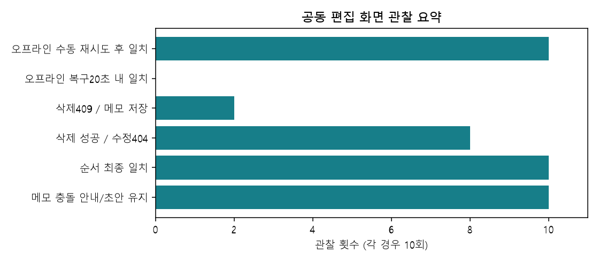
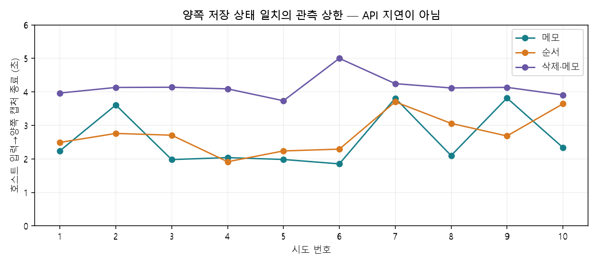
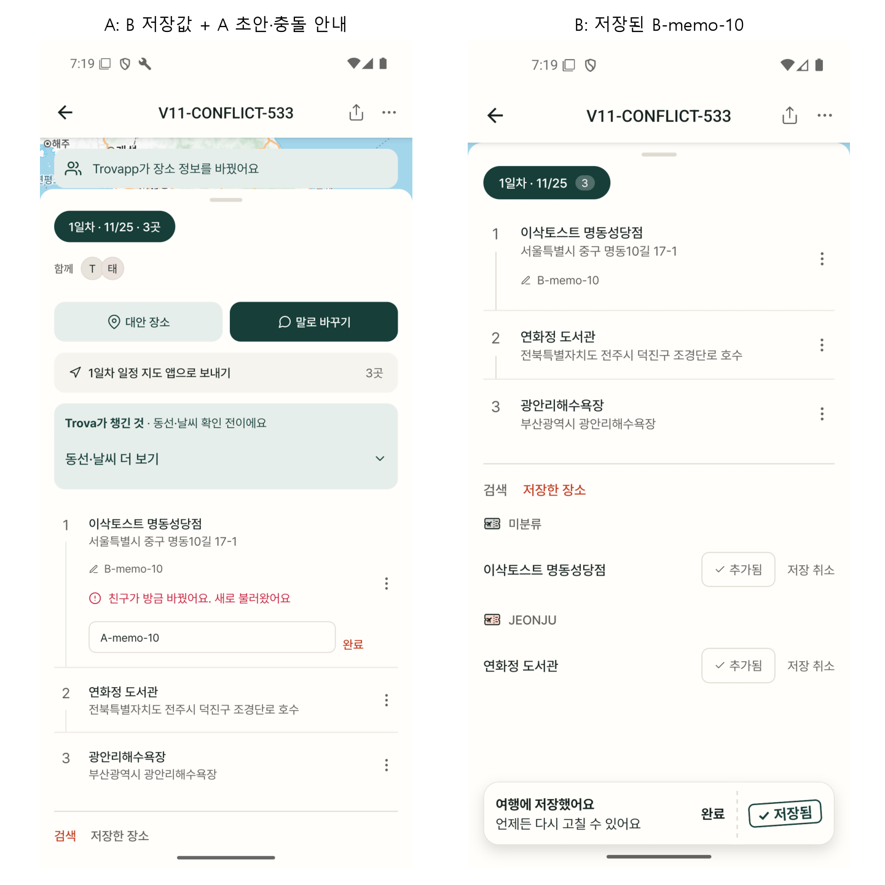
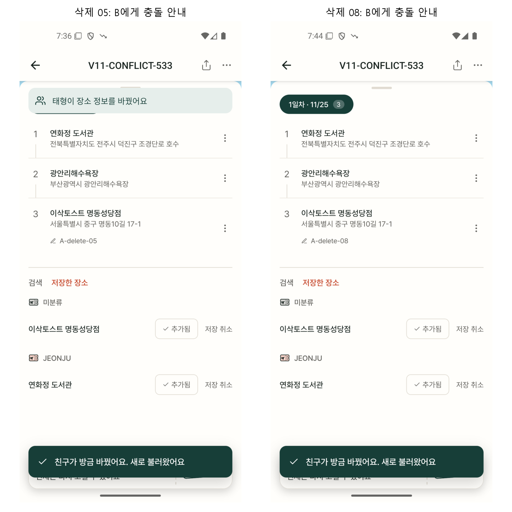
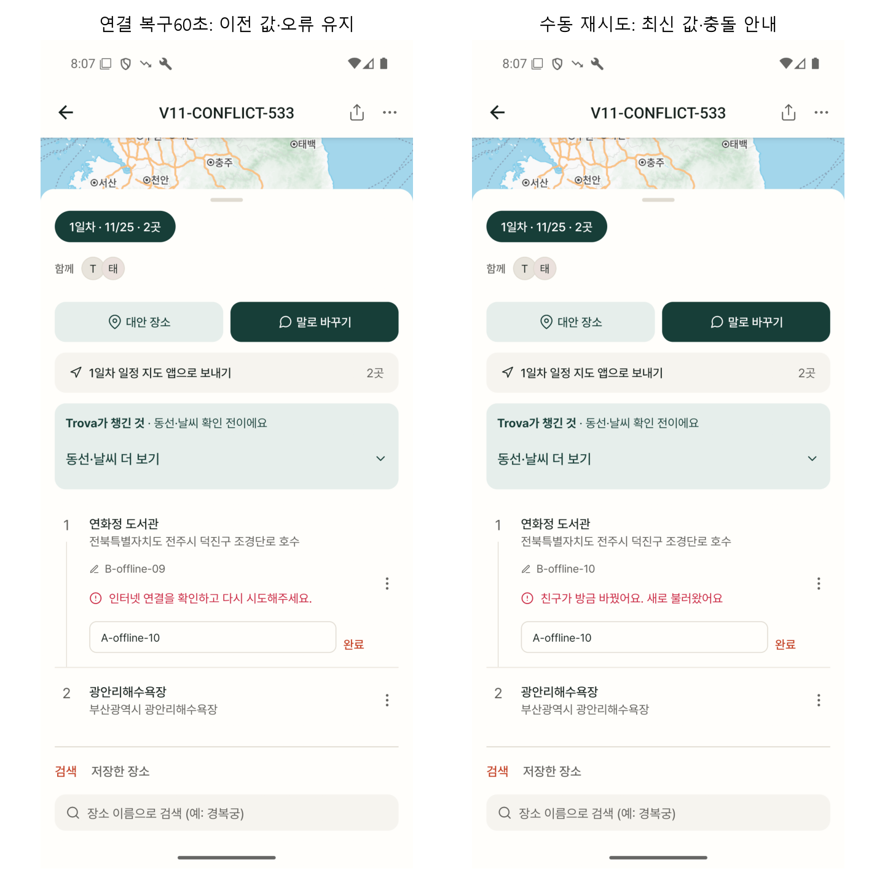
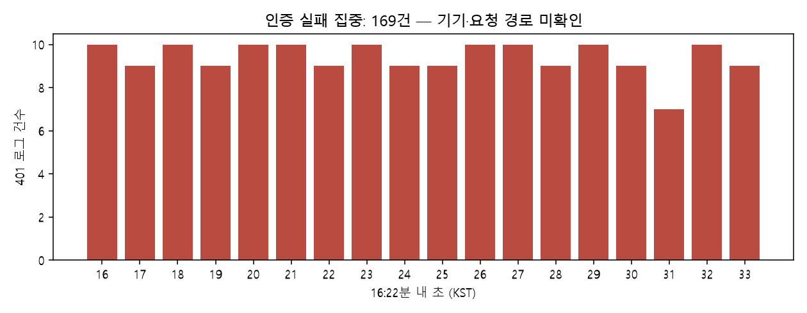
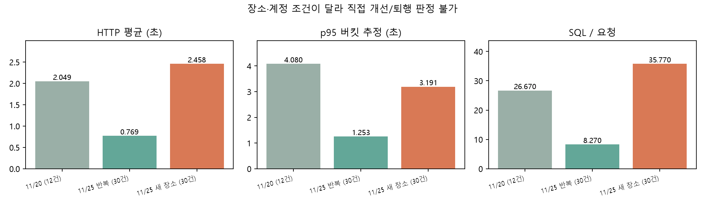
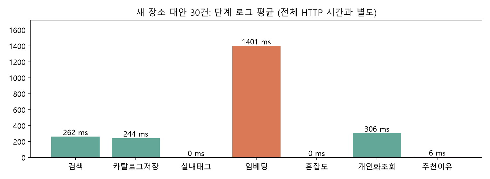
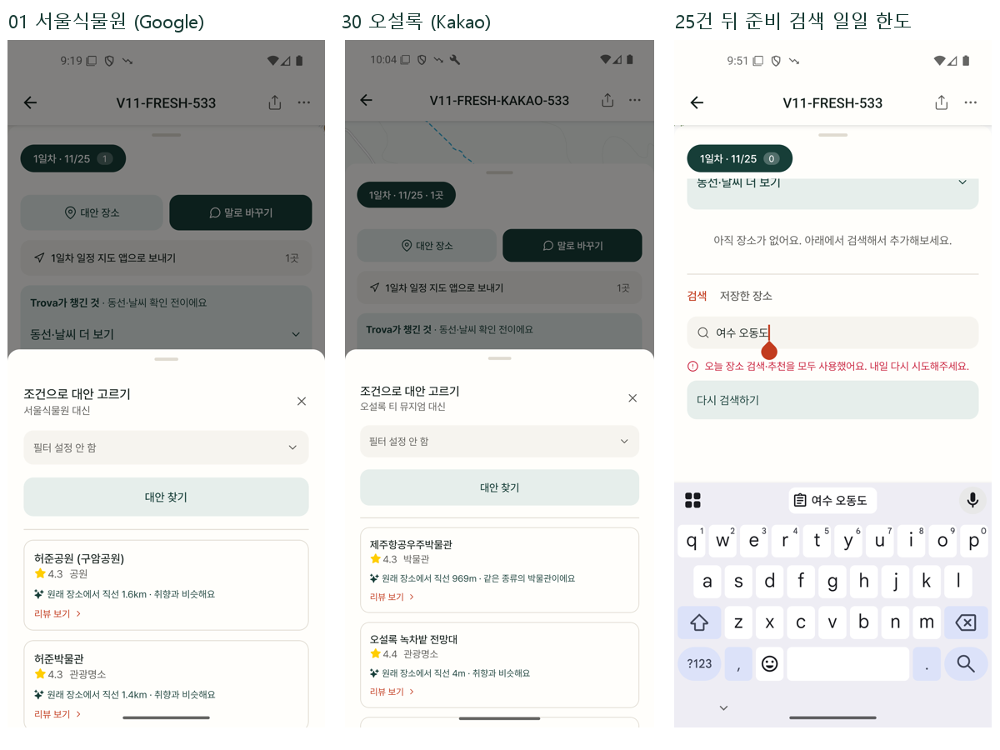

# v11 후속 측정 — 새 대안과 공동 편집 충돌

**공동 편집 40회와 새 장소 대안 30건 완료.** 이슈 #533, 기준 백엔드 `ef5bbb3`(origin/main), 서버 자료 `50699bd`. 앱·운영 코드나 설정을 고치지 않았다. 시험용 여행 데이터만 정상 앱 기능으로 만들고 삭제했다.

메모·순서 충돌과 삭제 대 수정에서는 저장 상태가 양쪽에서 일치했고 충돌 안내를 확인했다. 오프라인 복구에서는 10/10회가 20초 내 자동 수렴하지 않았고, 마지막 1회는 60초까지 이전 값이 남았다. 수동 저장 재시도 후에는 10/10회 최신 값과 충돌 안내가 나타났다. 401 집중 169건은 발견했으나 발생 클라이언트는 확인하지 못했다.

- [PDF 보고서](v11-followup-report.pdf)
- [40회 입력 시각·결과·수렴 관측 표](conflict-results.md), [구조화 결과](trial-results.json)
- [서버 집계·journal·Prometheus](server/README.md), [현장 기록과 준비 오류](field-notes.md)

## 조건

- Windows Android emulator-5584(카카오, A), emulator-5586(구글, B). 두 앱 모두 versionCode/versionName 11.
- 15:54 KST 두 기기 전면 앱 Trova 확인, 확인한 호스트 python/node 프로세스에 다른 테스트 자동화 징후 없음.
- 테스트 여행 `V11-CONFLICT-533`: B가 생성, A가 앱 공유 링크로 참여. 이삭토스트 명동성당점·연화정 도서관·광안리해수욕장 3곳을 기존 저장 목록에서 추가. 원래 저장 장소는 수정하지 않음.
- 준비는 15:55 KST부터, 동시 편집은 16:10:09~17:07:42 KST에 측정. 준비 요청은 측정 표본과 구분한다.
- 공유 주소는 앱 복사→호스트 클립보드→A의 정상 딥링크로 전달했고 값을 파일/로그에 저장하지 않음. 전달 후 호스트 클립보드를 테스트 문구로 덮음.
- Mac에서 Prometheus 30초 수집, 제공받은 전후 스냅샷과 journal 대조 완료. Windows에서 운영 SSH/DB/인증 토큰 접근 없음.
- 대안은 사용자 지시로 같은 JAR 재시작(18:09, UP18:12) 후 측정. Google 25건 후 일일 한도로 중단하고 매니저 승인 후 Kakao 5건을 진행했다. 개인화 조건의 계정 차이가 남는다.

## 코드의 기대 동작

| 경로 | 기대 동작과 근거 |
|---|---|
| 메모·삭제·순서 | `TripService.java:117`은 장소 버전을 `TripChanges.checkVersion`에 전달. `TripChanges.java:33`에서 If-Match가 있고 다르면 충돌, 헤더가 없으면 허용 |
| 동시 트랜잭션 | `TripPlace.java:15`의 JPA @Version. `TripConflictHandler.java:18`에서 버전 충돌·낙관적 잠금 실패를 409로 변환 |
| 메모 | `TripService.java:491`에서 수정 및 PLACE_DETAILS 기록. 클라이언트 v11 소스의 TripDetailScreen.tsx:970은 편집 시작 시 버전을 보관, :826에서 전달, :839에서 충돌 후 최신 버전 갱신 |
| 삭제와 수정 | 이미 삭제된 장소는 details PATCH가 404. 클라이언트 TripDetailScreen.tsx:831은 친구가 삭제했다는 안내와 재조회 |
| 순서 | `TripService.java:656`은 인접 두 장소 순서 교체와 시간 재배치. 경계 이동은 no-op이며 변경 기록 없음 |
| activity | `TripChanges.java:58`부터 여행 touch와 변경 기록을 동일 트랜잭션에 기록, 최근 100개 유지. 충돌 롤백은 성공 기록으로 세지 않음 |
| SSE | `TripStreams.java:45`에서 사용자당 활성 연결 3개 또는 전체 256개 이상이면 429. HTTP 요청률 제한과 구분 |

클라이언트 소스 참고: Windows `trova-app-v11-qa` 작업 트리 b356337. 설치 APK의 소스 해시까지 입증한 것은 아니며 앱 버전 번호와 구분한다.

## 측정 방법과 한계

`../scripts/followup_pair.py`는 수동으로 두 화면을 준비한 후 한 시도만 실행한다. 두 호스트 스레드가 barrier에서 동시에 ADB 입력을 보내고 양쪽 dispatch/completion 시각을 기록한다. 기기 내부 터치 처리·서버 도착 시각의 동시성을 보장하지 않는다. 1·3·6·10초 화면은 캡처 시작/종료 시각을 함께 보관한다. 두 화면 수렴 시간은 표본 간격으로 제한된 관측값이며 정밀한 SSE 전파 지연으로 해석하지 않는다.

HTTP 응답 집계는 서버 원자료를 사용한다. 각 시도의 A/B 응답 귀속은 입력 시각 주변 오류 로그·화면·구간 집계로 대조한 추정이며, 패킷 요청 ID로 기기와 연결한 결과는 아니다. **버전 숫자·activity 행은 40회 모두 미확인**이다. 화면이나 조회 API에서 확인 경로를 찾지 못했고, 운영 DB에 접근하지 않았다. 대안의 카탈로그 신규성도 UI 장소 이름으로 단정하지 않고 서버 카탈로그 저장·임베딩 로그와 대조한다.

## 결과

| 경우 | 관찰 결과 | 서버 대조 | 양쪽 저장 상태 일치 관측 상한 |
|---|---|---|---|
| 같은 메모 동시 수정 10회 | A 승1·B 승9, 패한 쪽 초안과 충돌 안내 유지 | 메모 409 10건과 시간 대응 | 1.851~3.817초 |
| 같은 일차 반대 순서 변경 10회 | 최종 순서 동일, 충돌 토스트 관찰 | order 200×10·409×10 | 1.915~3.704초 |
| 삭제 대 메모 10회 | 삭제8, 메모 저장/장소 유지2 | DELETE204×8·409×2, 메모404×8 | 3.736~5.002초 |
| 오프라인 저장 후 복구 10회 | 20초 내 자동 수렴0, 수동 재시도 후 최신 값·초안·충돌 안내10 | 재시도 메모409 10건과 시간 대응 | 자동 복구 >20초; 마지막 >60초 |

위 초 단위 수치는 캡처 주기에 따른 **관측 상한**이다. 실제 API 지연의 p95·최대값으로 읽지 않는다. 최초 1초 캡처에 값이 없고 3초 캡처에 보이는 경우도 있어 정밀한 전파 시간은 산출하지 않는다.

삭제 05·08의 B는 after-03s 캡처에서 두 건 모두 충돌 안내를 표시했다. 삭제 요청이 409로 거절돼 장소가 남은 것이며 데이터 유실은 아니다. 1초 캡처에 안내가 없더라도 3초 캡처를 확인해야 한다.

## 서버 지표와 429

서버 창은 16:08:36~17:10:00 KST, journal은 16:09~17:10:30이다. 시험 외 요청도 포함할 수 있어 전부 두 기기의 요청으로 귀속하지 않는다. 메모 PATCH 200×22·409×20·404×8, 순서 PATCH 200×10·409×10, 장소 DELETE204×8·409×2가 화면 결과와 맞는다. 성공 응답 평균은 메모0.373초·순서0.466초·장소삭제0.349초·여행상세0.087초다. 개별 성공 응답의 정확한 기기 귀속과 p50/p95/p99는 산출하지 않았다.

- 이번 SSE 429는 0건. 일일 장소 한도로 빈 시간 추천429 12건·장소상세429 2건. 빈 시간 조회는 편집 뒤 앱이 자동 호출한 것이며 의도적인 외부 API 부하가 아니다.
- `trova_api_call_seconds_count` 전후 증가: Google Places 0, Gemini 0, Kakao 0. 이는 서버에 계측된 외부 호출 기준이며 지도 SDK 등 계측 밖 클라이언트 호출의 횟수는 알 수 없다.
- 힙 사용량은 시작134.62MiB→끝77.07MiB, GC pause 79회·합계1.798초 증가. 두 시점 값으로 중간 최대 힙·CPU를 판단하지 않는다. 종료 시 Hikari active/pending은0/0이며 중간 풀 포화 여부는 이 두 스냅샷만으로 확정하지 않는다.
- SSE 완료3건의 평균2407.689초는 연결 유지 시간이다. 일반 API 지연·경보·p95 집계와 분리해야 한다. 이번 창은 서버 수용 한계를 찾는 부하 시험이 아니다.
- `TripStreams.java:44`의 429 조건은 사용자당 등록 연결3개 또는 전체256개 상한이다. 이번 오프라인 지연을 이 상한으로 설명할 증거는 없다.

원자료: [http-diff.tsv](server/http-diff.tsv), [지표 계산 결과](metric-summary.json), server/prom 전후 스냅샷.

## 16:22 인증 실패 집중 조사

16:22:16.064~16:22:33.917 KST에 401 169건, 약9.5건/초가 기록됐다. 전체 창에는 GET UNKNOWN401 168건·POST UNKNOWN401 4건(합172건)이 있다. UNKNOWN은 인증 단계에서 경로 태그를 얻지 못한 집계로 특정 SSE/API나 기기를 뜻하지 않는다.

그때 A는16:22:11.040, B는16:22:12.064에 순서 메뉴를 열었고 양쪽은16:22:28.295에 order-03 입력을 보냈다. 양쪽 before/after 캡처는 여행 화면이다. 첫 비행기 모드 전환은16:47:51로 401 집중보다 약25분 뒤다. 따라서 이 집중을 이번 오프라인 전환 직후 현상으로 해석하지 않는다.

두 기기의 logcat 버퍼는 해당 시각을 포함하지만 필터한 로그에는 401·Unauthorized·ReactNativeJS 요청 정보가 없었다. [버퍼 범위](logcat-availability.json), [가림 처리한 관련 4줄](logcat-1622-redacted.json). 요청을 보내지 않았다는 증명은 아니며, 현재 자료로 어느 기기의 토큰 만료인지 혹은 다른 클라이언트 요청인지 확정할 수 없다.

매니저 추가 확인: 운영 Caddy에는 출처를 대조할 접속 기록(IP·User-Agent)이 남지 않았다. Mac 부하 시험 폴더에는16:22 측정 파일이 없고 첫 측정은16:36 로컬 Docker 복제 환경 대상이었다. 운영 대상 실행 흔적은 찾지 못했으나 완전한 배제 근거는 아니다. 외부 스캐너 가능성도 남아 있어 **출처 미확인**을 유지한다.

`config/IpRateLimitFilter.java:34`의 기본 상한은 IP당300회/분이며, :47에서 인증 결과와 관계없이 전체 요청을 제한한다. 이 약17.9초 동안의169건만으로는 동일 IP였더라도 분당300회를 넘지 않는다. IP별 실제 누계와 운영 설정값은 이번 자료로 확정하지 않았으므로 이것만으로 제한 우회나 고장을 주장하지 않는다. :40의 루프백 제외도 별도 조건이다.

참고 앱 소스 `b356337`에서는 `src/lib/api/client.ts:44`가 401에서 토큰 삭제와 인증 해제를 호출하고, `src/lib/api/errors.ts:85`는 4xx query 재시도를 막는다. `src/lib/tripLive.ts:86`은403만 종결하고 그 외 오류를1초부터30초까지 지수 대기 후 다시 연결한다. 네이티브 SSE는 `src/lib/tripStream.ts:32`에서 일반 apiFetch를 거치지 않는 별도 fetch를 쓴다. **SSE401 종결/인증 해제 보강은 개선 후보지만, 현재 소스가 대기 없이 초당10번 재시도한다는 증거는 없다.** 설치 APK와 소스 해시 일치도 미검증이다.

## 개선 제안 (코드 변경 없음)

| 경로 | 제안·근거 파일:줄 | 기대 효과 | 난이도·위험 |
|---|---|---|---|
| 메모 충돌 | 앱 TripDetailScreen.tsx:839의 초안 보존을 유지하고 최신 값/내 입력을 명시적으로 비교·재적용 | 충돌 뒤 다시 저장할 내용이 명확해짐 | 중; 재적용을 자동화하면 다시 덮어쓸 위험 |
| 메모 저장 | 앱 TripDetailScreen.tsx:819·:1077·:1096에서 blur와 완료 버튼 중복 저장 가드를 점검 | offline-02의 저장 시작 실패 안내 혼동 감소 | 중; 키보드 저장 누락 회귀 주의 |
| 순서 충돌 | TripService.java:656와 앱 TripDetailScreen.tsx:788을 기준으로 이동 의도와 최신 순서 표시 | 충돌 뒤 사용자가 같은 이동을 반복할 때 혼동 감소 | 중; 자동 재실행은 의도와 다른 이동 가능 |
| 삭제 충돌 | 앱 TripDetailScreen.tsx:805의 안내에 삭제가 적용되지 않았음을 명시하고 장소를 강조 | 현재의 일반 충돌 문구보다 결과가 명확 | 하; 불필요한 삭제 재요청을 유도하지 않기 |
| 오프라인 복귀 | 앱 useTripLive.ts:44에 네트워크 복구 이벤트 기반 단일 재연결·조회 검토 | 화면을 떠나지 않아도 최신 상태 복구 | 중; 이벤트 중복 조회·SSE 연결 누수 주의 |
| SSE 연결 | 앱 tripStream.ts:38의 읽기 대기에 무응답 감지·정리 후 재연결 검토 | 연결 종료 감지가 지연될 때 복구 상한 제공 | 중; heartbeat25초보다 짧으면 정상 연결을 끊을 위험 |
| 401 | 앱 tripLive.ts:86에서401을 인증 해제·재로그인 흐름으로 처리, 일반 client.ts:44와 통일 | 만료 토큰의 반복 연결 차단 | 중; 일시적 인증 장애를 무조건 로그아웃시키지 않도록 분류 필요 |
| 401 진단 | 서버 ApiErrors와 앱 요청에 비밀 없는 요청 ID·앱 버전·재시도 횟수 연결 | 169건의 호출 주체·원인을 다음 측정에서 판별 | 중; 토큰/개인정보 로그 금지 |
| 401 출처 기록 | 운영 Caddy 접속 기록 부재를 보완: IP 일부 가림, 경로 템플릿·상태·시각·제한된 클라이언트 정보만 짧게 보관 | 앱·외부 스캐너 등 출처 구분에 필요한 근거 확보 | 중; 부분 가림도 완전 익명은 아님. 원본 IP·토큰·쿼리·쿠키 제외, 짧은 보존과 접근 제한 필요 |
| 인증 실패 상한 | config/IpRateLimitFilter.java:34·:47의 전체300회/분과 별도로 인증 실패 IP별 분당 상한·일시 대기 검토 | 이번 규모의 인증 실패 집중을 더 일찍 완화 | 중; 공유 NAT 정상 사용자 차단 위험, 정상 로그인과 구분하고 임계값은 별도 검증 |
| 일일429 | DailyQuotaService.java:95와 앱 편집 후 빈 시간 재조회에 한도 상태 공유·당일 재시도 억제 | 불필요한429·오류 안내 감소 | 중; KST 자정 초기화와 계정 전환 처리 필요 |
| 경보 | SSE URI를 일반 응답 지연 집계에서 분리 | 장시간 정상 연결의 p95 오염 방지 | 하; 별도 연결 수/실패율 경보는 유지 |

파일 위치의 앱 접두사는 `Trovapp/trova-app`의 `src/`를 뜻한다. 백엔드는 `src/main/java/com/trova/backend/` 아래이며 기준 커밋은 위 조건과 같다. 새로운 구현안의 성능 효과는 측정값이 아니라 기대 효과다.

## 새 대안 30건 — 실제 외부 API 사용

18:18:54.631~19:04:27.236 KST, 서로 다른 지역·분류의 원래 장소 30곳에 각1회, 필터 없이 실행했다. 서버 HTTP 200×30, 대안429는0건이다. UI 관측 평균4.258초는 ADB·캡처 지연을 포함하며 HTTP 시간과 다르다. 서버 증거 커밋 bf19482; 측정 창 내부 재시작 없음.

| 비교 기준 | HTTP 평균 | p95 | SQL/요청 | 조건 |
|---|---|---|---|---|
| 11/20 대안12건 | 2.049초 | 4.080초 | 26.67 | 이전 장소 구성 |
| 11/25 같은 두 장소 반복30건 | 0.769초 | 1.253초 | 8.27 | 카탈로그·임베딩 저장 이력 |
| 11/25 새 원래 장소30건 | 2.458초 | 3.191초 | 35.77 | Google25·Kakao5 |

p95는 Prometheus 버킷 선형 보간 추정이다. 새 장소 평균은 반복보다1.689초 길다. 임베딩 평균1.401초(최대2.175초)는 HTTP 평균의 약57%이며 반복의 약33ms보다 길다. 검색262ms·카탈로그저장244ms·개인화306ms·추천이유6ms, 실내태그0ms다. 실내 필터를 사용하지 않아 태그 재사용 개선 효과를 측정한 것이 아니다. SQL 증가는 카탈로그·임베딩 쓰기 영향으로 추정하지만 장소 구성이 달라 퇴행으로 판정할 수 없다.

**신규성 해석 보정:** 서버 README의 ‘4~16곳 신규 저장’은 확정하지 않는다. AlternativeFinderService.java:332는 괄호에 raw.size()를 기록하고 PlaceCatalogService.java:43은 기존 장소도 반환하므로 N은 후보 수다. PlaceEmbeddingService.java:69~74는 임베딩 없는 장소만 생성하므로 묶음 로그는 임베딩 미보유 장소가 있었음을 입증한다. 원래 장소 준비 검색도 저장을 수행한다. 모든 후보의 최초 DB 삽입이나 정확한 신규 INSERT 개수는 확인하지 못했다.

| 외부 호출·한도 | 확인값·범위 |
|---|---|
| Places | 계측된 nearby-search-alternative 성공30회. 준비 검색·지도 SDK 등 계측 밖 호출을 합친 공급자 전체 과금 횟수는 미확인 |
| Gemini | 성공 카운터428은 문장 단위. journal 묶음59줄을 호출 관측 근거로 사용하며 준비 과정도 포함. 428 HTTP 호출로 해석하지 않음 |
| 한도429 | 창 전체 검색2·빈 시간1, 대안0. Google 테스트 계정 일일 장소 한도 후 승인받아 Kakao로 전환 |
| 한계 | 순차 측정으로 Gemini 한도·서버 수용 한계 VU/RPS는 찾지 않음 |

| 개선안·근거 | 기대 효과 | 난이도·위험 |
|---|---|---|
| AlternativeFinderService.java:214 임베딩을 비동기로 분리하고 기본 후보 우선 제공 | 평균1.4초 단계 일부를 응답 경로 밖으로 이동 가능; 보장값 아님 | 상; 개인화·순위 품질, 중복 작업·재시도 검증 |
| PlaceEmbeddingService.java:50·:101을 기준으로 새 장소 사전 생성과 요청 간 작업 중복 억제 | 후속 요청의 외부 대기·쓰기 감소 | 중; 선계산 비용·캐시 무효화·최초 결과 품질 |
| AlternativeFinderService.java:330에 실제 삽입/재사용 수 추가, Gemini HTTP와 문장 수 분리 | 신규성·SQL·비용 원인 판별 | 하; 장소ID를 지표 라벨로 사용하면 cardinality 증가 |

[30건 표·캡처](fresh-ui-results.md), [계정 전환·진행 기록](fresh-protocol.md), [서버 원자료](server-alternatives/README.md), [단계 재계산](fresh-stage-summary.json). 이전 비교값은 11/20 alternatives와 11/25 v11 재측정 보고 기준이다.

## 정리와 재현

17:08~17:09 KST 테스트 여행 삭제 및 A의 비행기 모드 해제·Wi-Fi 복구를 확인했다. 서버 DELETE 여행204 1건도 확인했다. 원래 저장한 장소 목록은 수정하지 않았다. cleanup 캡처를 보관했다.

사전 `gradlew.bat build` 성공: 1489개, 실패0·오류0·건너뜀22. 16:08:39 종료로 측정과 겹치지 않는다. 결과 스크립트는 원자료만 읽어 표·차트·PDF를 생성한다. 화면 입력 도구는 준비된 화면에서 한 번만 동작하며 좌표를 다른 화면에 그대로 재사용하지 않는다. 준비 중 잘못 연 장소 상세2건과 복원 탭 오류는 field-notes/request-times에 별도 기록했다.

새 대안 테스트 여행 두 개도19:05 KST에 삭제했다(fresh-limit/cleanup-*.png).

재생성 순서: `followup_extract_ocr.ps1` → `build_followup_results.py` → `plot_v11_followup.py` → `summarize_fresh_ui.py` → `plot_fresh_followup.py` → `pdf_v11_followup.py`. Python reportlab·matplotlib·Windows Malgun 폰트가 필요하며 기존 측정용 가상환경을 사용했다. 전역 설치는 하지 않았다. UI 제어 스크립트는 재생성에 필요하지 않다.

미확인: 버전/activity, 401 출처, 공급자 전체 과금 횟수. 원래 Windows Docker 한계 부하 시험은 환경·개발 키 부족으로 수행하지 않았으며 이 순차 측정으로 서버 한계를 추정하지 않는다.
