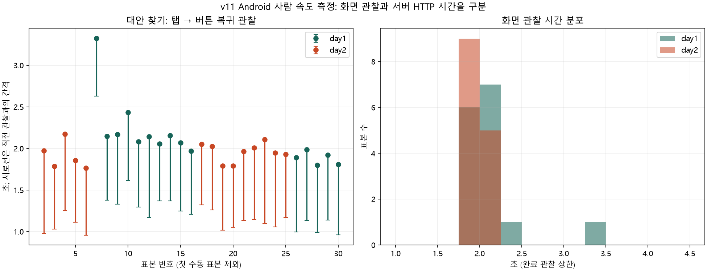
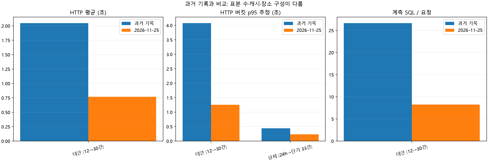
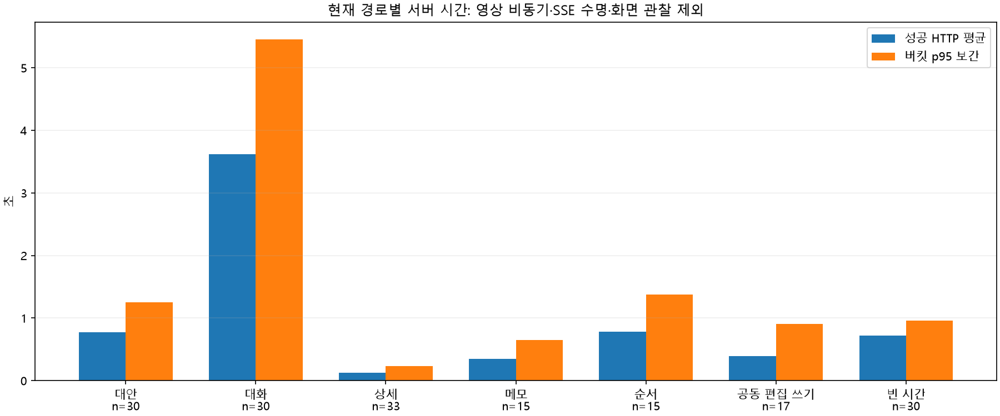
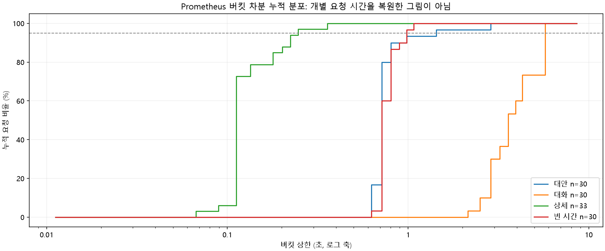
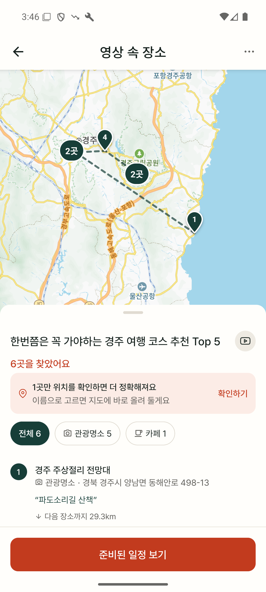
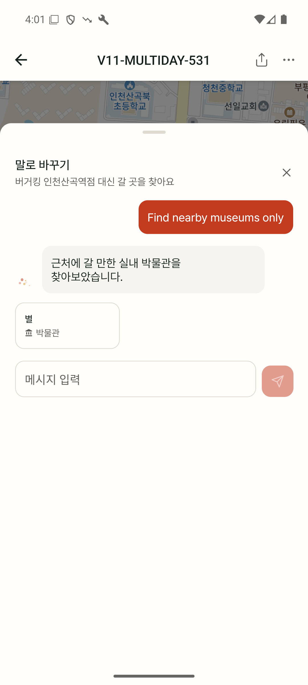
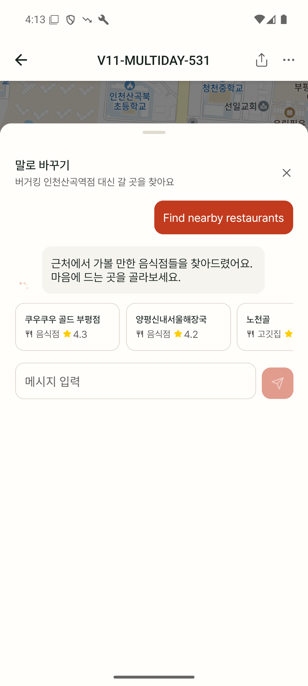
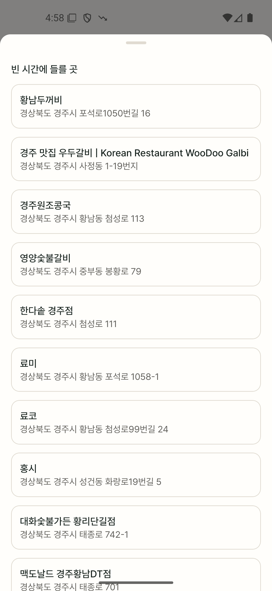
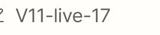

# v11 이후 앱 성능 재측정 — 2026-11-25

작업 이슈 [#531](https://github.com/Trovapp/trova-backend/issues/531), PR [#532](https://github.com/Trovapp/trova-backend/pull/532). 기준 소스 `ef5bbb3`, 운영 JAR #526이다. **앱 측정·운영 지표·journal 대조 완료.** 대안 평균 0.769초·SQL 8.27, 대화 평균 3.616초였다. 정상 사용 중 SSE 429 51건과 자동 추천 429 19건이 발견되어 응답 속도와 별도로 개선이 필요하다.

[최종 PDF](v11-recheck-report.pdf) · [운영 원자료](server/README.md) · [집계·분해](server-results.md) · [Grafana 패널](grafana-evidence.md) · [시간창 JSON](time-windows.json)

## 조건과 방법

- Windows Android 에뮬레이터 5584(카카오), 5586(구글); 두 기기 설치 앱 `versionName=11`, `versionCode=11` 확인. 조정자가 두 기기의 독점 사용을 확인했다. poomasi는 사용하지 않았다.
- 요청은 앱의 정상 UI에서 순차 실행한다. 대안 반복은 결과 뒤 최소 6초, 시작 간격 최소 10초로 제한한다. 직접 인증 HTTP 호출, 인증 토큰 추출, 운영 DB 직접 조회·변경, 설정 변경, 배포는 없다.
- 원자료 [request-times.txt](request-times.txt)의 시각은 Windows 호스트에서 `UTC+09:00`을 명시해 기록했다. 에뮬레이터 상태 표시줄은 UTC로 보이므로 시간창 판정에 쓰지 않는다. `tap`은 탐색도 포함하며 요청 수로 세지 않는다. `request-start`와 명시한 제출 버튼을 실제 요청 후보로 삼고 서버 완료 카운터와 대조한다.
- SSH 키는 Mac에만 있다. 조정자가 12:34 KST부터 운영 `127.0.0.1:8080/actuator/prometheus`를 30초마다 읽어 보관한다. Windows 작업자는 SSH 키를 복사하거나 인증 토큰을 생성하지 않는다. 경로별 창 바깥의 가장 가까운 스냅샷을 매칭하며 여유 구간과 다른 요청 혼입을 명시해야 한다.
- HTTP 평균은 `Δsum/Δcount`, SQL 평균은 자체 `Δsum/Δcount`, p95는 누적 버킷 차분에서 rank `0.95×count`를 찾은 선형 보간값이다. 시작 시 없는 시리즈는 프로세스 시작 시각이 같고 새 등록이 확인된 때에만 0으로 취급한다. 재시작·카운터 감소는 창을 분리한다.
- 외부 API 타이머는 논리 호출/재시도 포함 여부를 코드와 대조한다. 특히 `place-embedding-batch`는 문장별 중복 기록이므로 그 count를 실제 Gemini HTTP 호출 수로 쓰지 않는다. 묶음 수·실제 대기는 단계 로그로 보완한다.
- 화면 시간과 HTTP 시간은 다르다. ADB 스크린샷·UIAutomator 확인은 지연이 있어 관측 상한이다. 버튼 상태 표본은 [ui-observations.jsonl](ui-observations.jsonl)에 이전 표본 시각·busy 관측 여부를 함께 보관한다. 녹화 프레임은 고정 FPS로 환산하지 않고 프레임 PTS를 사용한다.

## 배포 범위 해석

운영 JAR은 #526이며 Java 쪽 #518 변경을 포함한다. 운영 Python 두 파일은 #518 이전 백업과 해시가 일치한다([해시 증거](server/README.md)). 따라서 제목 조회·Gemini 병렬 시작은 **운영 미적용**이며 이번 영상 시간을 그 개선 효과로 설명할 수 없다. 파일 교체나 배포는 하지 않았다.

## 영상 분석

공개 한국어 국내 여행 쇼츠 5편을 신규 제출했다. 같은 영상의 재분석 버튼은 사용하지 않았다. 기존 영상 목록의 최근 7일 표시에서는 2편이 보였고, 앱에서 한도 초과·AI_QUOTA 응답은 이번 5편 중 관측하지 않았다. 사전 잔여량 API는 앱에 노출되지 않으며 공유 한도는 서버가 접수 직전 검사한다(`DailyQuotaService.java:77`). AI 제공자 전체 프로젝트의 실제 남은 일일 한도는 이 작업자가 조회하지 않았다.

영상 후보 출처: [경주 영상 목록](https://gyeongju.webforai.kr/videos/). 사용자 승인된 기능 테스트 목적으로만 사용했고 원본 영상 재생 화면·썸네일은 보고서에 싣지 않는다.

| 표본 | 영상 ID | 내용 | 결과 장소 수 | 비고 |
|---|---|---|---:|---|
| 1 | `5cGq5pxZoKk` | 보문관광단지 | 1 | 최초 잘못된 화면 좌표 시도는 요청 표본에서 제외 |
| 2 | `Z0ItlTVpm8Q` | 석굴암 여행 팁 | 1 | UIAutomator idle 대기 실패로 완료 관측 지연 |
| 3 | `BTdwatJi-KM` | 대릉원·천마총 | 5 | 최초 입력 좌표 실패를 제외한 실제 제출 1건 |
| 4 | `MMm9GVCFExU` | 경주 여행 코스 Top 5 | 6 | 위치 확인 필요 1곳; 프레임 관측 별도 |
| 5 | `Glp-yFEtSIg` | 황리단길 음식점 | 4 | 테스트 여행 원본으로 사용 |

영상 분석 결과와 자동 일정 초안 생성 완료는 서로 다른 사건이다. 장소 수와 초안에 채택된 장소 수도 다를 수 있다. 결과 확인 후 5편에서 멈췄다.

## 테스트 데이터

- `V11-RECHECK-531`: 이번 5번 영상의 초안을 저장한 경주 당일 4곳 여행.
- `V11-MULTIDAY-531`: 11월 25~26일 빈 여행을 새로 만들고 1일차에 기존 저장 장소 맥도날드 서울역점, 2일차에 버거킹 인천산곡역점을 추가한 2일 여행. 기존 저장 장소 자체는 수정하지 않았다.
- 여행 상세는 빈 시간 추천을 자동 요청한다. 상세·일차 전환·편집 뒤 추천 요청이 섞일 수 있으므로 외부 타이머 총량만으로 특정 대안/대화의 호출 수를 단정하지 않는다.
- 측정 뒤 테스트 여행 2개·영상 기록 5개를 정상 UI에서 삭제하고 미승인 초안 4개를 숨겼다. 정리는 14:10:59~14:23:15 KST에 수행했다. B에서 공유 여행 접근 해제도 확인했다. 숨긴 초안·내부 작업 기록의 DB 영구 삭제를 뜻하지 않는다.

## 앱 관찰 집계

| 경로 | 제출·조작 수 | 화면에서 확인한 결과 | 시간 해석 |
|---|---:|---|---|
| 새 영상 분석 | 5 | 1·1·5·6·4곳 | 4번 녹화: 화면 진입 15.240초, 목록 확인 16.369초, 지도 마커 확인 16.941초. [프레임 근거](video-frame-observations.md) |
| 대안 찾기 | 30 | 두 일차 각 15회, 모두 후보 표시 | 버튼 복귀를 측정한 29건 평균 2.038초·범위 1.762~3.326초. 약 1초 화면 관찰 간격이며 서버 평균 아님 |
| 말로 바꾸기 | 30 | 후보 1곳 17건·3곳 11건·없음 2건 | 29건은 12초 고정 대기 뒤 캡처한 완료 관찰 상한. 13~14초를 대화 응답 평균으로 사용하지 않음 |
| 메모·순서 수정 | 30 | 메모 15회·순서 15회, 직접 만든 경주 4곳 여행 | 고정 대기 뒤 화면 반영 확인; 메모·순서 각 HTTP 15건 확인; 별도 JDBC 계측 누락 주의 |
| 빈 시간 추천 | 30 진입 | 경주 4곳·마지막 일정 뒤 300분 구간, 후보 목록 표시 | 상세 재진입의 자동 추천 조회; HTTP 30건·200 확인; 동반 SSE 429 27건 |
| 상세 열기 | 30 | 2일·총 2곳 동일 여행, 1일차 기본 진입 | 29건은 4초 고정 대기 뒤 캡처. 상세 HTTP 33건; 추가 3건은 조작 30건과 일대일 대응 불가 |

대화 문구는 `Find nearby museums only` 15건과 `Find nearby restaurants` 15건이다. 정상 텍스트 입력을 위해 영문을 사용했고 응답은 한국어였다. 같은 문구에서도 후보 수가 달라졌으므로 요청 의도가 아닌 [실제 카드 수](conversation-candidates.csv)로 분류했다. 서버 질의 임베딩은 11회로 복수 후보 11건과 수가 일치한다. 요청별 trace 연결 자료가 없어 개별 요청의 생략까지 입증하지는 않는다. 후보 적합성의 정확도 검증은 별도다.

초기 화면 좌표 오류·읽기 탐색은 request-times.txt에 별도로 남겼다. 상세 측정 창이 끝난 뒤 기존 고성 여행을 잠시 읽기만 한 탐색은 표본 30건에 포함하지 않고 수정하지 않았다.

## 공동 편집 화면 기준선

A(5584)의 테스트 여행에 B(5586)가 정상 공유 링크로 참여했다. 링크는 앱의 복사 버튼과 메모리의 클립보드 전달만 사용했고 파일·로그에 저장하지 않았다. 공유 시트 전체 캡처는 자동 승인 검토가 차단해 실행하지 않았으며 버튼 위치만 메모리 OCR로 확인했다. 전달 뒤 호스트 클립보드는 테스트 문구로 덮었다.

17회 메모 변경이 B에 전달됐다. 1번은 부분 그리기 시점, 2번은 검출 임계값 미달로 시간 표본에서 제외했으며 전달 자체는 화면에서 확인했다. 3~17번 15회는 B를 새로고침하지 않고 첫 화면 변화와 0.5초 대기 후 완성 메모를 관찰했다. 첫 변화 관찰 평균 **2.427초**(1.827~2.928초), 완성 메모 관찰 상한 평균 **3.399초**(2.748~4.033초)다. ADB 입력·캡처 대기가 포함되므로 실제 전파 지연으로 단정하지 않는다. 표본별 직전 미변경 시점도 JSONL에 있다. 동일 서버 로컬 SSE 전달일 수 있어 Kafka 정상 여부는 별도 지표로 판단한다.

## 비교 기준의 한계

| 경로 | 과거 기준 | 같은 지표로 비교할 때의 조건 |
|---|---|---|
| 영상 | 11-21 QA 약 38초 | 영상 길이·장소 수·AI 응답·측정 시작/종료 정의가 다름 |
| 대안 | 11-20 HTTP 평균 2.049초, p95 보간 약 4.080초, SQL 26.667항목/요청, n=12 | 당시 11곳·1일차, 빈 응답 3건 포함; 이번 반복 캐시와 구성 다름 |
| 대화 | 11-21 QA 약 5.4초 | 화면/서버 정의와 후보 수, 도구 호출 여부를 구분 |
| 여행 상세 | 11-18 운영 최근24h p95 0.444280초, 추정 요청 27.012 | 30건 단기 창·공동 편집 도입과 다른 조건 |
| 여행 상세 SQL | 11-18 로컬 H2 6/10/14/18 → 5/5/5/5 | 1/3/5/7일 테스트이며 운영 실측과 직접 개선율 계산 금지 |
| 공동 편집 | 없음 | 이번 화면 전파·SSE·Kafka의 첫 기준선 |
| 빈 시간 | 11-19 P4 계측 및 이후 DTO 조회 개선 기록 | P4 문서 자체는 운영 지연 기준값이 아님; 로컬/운영 구분 |

## 서버 집계와 개선 제안

운영 스냅샷 16개와 journal 235줄을 결합했다. [전체 HTTP·SQL·외부 호출 차분](server-deltas.json), [결과·단계 분해](server-results.md), [개선안](improvement-candidates.md)을 제공한다. 아래 시간은 성공 HTTP 평균·버킷 p95이며 영상은 비동기 실행 시간이다.

| 경로 | 표본 | 평균 초 | p95 초 | 계측 SQL/요청 | 과거와의 비교 |
|---|---:|---:|---:|---:|---|
| 영상 실행 | 5 | 9.424 | 히스토그램 없음 | 비동기 SQL 미계측 | QA 38초와 구간 다름; 화면 1건 16.369초 |
| 대안 | 30 | 0.769 | 1.253 | 8.27 | 2.049 / 4.080 / 26.67 → 현재; 반복·캐시 조건 다름 |
| 대화 | 30 | 3.616 | 5.458 | 12.50 | QA 5.4초의 정의 불명; 직접 개선율 없음 |
| 상세 | 33 HTTP / 30 조작 | 0.123 | 0.232 | 2.00 | 과거 24h p95 0.444 → 단기 0.232; 구성 다름 |
| 메모 | 15 | 0.343 | 0.649 | 4.00 | 같은 운영 지표의 과거 기준 없음 |
| 순서 | 15 | 0.784 | 1.378 | 6.13 | 같은 운영 지표의 과거 기준 없음 |
| 공동 편집 쓰기 | 17 / 화면 유효 15 | 0.389 | 0.908 | 4.00 | 첫 기준선; 화면 첫 변화 평균 2.427초 |
| 빈 시간 | 30 | 0.723 | 0.962 | 6.00 | P4는 계측 기록; 동일 운영 지연 기준 없음 |

관측값이 낮아진 경로는 대안(평균 약 62.5%, p95 69.3%, SQL 69.0% 낮음)과 상세 p95다. 동일 영상·장소·캐시 조건의 전후 실험이 아니므로 **변경의 인과적 개선율로 해석하지 않는다**. 영상·대화 QA, 빈 시간 P4, 수정·실시간은 직접 비교할 같은 기준이 부족하다. 새로 드러난 문제는 429이며 과거 같은 조건의 오류율이 없어 회귀라고 단정하지 않는다. 메모 15·순서 15로 수정 총 30건을 채웠으며 각 하위 유형 30건은 확보하지 못했다(합계 기준으로 수행); 이미 한도 응답이 확인된 뒤 추가 측정하지 않는다.

429는 상세 창 SSE 24건, 수정 창 자동 추천 2건, 공동 편집 창 자동 추천 17건, 빈 시간 창 SSE 27건이다. **전용 빈 시간 추천 30건과 공동 편집 메모 17건은 모두 200**이다. 오류는 서버 자료를 사후 결합하면서 발견했고 측정 중 화면에서 한도 메시지를 식별하지 못했다. B 기기 사용은 사전 계획된 공동 편집 흐름이며 한도 초기화나 우회 조작을 하지 않았다. 429의 정확한 원인은 응답 코드만으로 확정하지 않으며 연결 제한·일일 추천 한도 경로를 우선 조사한다.

SSE 활성 연결 수 지표와 fallback 카운터는 제공되지 않았다. deferred discard 증분과 deferred size는 0, Kafka lag는 경계 스냅샷 및 제공된 그래프에서 0이었다. 짧은 미관측 순간의 지연이나 fallback 없음까지 보장하지 않는다. SSE 완료 요청 평균은 상세 창 119.034초, 빈 시간 창 51.428초이며 버킷 p95는 **30초 초과**다. Grafana의 30초 선은 마지막 유한 버킷 상한이므로 실제 SSE가 30초에 종료됐다는 뜻이 아니다.

### 코드에서 확인한 계측 공백

공동 편집 추가 비용을 SQL 지표만으로 전부 설명할 수 없다. `RequestDbQueryMetrics`는 Hibernate StatementInspector와 명시적 JDBC 훅만 센다(`config/RequestDbQueryMetrics.java:76`, `:82`). 반면 `service/TripChanges.java:61`의 변경 기록 INSERT와 오래된 기록 DELETE, `events/TripAudience.java`의 권한/버전 JDBC 조회, `service/TripMemberBackfill.java`의 JDBC에는 해당 훅이 없다. 이 SQL들은 Prometheus 요청당 SQL 수에서 빠질 수 있다. 이번 작업에서 계측 코드를 고치지는 않는다.

`events/TripStreams.java:19`는 열린 연결을 Set으로 관리하지만 MeterRegistry gauge를 등록하지 않는다. 따라서 SSE 동시 연결 수가 실제 운영 스냅샷에 없다면 요청 누적 count로 대체하지 않고 **직접 지표 미제공**으로 남긴다. 연결 등록·해제 시 gauge와 전파 지연 히스토그램을 추가하는 것이 후속 관측 개선안이다.

`events/KafkaTripEventBus.java:74`는 로컬 SSE 전파를 먼저 수행하고 Kafka를 비동기로 보낸다. 같은 서버에 연결한 두 기기의 빠른 화면 반영은 Kafka 왕복 시간의 증거가 아니다. Kafka 소비 지연과 fallback 증가는 별도로 확인한다.

## 오류·경보 확인 범위

401·404는 5xx 비율 경보의 분자에 들어가지 않는다. 저장소 HTTP 규칙은 `http_server_requests_seconds_count/bucket`과 `job`, `uri`, `status`를 사용하므로 오류 본문 형식 변경과 독립적이다. Mac 읽기 전용 확인에서 운영 지표 이름·라벨과 저장소 HTTP/Kafka 쿼리가 일치했다. Trova 규칙 7개는 조회 당시 health=ok, state=inactive였다([운영 확인](server/README.md)). 다만 HighHttpLatencyP95는 SSE를 제외하지 않아 장기 연결 수명을 일반 API 지연으로 해석하는 문제가 있다. SSE 제외와 연결 전용 경보 분리를 제안한다; 규칙은 수정하지 않았다.

Kafka topic `trova.trip-events`는 저장소 lag 규칙의 topic 패턴에 포함된다. fallback 카운터는 운영에 없어 값을 확정할 수 없다. 의도적인 경보 유발·5xx 생성·장애 주입은 하지 않았다.

| 시각 KST | 상태 / code | 본문·헤더 공통 traceId |
|---|---|---|
| 14:09:57 | 404 / NOT_FOUND | `bfe22e57-b6eb-490a-be8c-39d9324fa199` |
| 14:10:05 | 401 / UNAUTHORIZED | `1306b7a7-03fe-4975-b0c4-d4ac781e4c92` |
| 14:10:14 | 404 / NOT_FOUND | `b2b1e587-9557-48df-9758-04f723b78d54` |
| 14:10:22 | 401 / UNAUTHORIZED | `12b796a2-77bd-4f10-b672-baa32f6eedb0` |

네 건 모두 본문·헤더 traceId가 일치한다. 네 traceId 모두 journal에서 동일 상태로 찾았고, URI·상태별 차분은 401 2건·404 2건이었다. 인접 빈 시간 창에도 3건이 겹치므로 합산 중복을 제외했다. 클라이언트 시간은 TLS·네트워크를 포함하며 HTTP 서버 시간과 비교하지 않는다.

## 화면 증거와 검증

계정 이름·아바타·공유 주소·영상 썸네일이 없는 결과 화면만 보고서에 포함했다. 원본 영상 녹화와 목록 캡처는 보고서에 넣지 않았다. 공동 편집은 메모 영역만 보관했다.

`gradlew.bat build` 성공: JUnit 테스트 1,489개, 실패·오류 0개, 건너뜀 22개. 문서 스크립트의 AST 검사도 통과했다. [검증 상세](validation.md). 구현 코드 변경·배포는 하지 않았다. PDF와 전후 서버 차트는 운영 원자료를 반영해 재생성했다. 과거 11-20 원자료를 새 집계기로 계산해 n=12·평균 2.049378초·SQL 26.666667을 재현했다.

관찰 스크립트는 `../scripts/v11_*.py`, 차트는 `plot_v11_recheck.py`, PDF는 `pdf_v11_recheck.py`다. UI 스크립트는 당시 기기의 좌표와 직접 만든 여행을 전제로 하므로 다른 화면에서 그대로 재실행하면 안 된다. 한 묶음 최대 5회로 실행하고 화면을 확인했다. 그림·PDF 생성은 저장된 자료만 읽으며 네트워크 요청을 만들지 않는다. matplotlib·OpenCV·reportlab·PDF 검수 도구는 채팅 임시 폴더의 가상환경에만 설치했다.

## Grafana 캡처용 시간창

Windows에서는 Grafana를 조작·캡처하지 않았다. 아래는 앱 단계 시작·종료이며 실제 Prometheus 스냅샷 시각은 [snapshots.json](server/snapshots.json)과 [집계 부록](server-results.md)에 기록했다. Mac에서 받은 12:35~14:12 KST Grafana 9개 패널을 PDF 부록에 포함했다. 전후 30초 수집 간격 때문에 옆 경로 요청이 겹칠 수 있으므로 method/uri/status로 나눈다. 수정 단계의 마지막 관찰은 13:43:53.676이며 끝 표식까지는 대기 시간이다. 정리 작업(14:10:59 이후)은 모든 성능 창에서 제외한다.

HTTP: 해당 uri의 `http_server_requests_seconds_count/sum/bucket`; SQL: `trova_db_queries_per_request_count/sum`; 외부 API: `trova_api_call_seconds_count/sum`의 provider/operation/success별 차분을 권장한다. Cloud 패널에는 `job="trova-prod"`를 추가한다. p95는 `histogram_quantile(0.95, sum by(le)(increase(..._bucket[창 길이])))`이며 Cloud 외삽값은 직접 스냅샷 차이와 구분한다.

| 경로 | 표본 | KST 시작 | KST 끝 | 추천 패널 / uri·지표 |
|---|---:|---|---|---|
| 영상 분석 | 5 | 12:38:36 | 12:47:09 | 분석 execution/stage, POST /api/shares는 접수만 |
| 대안 찾기 | 30 | 12:52:03 | 13:00:44 | GET /api/trip-places/{id}/alternatives |
| 말로 바꾸기 | 30 | 13:00:46 | 13:21:23 | POST /api/conversations/{sessionId}/messages |
| 여행 상세 | 30 | 13:22:30 | 13:31:46 | GET /api/trips/{id}; 동반 요청 별도 |
| 메모·순서 수정 | 30 | 13:33:26 | 13:47:37 | PATCH /api/trip-places/{id}/details 및 /order |
| 같이 고치기 | 17 | 13:51:45 | 13:57:50 | SSE 활성 수(있는 경우), trip-events fallback, Kafka lag |
| 빈 시간 추천 | 30 | 13:58:50 | 14:09:56 | GET /api/trips/{tripId}/days/{day}/gap-recommendations |
| 읽기 전용 오류 | 4 | 14:09:57 | 14:10:30 | HTTP status=401/404; traceId journal 대조 |
