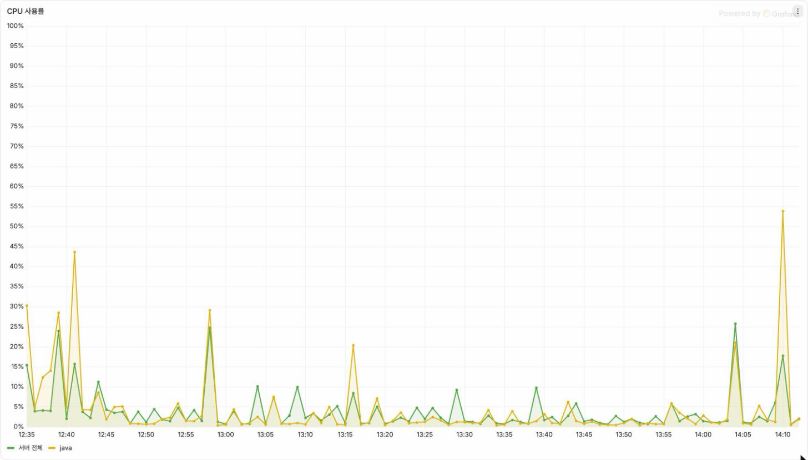
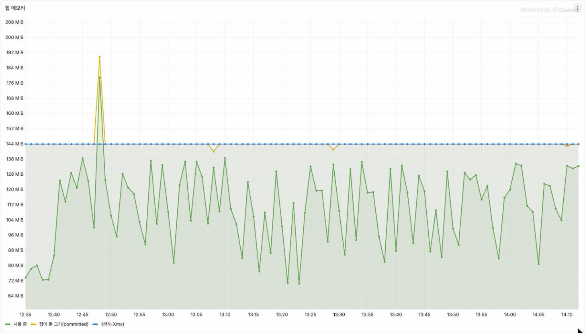
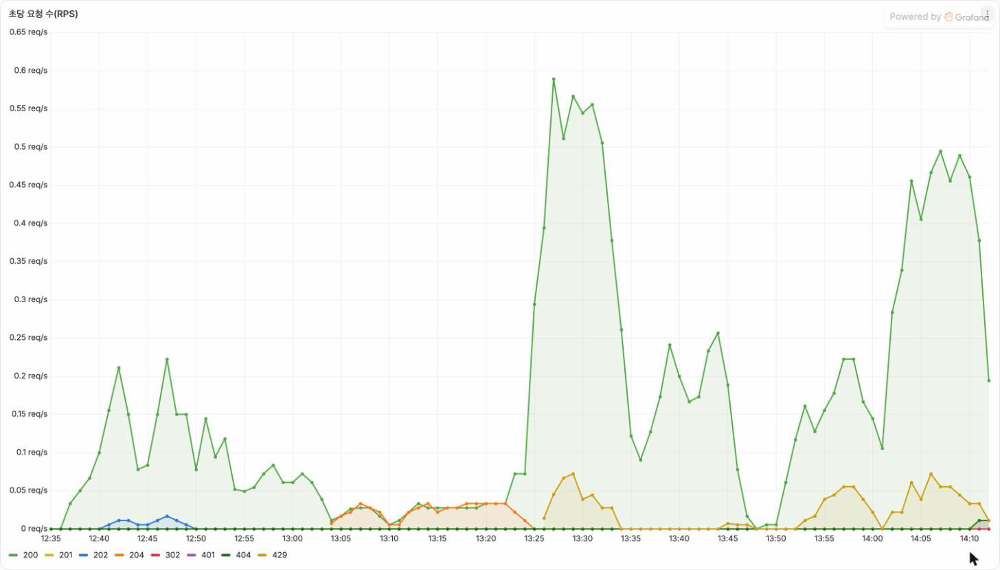
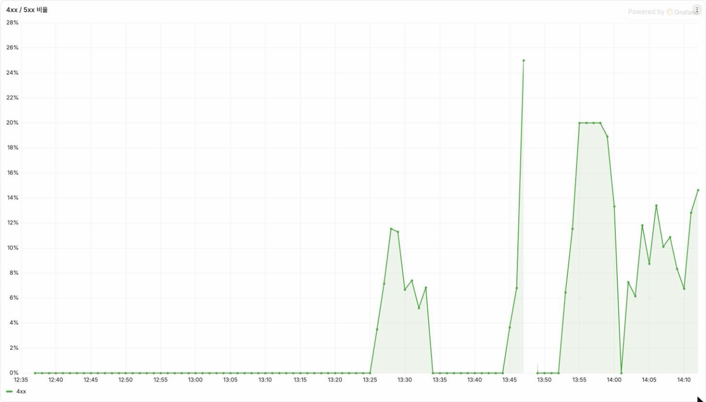
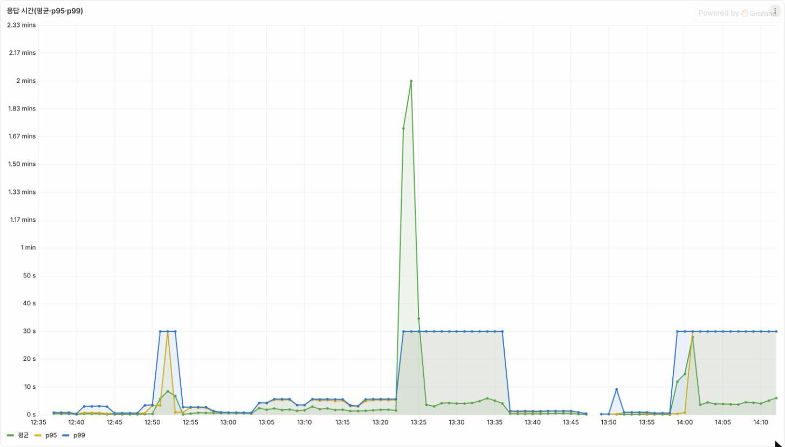
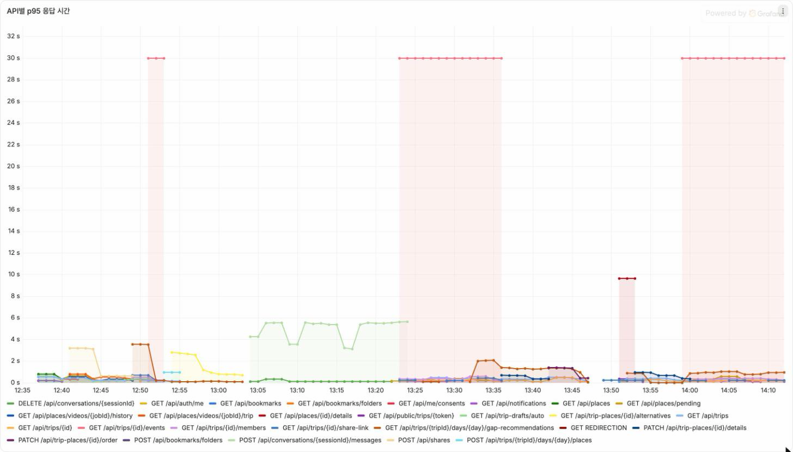
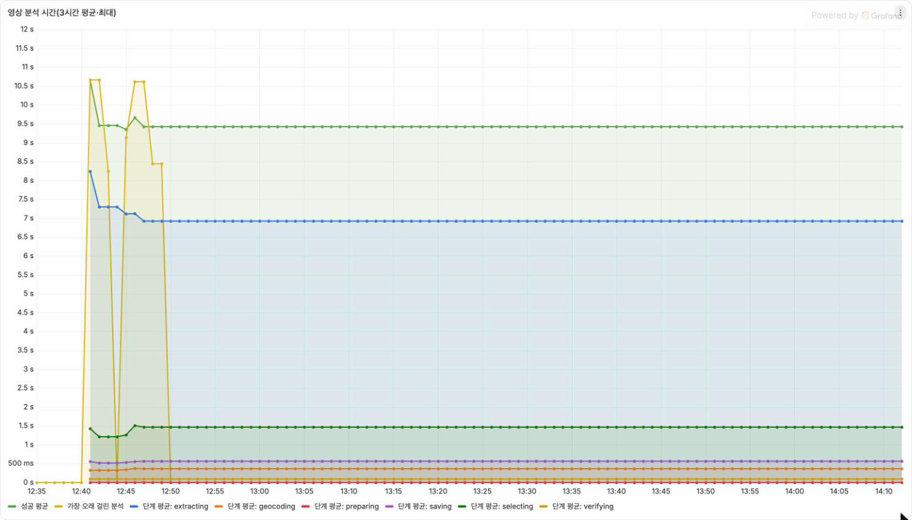
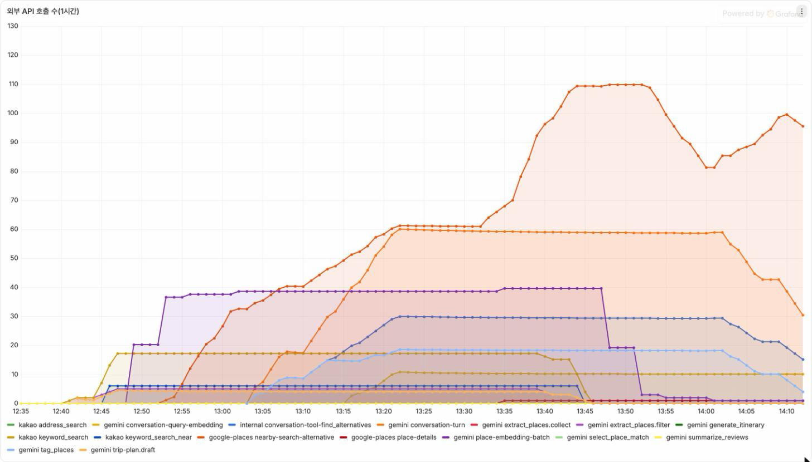
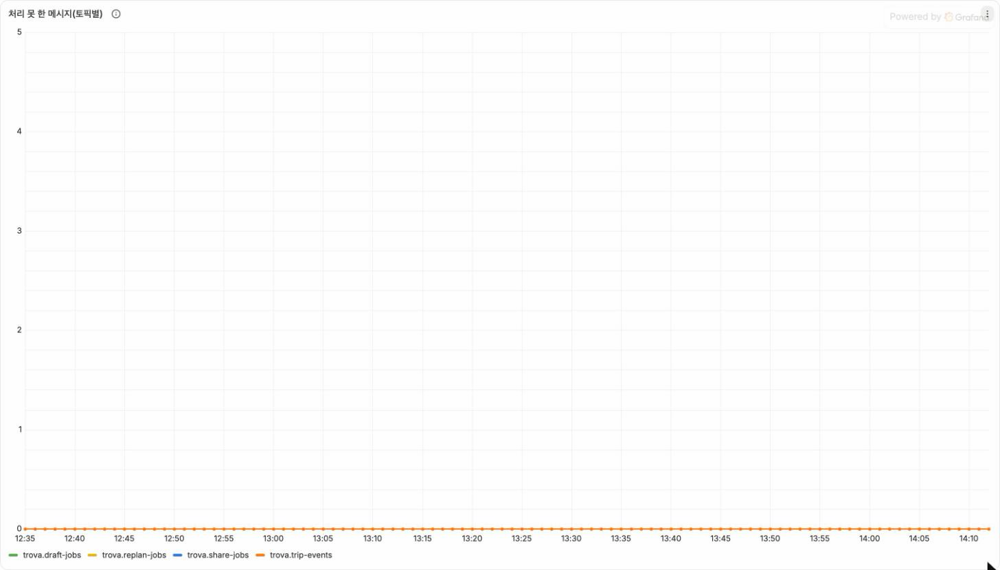

# Grafana 운영 화면 부록

매니저가 Mac에서 읽기 전용으로 캡처한 12:35~14:12 KST 패널 9개다. Windows 작업자는 Grafana를 조작하지 않았다. 계정·토큰·공유 주소가 없는 패널 그림을 확인했다. 원본은 server/grafana에 보관한다.

## CPU

CPU: Java 순간 최대 약 54%; 이를 지속 포화로 해석하지 않는다.

## 힙

힙: 사용량 약 70~136MiB; 시점별 변동이며 누수 여부는 이 창만으로 판단하지 않는다.

## 상태별 요청 속도

상태별 요청 속도: 상세 반복 진입 때 동반 API가 늘고 429가 함께 나타난다.

## 4xx 비율 상승

4xx 비율 상승: 주로 SSE·추천 429; 의도적인 경보 부하는 없었다.

## 전체 지연

전체 지연: 30초 p95 선은 SSE가 마지막 유한 버킷을 넘을 때의 경계 반환값이다. 실제 SSE 평균은 30초보다 크며 정확한 p95가 아니다.

## URI별 p95

URI별 p95: SSE와 일반 요청을 분리해서 읽는다. Cloud 이동창 p95는 직접 스냅샷 차분과 표본 범위가 다르다.

## 영상 단계

영상 단계: 비동기 실행 평균 약 9.4초, extracting 약 6.9초. 앱 화면 전체 시간이 아니다.

## 외부 호출

외부 호출: 1시간 이동 합계이며 이번 경로별 고유 호출 수가 아니다. 정확한 창별 수는 서버 집계 표를 사용한다.

## Kafka lag

Kafka lag: 제공 그래프에서 0; 순간 지연·fallback 부재까지 보장하지 않는다.

